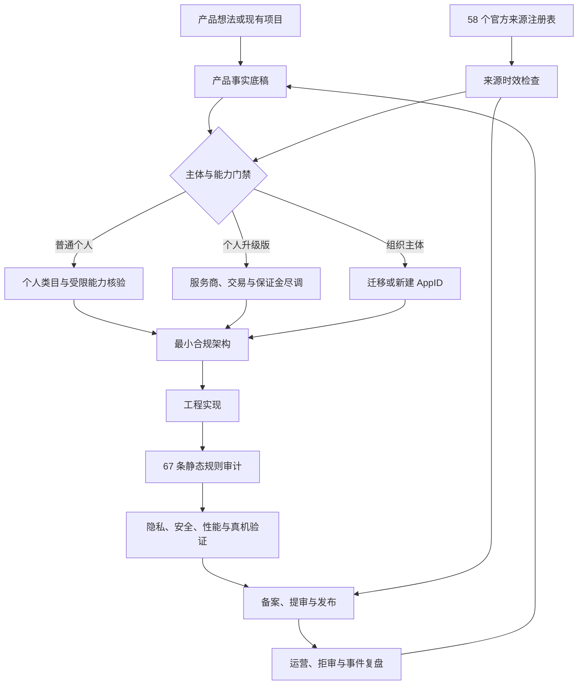

<div align="center">


# 微信小程序个人开发者全流程 Skill

**先判断能不能做，再决定怎么做。**<br>
把主体、类目、支付、隐私、代码与审核证据，从第一天就对齐。

<sub>Evidence-driven decision, engineering, compliance, and review workflow for personal WeChat Mini Programs.</sub>

<br><br>

[](https://github.com/juanyun-ai/build-personal-wechat-mini-program/actions/workflows/validate.yml)
[](#快速开始)
[](./references/source-registry.json)
[](#静态审计器)
[](#测试与验证)
[](./references/sources-and-freshness.md)
[](./LICENSE)
[](https://github.com/juanyun-ai/build-personal-wechat-mini-program)

</div>

> [!IMPORTANT]
> 这不是一份“赌审核技巧合集”，而是一套可追溯、可执行、可复核的产品决策与工程系统。

**3 条主体路线 · 58 个平台与监管官方来源 · 67 条静态审计规则 · 27 项自动测试 · 10 份实战模板**

## 为什么需要它？

个人微信小程序最难的，通常不是写页面，而是在写第一行代码前回答这些问题：

- 个人主体到底能不能做这个产品？相似类目是否真的覆盖实际功能？
- 实物、线下服务、订金、广告、PDF、视频会员和 AI 次数，分别能走哪条变现路线？
- 微信认证、职业身份认证、小程序备案与主体类型，到底各自解决什么问题？
- 为什么认证后的个人主体，仍可能不能使用普通支付、虚拟支付、`web-view` 或手机号组件？
- 隐私声明、代码调用、第三方 SDK、服务端数据流和审核说明，怎样形成同一条证据链？
- 一份几个月前正确的规则，今天是否仍然有效？

这个 Skill 把高风险问题前置为明确的门禁：

```text
产品事实底稿 → 主体路线判断 → 类目与能力映射 → 最小合规架构
             → 工程实现 → 静态审计 → 真机验证 → 备案提审 → 运营复盘
```

它既能评估一个想法是否适合个人主体，也能进入现有仓库，检查工程、安全、隐私、支付、UGC、性能和审核风险。

## 三条主体路线

| 路线 | 典型适用场景 | 关键边界 | 主要结论 |
|---|---|---|---|
| **普通个人主体** | 本地工具、图片处理、部分内容展示、符合个人类目的轻服务、满足条件后的广告变现 | 标准支付和虚拟支付不可直接推定可用；个人认证不会自动解锁组织类目或受限接口 | `PERSONAL_FEASIBLE` / `PERSONAL_FEASIBLE_WITH_QUALIFICATION` |
| **个人升级版** | 符合条件的个人卖家、小微经营者，通过合格服务商处理开放范围内的部分实物或线下服务交易 | 依赖服务商资格和当前开放范围；不是虚拟支付通道，也不是规避营业执照、许可或类目的捷径 | `PERSONAL_UPGRADED_ROUTE` |
| **个体工商户 / 企业等组织主体** | 虚拟商品、付费内容、AI 次数、多商家平台、持证经营、长期品牌经营或组织专属能力 | 需要重新核验注册、认证、备案、类目、支付、隐私与行业资质 | `NON_PERSONAL_SUBJECT_REQUIRED` |

> [!NOTE]
> 服务商快速注册、授权或专项代认证，仍可能只是普通个人路线，**不等于个人升级版**。<br>
> “已经认证”也不等于“所有能力都已开放”。

## 它能做什么？

| 模块 | 解决的问题 | 可交付产物 |
|---|---|---|
| **主体与类目门禁** | 普通个人、个人升级版或组织主体，哪条路线真正可行 | 主体决策记录、功能—类目矩阵、阻断项 |
| **支付与变现判断** | 区分实物、线下服务、订金、广告、虚拟商品和数字权益 | 支付路线、退款边界、替代方案 |
| **工程架构** | 原生、Taro、uni-app，云开发或自建后端如何选择 | 最小合规架构、服务端边界、实施路径 |
| **静态代码审计** | 密钥、路由、隐私、支付、UGC、分享、订阅、性能与审核对抗 | Markdown / JSON 风险报告 |
| **隐私与安全** | 对齐代码调用、后台隐私声明、第三方 SDK 与服务端鉴权 | 数据清单、权限降级、内容安全与整改建议 |
| **备案与提审** | 让名称、简介、类目、备案、页面和审核说明保持一致 | 提审说明、发布检查清单、测试矩阵 |
| **拒审与违规复盘** | 从平台原文定位真实根因，而不是只删除截图中的入口 | 拒审复盘、修复证据与再提交方案 |
| **来源时效检查** | 识别官方页面过期、跳转、失效或元数据变化 | 只读时效报告，不自动篡改规则 |

## 工作流



## 快速开始

### 安装到 Codex

```bash
git clone https://github.com/juanyun-ai/build-personal-wechat-mini-program.git \
  ~/.codex/skills/build-personal-wechat-mini-program
```

新建一个 Codex 任务，直接这样说：

```text
使用 $build-personal-wechat-mini-program，
评估并开发这个个人主体微信小程序。
先判断主体与类目是否可行，再处理工程、隐私、测试和提审。
```

更新 Skill：

```bash
cd ~/.codex/skills/build-personal-wechat-mini-program
git pull --ff-only
```

> [!TIP]
> 如果你正在参与仓库开发，可把仓库克隆到任意目录，再软链接到 `~/.codex/skills/`，这样修改会立即生效。

## 真实场景

<details>
<summary><strong>场景 1：本地证件照工具 + 流量主</strong></summary>

```text
使用 $build-personal-wechat-mini-program 评估一个证件照裁剪小程序。
图片只在本地处理，不登录、不上传，计划通过流量主变现。
请给出类目、隐私、性能、提审和真机测试方案。
```

</details>

<details>
<summary><strong>场景 2：上门美甲预约 + 在线订金</strong></summary>

```text
比较普通个人、个人升级版和个体工商户三条路线。
产品提供上门美甲预约并在线收取订金，请分析支付、退款、
类目、备案、服务商依赖和长期经营风险。
```

</details>

<details>
<summary><strong>场景 3：视频、PDF、数字会员 + AI 次数</strong></summary>

```text
我想用个人主体出售视频课程、PDF、数字会员和 AI 生成次数。
请判断哪些属于虚拟商品，是否必须更换主体，并给出可上线的替代方案。
```

</details>

<details>
<summary><strong>场景 4：审计一个准备提审的现有仓库</strong></summary>

```text
使用 $build-personal-wechat-mini-program 审计当前项目。
按 P0 / P1 / P2 / INFO 输出文件证据、影响、修复方式、
主体能力冲突和提审前未验证项。
```

</details>

## 静态审计器

审计器只依赖 Python 标准库，覆盖 13 个规则域、67 条规则：

`CFG · RTE · SEC · PRI · CAP · NET · REV · PERF · PAY · UGC · SUB · SHR · AIC`

```bash
python3 scripts/audit_miniprogram.py /path/to/project \
  --subject ordinary-personal \
  --profile release \
  --format both \
  --output audit-report.md \
  --json-out audit-report.json
```

常用命令：

```bash
# 查看全部规则
python3 scripts/audit_miniprogram.py --list-rules

# 解释单条规则
python3 scripts/audit_miniprogram.py --explain PAY009

# 把 P2 也作为 CI 阻断条件
python3 scripts/audit_miniprogram.py /path/to/project \
  --subject ordinary-personal \
  --fail-on P2
```

主要覆盖：

- 前端密钥、支付秘密、云密钥与疑似硬编码凭据；
- 页面路由、分包、导航、组件、资源引用与发布包体；
- 隐私接口、位置声明、提前索取权限与拒绝后的降级；
- 普通个人主体的手机号、`web-view`、支付与虚拟商品冲突；
- 不安全网络地址、测试域名、敏感查询参数与服务端信任边界；
- 审核模式、占位页面、测试态内容与隐藏功能；
- `setData`、长列表、资源体积和组件启动成本；
- UGC 内容安全、订阅消息、强制分享与生成式 AI 风险。

> 静态报告提供审计线索，不替代真机测试、服务端安全审计、管理后台核验或平台审核。公开分享报告前，请再次检查其中的项目路径、业务 URL 与脱敏代码片段。

## 58 个官方来源，但不迷信历史快照

[来源注册表](./references/source-registry.json)覆盖微信开放文档、腾讯客服、微信支付、微信广告、工信部门、网信部门及国家法律法规等一手页面。

```bash
python3 scripts/check_official_sources.py \
  --registry references/source-registry.json \
  --format text
```

检查器会识别：

- 快照是否超过对应波动等级的有效期；
- HTTP 状态与最终跳转地址是否变化；
- `Last-Modified` 是否发生变化；
- 是否需要浏览器、管理后台或人工核验。

它是只读工具：页面变化只会被标记为 `stale`、`changed` 或 `unavailable`，不会自动覆盖规则。

联网模式会访问注册表中的 URL 并跟随跳转，只应对维护者已经审查的注册表运行；外部 Pull Request 必须先使用 `--no-network` 验证结构和快照状态。

> [!WARNING]
> 网页可访问，不代表规则语义没有变化；网页发生变化，也不代表原结论必然失效。动态能力最终以当日官方文档和目标 AppID 管理后台为准。

## 输出不是一句“能做”或“不能做”

Skill 对评估、审计、实现或拒审任务使用统一交付契约：

1. **结论状态**：`PERSONAL_FEASIBLE`、`PERSONAL_UPGRADED_ROUTE`、`NON_PERSONAL_SUBJECT_REQUIRED` 等明确状态；
2. **主体路线**：普通个人、个人升级版或组织主体；
3. **证据时点**：核验日期、官方页面标题与 URL；
4. **阻断项**：按 `P0 / P1 / P2 / INFO` 排序；
5. **功能映射**：功能、页面、类目、备案标识、资质、数据与审核条件；
6. **实现或整改**：实际修改、关键取舍和未完成项；
7. **验证结果**：测试、静态审计、真机与后台未验证项；
8. **下一动作**：只保留真正需要用户、服务商、审核后台或外部机构完成的步骤。

每个风险发现都应包含规则 ID、严重度、置信度、文件或页面证据、影响与可执行修复。没有证据时，不制造精确阈值、成功率或审核承诺。

## 测试与验证

```bash
python3 -m unittest discover -s scripts -p 'test_*.py' -v
```

当前包含 **27 项自动测试**，覆盖：

- 干净项目与高风险项目；
- 严重度阈值和 CLI 退出码；
- 敏感值脱敏与扫描边界；
- 主体能力冲突与生成式 AI 人工门禁；
- 来源过期、跳转、HTTP 失败和元数据变化；
- 来源检查器只读、不静默修改注册表。

GitHub Actions 会在每次 push 和 Pull Request 时验证 Python 语法、Skill 元数据、来源注册表、规则目录与全部单元测试。
另有一个仅运行于受信任默认分支的每周只读任务，用于发现官方来源的失效、跳转与元数据变化；它不会在外部 Pull Request 上执行联网抓取。

## 仓库结构

```text
.
├── SKILL.md                       # Skill 主工作流与输出契约
├── agents/openai.yaml             # Codex 展示信息与默认提示
├── references/                    # 主体、工程、隐私、性能、提审等专题资料
├── assets/                        # 需求、类目、隐私、测试、提审和复盘模板
└── scripts/
    ├── audit_miniprogram.py        # 小程序静态风险审计器
    ├── check_official_sources.py  # 官方来源时效检查器
    └── test_*.py                  # 27 项自动测试
```

推荐从这些入口开始：

- [主体、类目、认证与支付门禁](./references/subject-and-category-gate.md)
- [端到端工作流与架构](./references/workflow-and-architecture.md)
- [工程实现手册](./references/engineering-playbook.md)
- [隐私、安全与内容治理](./references/privacy-security-content.md)
- [性能、质量与测试](./references/performance-quality-testing.md)
- [备案、提审、发布与运营](./references/review-filing-operations.md)
- [拒审与违规复盘](./references/rejection-playbook.md)
- [典型产品场景打法](./references/scenario-playbook.md)

## 设计原则

- **能力门禁先于编码**：主体或类目不成立，就先改产品路线；
- **证据优先**：动态结论必须能回到官方来源和核验日期；
- **保守失败**：无法访问后台或无法确认动态规则时，输出 `LIVE_VERIFICATION_REQUIRED`；
- **工程化合规**：隐私、安全、内容治理与审核证据进入架构和测试，而不是上线前补文案；
- **拒绝审核对抗**：不提供隐藏功能、审核后开启、套类目、借资质或外部收款绕行方案；
- **尊重现有技术栈**：支持原生、Taro、uni-app 等项目，不为偏好进行无意义重写。

## 贡献

欢迎提交规则修正、官方来源更新、误报样例、测试用例、工程模板与真实拒审复盘。涉及动态规则时，请同时提供官方一手 URL、核验日期、适用主体和可复现证据。

提交前请阅读 [CONTRIBUTING.md](./CONTRIBUTING.md) 和 [SECURITY.md](./SECURITY.md)。版本变化记录见 [CHANGELOG.md](./CHANGELOG.md)。

## 边界与免责声明

> [!IMPORTANT]
> 本仓库的规则快照核验于 **2026-07-12（Asia/Shanghai）**。类目、认证、支付、备案、费用、配额与审核口径可能随时变化，作出商业或上线决定前，必须核验当前官方页面和目标小程序管理后台。

> [!NOTE]
> 本项目不是腾讯或微信官方项目，与腾讯不存在隶属、合作或背书关系。项目名称中出现的“微信小程序”仅用于描述适用技术平台。<br>
> 本项目不构成法律、税务或行政许可意见，也不承诺审核通过。

本项目不会提供隐藏功能、审核后远程开启、套类目、借用资质、个人收款码绕过支付或其他审核对抗方案。

## License

[MIT](./LICENSE) © 2026 [juanyun-ai](https://github.com/juanyun-ai)

---

<div align="center">

如果它帮你少走了一次主体、类目或提审弯路，欢迎点一个 ⭐。<br>
也欢迎把真实案例带到 Issues，让规则库在可复核的证据上继续进化。

</div>
