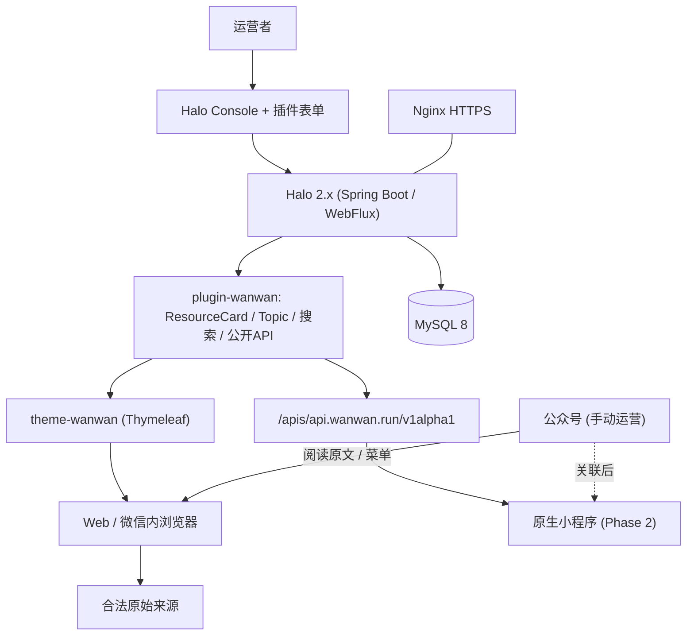

# 弯弯 Wanwan：CTO 技术评审与选型决策（v6 草案）

评审日期：2026-11-17｜评审基线：GitHub `main@22ecc39`（已拉取，无新提交）｜评审人角色：CTO / 技术经理

> [!IMPORTANT]
> 仓库目前**只有文档，没有任何代码**（`README.md` + `docs/` 共 25 个 Markdown）。README 中提到的 OpenIsle 代码不在仓库内。所以"代码评估"一项的结论是：**没有可评估的代码，后续从零按本文结构建立**。

---

## 1. 评审结论（一页版）

| 维度 | 结论 |
| --- | --- |
| 产品范围（v5） | ✅ 认可。手动精选资料卡导航，砍掉论坛、AI、病例，是个人运营唯一能长期维护的范围 |
| 后端 Halo 2.x（Spring Boot） | ✅ 确认采用，但**资料卡改用插件自定义模型**，不用 Post＋元数据（见 §3.1） |
| Web | ✅ Halo 自研 Thymeleaf 主题，服务端渲染，移动端优先；不另做 Nuxt/Vue 前端 |
| 微信小程序 | ⚠️ 技术方案确认（原生＋TypeScript），但**个人主体能否上线是项目最大风险**，必须先做资质验证再开发 |
| 微信公众号 | 🆕 文档未覆盖，补充决定：**作为纯分发渠道，手动运营，不做服务端开发** |
| 数据库 | ✅ MySQL 8.0（Halo 官方支持；数据量极小，选型不是瓶颈） |
| 搜索 | ✅ 插件内自建轻量检索（内存索引＋中文 bigram），不依赖外部搜索服务 |
| 部署 | ✅ 单台大陆云服务器 + Docker Compose（Nginx + Halo + MySQL），每日备份到对象存储 |
| AI / RAG | ❌ 首版不做，保留稳定 ID 与版本即可 |
| 文档体系 | ⚠️ 版本过多（v1~v5 并存，约 39 万字节），需冻结；技术决策后续以 ADR 形式记录 |

---

## 2. 文档 / 方案评估

### 2.1 优点
- **范围收敛正确**：从"全流程医疗平台"收敛到"资料卡导航"，与个人、非医疗背景的运营能力匹配。
- **安全边界意识强**：公开 DTO 白名单、内部记录隔离、撤回覆盖所有读取路径、不内置管理员令牌、SSRF 防护——这些都是正确的工程要求，直接转为验收用例。
- **没有过度设计**：明确不要 Redis/MQ/ES/向量库/微服务。

### 2.2 问题
| # | 问题 | 处理 |
| --- | --- | --- |
| 1 | 关键技术点停留在"待验证"，没有拍板（Post 还是自定义模型、搜索怎么做、主题自研还是套用） | 本文 §3 直接拍板 |
| 2 | 小程序个人主体能力被低估：文档写"待验证"，但有几项已知限制会直接影响产品形态 | §4 列出并设为开发前第一关卡 |
| 3 | 公众号完全没有规划 | §5 补充 |
| 4 | 文档冗余、措辞反复免责，工程人员难以提取可执行项 | 冻结 v5，新增 `docs/adr/` 记录决策，需求转为 Issue / 验收用例 |
| 5 | 没有仓库结构、版本锁定、CI、环境划分 | §6、§7 补充 |

---

## 3. 技术决策（ADR 摘要）

### 3.1 ADR-001：资料卡用插件自定义 Extension，不用 Post

v5 首选"Post＋annotations"，备选插件。**我改为直接用插件定义 `ResourceCard` 模型**，理由：

| 对比项 | Post＋元数据 | 自定义 `ResourceCard` Extension |
| --- | --- | --- |
| 结构化字段（URL、DOI、访问条件、入口类型、链接状态） | 塞进 annotations，无类型、难校验 | 强类型 schema，可校验、可建索引 |
| 按阶段/类型/状态筛选 | annotations 查询能力受限 | Halo 2.x 索引机制可直接按字段查询 |
| 泄露面 | Post 自带 `/archives/*`、RSS、站点地图、评论、公开 API，撤回必须逐一覆盖 | 只有插件主动暴露的路由，**撤回面最小** |
| 编辑体验 | 富文本编辑器（对 1~3 句介绍是浪费） | 需写一个 Console 表单页（Vue3 + Halo 组件），约 1~2 周工作量 |

分工：
- `ResourceCard`（插件）：外部资料卡。
- `Post`（Halo 原生）：**本站原创导读**——这才是真正需要富文本的内容。
- `Topic`（插件）：专题 = 导读文字 + 有序的资料卡 ID 列表。
- `Stage`：5 个固定阶段，用 Halo 分类或插件配置，二选一在 POC 中定。
- 内部记录（许可凭据、投诉）：首版**不进系统**，用私有离线台账（文档已允许），减少权限设计。

### 3.2 ADR-002：技术栈与版本锁定

| 层 | 选型 | 说明 |
| --- | --- | --- |
| 内容后端 | Halo 2.x 社区版（实施当天的最新稳定小版本，锁定） | Spring Boot 3 + WebFlux + R2DBC，GPLv3 |
| 插件 | Java 21、Gradle、Halo plugin devtools | 响应式编程，禁止阻塞调用 |
| 插件 Console UI | Vue 3 + TypeScript + `@halo-dev/components` | 只做资料卡/专题编辑表单 |
| Web 主题 | Thymeleaf + Tailwind CSS（自研 `theme-wanwan`） | 现有博客主题都是时间流，改造成本 > 自研 |
| 数据库 | MySQL 8.0 | Halo 以 Extension 方式存储，不直接写 SQL |
| 小程序 | 微信原生 + TypeScript，不用 Taro/uni-app | 单端、页面少（约 6 页），跨端框架无收益 |
| 部署 | Docker Compose：Nginx（HTTPS）+ Halo + MySQL | 2C4G 级别即可 |
| 备份 | 每日 `mysqldump` + Halo 工作目录打包 → 对象存储，保留 30 天 | 每季度演练一次恢复 |
| 监控 | 云厂商拨测 + 磁盘/备份告警 | 不上 Prometheus |

### 3.3 ADR-003：搜索

资料量预期为百级到千级。插件在启动时与发布/撤回事件时，将**已发布**资料卡的标题、介绍、来源、标签构建为内存倒排索引（中文按 bigram 切分），查询结果返回前**再按主数据核验状态**。不用 Halo 自带搜索作为双端统一入口（中文效果与字段覆盖都不可控）。数据过万再评估外部引擎。

### 3.4 ADR-004：公开 API

插件统一前缀 `/apis/api.wanwan.run/v1alpha1/`（遵循 Halo 插件路由规范），接口按 v5 §6 的六个逻辑接口实现。Web 主题和小程序**都读这一套**（主题通过 Finder，小程序通过 HTTP），保证双端规则一致。响应只用白名单 DTO，`entry` 字段显式给出 `type: web | mp_article | miniprogram | citation_only`。

---

## 4. 微信小程序：先验资质，再写代码

> [!WARNING]
> 以下是基于微信平台公开规则的已知限制，**需在实际账号中确认**，但足以影响产品形态：
> 1. **个人主体小程序不支持 `web-view` 组件** → 小程序内基本无法打开外部原文网页。
> 2. **医疗/健康类目通常需要企业或机构资质**，个人主体可选类目有限，"孕产、医疗相关资料"有被审核拒绝的风险。
> 3. 小程序本身也需要**备案**，`request` 合法域名必须是已备案的 HTTPS 域名。

**因此决定**：
- 小程序是 **Phase 2**，Web 先上线，不互相阻塞（与 v5 一致，但优先级更明确）。
- **开发前第一关卡**：用个人账号实际尝试注册、选类目、提交一个最小页面审核。
- 若个人主体无法通过：
  - 方案 A：只做 Web + 公众号（推荐，零额外成本）；
  - 方案 B：注册个体工商户或企业主体再做小程序（属于业务决策，需要你来定）。
- 小程序内的原文入口：`citation_only`（展示题名、来源、DOI + "复制链接"）为默认；公众号文章用 `wx.openOfficialAccountArticle` 等官方能力实测后再开放。

---

## 5. 微信公众号（新增）

| 项 | 决定 |
| --- | --- |
| 账号类型 | 个人订阅号 |
| 用途 | 分发渠道：发布本站**原创导读**，"阅读原文"指向 Web 资料页/专题页 |
| 开发 | **首版不开启服务器配置（开发者模式）**，不做自动回复、菜单 API、AI 问答 |
| 菜单 | 后台手动配置：阶段导航 → 对应 Web 页面或小程序（关联后） |
| 限制 | 个人订阅号无法认证，因此 Web 端**不能用 JS-SDK 自定义分享卡片**；分享在微信内显示默认样式，可接受 |
| 前提 | Web 域名必须 ICP 备案，否则在微信内打开会被拦截/提示 |

---

## 6. 目标架构



### 仓库结构（单仓库）

```
wanwan/
├── docs/                 # 冻结的 v5 文档 + adr/
├── plugin-wanwan/        # Halo 插件 (Java 21 + Gradle + ui/ Vue3)
├── theme-wanwan/         # Thymeleaf 主题
├── miniprogram/          # 原生小程序 (Phase 2)
├── deploy/               # docker-compose.yml、nginx.conf、backup.sh、.env.example
└── .github/workflows/    # 插件构建/测试、主题打包
```

---

## 7. 实施路线与关卡

| 阶段 | 内容 | 退出条件 | 估算 |
| --- | --- | --- | --- |
| P0 资质并行 | ICP 备案申请；个人小程序注册＋类目试探；公众号注册 | 拿到备案号；小程序结论（可/不可） | 备案约 2~4 周，与开发并行 |
| P1 技术 POC | 本地 Halo + 插件定义 `ResourceCard`，Console 表单录入 3 条，公开 API 返回，撤回后所有路径 404 | v5 关卡"Halo 内容小样"＋"权限与撤回"通过 | 1~2 周 |
| P2 Web MVP | 主题：首页/阶段/列表/详情/专题/搜索/关于；20~30 条真实资料 | 验收情境 P01~P04、P06~P10 | 3~4 周 |
| P3 上线 | 云服务器部署、HTTPS、备份＋恢复演练、公众号首发 | 恢复演练成功 | 1 周 |
| P4 小程序 | 仅在 P0 结论为"可"时启动 | 真机验收 P05、P06 | 2~3 周 |
| P5 RAG | 独立立项 | — | — |

**风险停止条件**（沿用 v5）：如果 P1 发现必须修改 Halo 核心才能实现资料卡闭环，停止并改为评估 Spring Boot 3 自建精简后端（Spring MVC + JPA + 管理后台），不再叠加插件。

---

## 8. 风险清单

| 风险 | 等级 | 应对 |
| --- | --- | --- |
| 个人主体小程序无法过审或无法外链 | 高 | P0 先验证；Web + 公众号兜底 |
| Halo 插件开发学习成本（响应式、Extension 模型） | 中 | P1 POC 限时 2 周，超时启动停止条件 |
| Halo 大版本升级破坏插件 | 中 | 锁定版本；升级前在备份副本上回归 |
| 个人运维精力不足 | 中 | 架构极简；内容停更不影响站点可用 |
| 医疗内容合规 | 高（非技术） | 技术上保证"一键下线全路径生效"；合规判断需外部意见 |

---

## 9. 确认与实施状态（2026-11-17）

1. **ADR-001~005 已确认并落地**至 `docs/adr/`。其中 [ADR-005](./adr/ADR-005-前后端分离与微信云托管部署.md) 根据最新部署要求，将架构调整为：
   - **后端**：部署于微信云托管（Halo 2.27.3 + `plugin-wanwan` + 云托管 MySQL + CFS 挂载），不改 Halo 核心源码，新增原创导读接口与 CORS 白名单；
   - **Web**：独立部署于 Web 服务器（`web/`，Node 22 + TypeScript 轻量 SSR），通过 HTTPS + CORS 白名单消费后端公开 JSON API（已撤除原 `theme-wanwan/`）；
   - **小程序**：Phase 2 改用 `wx.cloud.callContainer` 直连云托管服务，保留 `wx.request` 调试回退。
2. 工程骨架已建立：`plugin-wanwan/`、`web/`、`miniprogram/`、`deploy/cloudrun/`、`deploy/web-server/`、`.github/workflows/ci.yml`。
3. 待办：P0 资质验证（ICP 备案、个人主体小程序类目与外链能力确认，及兜底方案 A/B 选择）、云托管与 Web 服务器实际部署验收。
