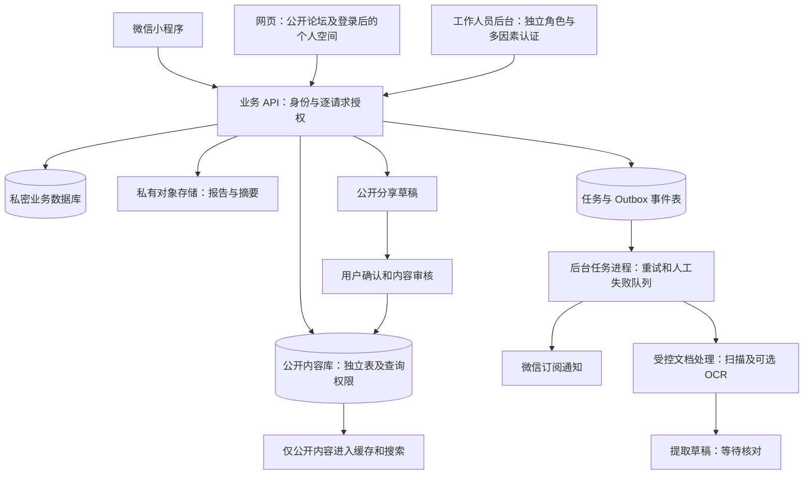
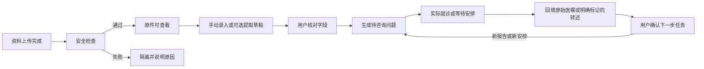

# 弯弯技术实施方案

2026年11月12日 · 方案评审稿 · 配套[商业计划书](../business-plan/business-plan.md)与[三方视角审查](../reviews/2026-11-12-investor-cto-user-review.md)

本文件给出可供研发估算、原型验证和架构评审的设计，不代表系统已经开发、压测或取得医疗机构接入。技术资料优先采用官方文档；供应商事实附链接，其他架构、参数和验收阈值均为本项目建议。未编制预算。

## 1 技术决策先服务于三个交付

第一，孕妇在没有上传报告、没有开通付费、没有同意消息通知时，仍能理解当前步骤，保存要问医生的问题。第二，一次检查的多个结果分别跟踪，原件、用户转述、机器提取和医生意见不能混为一种事实。第三，产前资料可以带到出生后接诊，家庭共享和公开发帖都要有明确边界。

因此，第一阶段的主要技术工作是身份、资料、任务、版本、权限和内容审核；模型能力只在这些基础成立后加入。可用性必须在关闭 OCR、关闭 AI、微信通知发送失败时仍然成立。

### 首版范围

| 必须实现 | 交付形式 | 暂缓部分 |
| --- | --- | --- |
| 阶段和问题管理 | 可跳步、可暂停的时间线；问题卡与就诊关联 | 自动判断疾病风险、自动决定检查路径 |
| 私密资料与就诊包 | 原件、少量手动字段、一页摘要及原件目录 | 全医院报告自动同步、全面结构化病历 |
| 检查和随访记录 | 每项检查独立状态；按实际安排记录复诊和支具计划 | 自动生成医疗安排、远程监控依从性 |
| 医生导航 | 可核查的官方入口、核实日期、适用阶段 | 无合同和接口的站内挂号、即时多学科会诊 |
| 小型论坛 | 主题、回复、阶段标签、结局更新、举报审核 | 私信、群聊、直播、积分商城、复杂推荐算法 |
| 家庭协作 | 指定资料及任务授权、撤销、访问审计 | 默认全家共享、亲属自动加入 |
| 内容运营 | 审核版本、来源、修订和失效状态 | 未经审核的 AI 医学回答直接发布 |

## 2 现成方案比较与推荐

### 2.1 三条后端路线

| 路线 | 可利用的现成能力 | 本项目仍须完成的工作 | 采用条件与判断 |
| --- | --- | --- | --- |
| CloudBase 一体化 | 登录接入、数据库、文件存储、函数及云托管 | 病例授权、资料版本、业务状态、内容审核；逐项核对安全规则 | 适合熟悉云开发的小团队先验证；不能把上传示例直接当病历系统 |
| 自有业务 API + 托管 PostgreSQL + 私有对象存储 | 成熟关系数据库、托管备份、对象存储、容器部署 | 身份适配、业务服务、授权与运维流程 | 推荐作为正式试点基线；适合需要家庭授权、跨端和机构协作的路线，但需明确后端与运维负责人 |
| Supabase | PostgreSQL、Auth、Storage、数据接口等组合能力 | 微信身份适配、数据地域核实、权限策略、文件备份；自托管时承担完整运行维护 | 已有相关经验时可选；本项目不因“一键部署”而采用，也不默认托管区域满足大陆医疗资料需求 |

CloudBase 能力依据其[官方文档](https://docs.cloudbase.net/)。其[小程序文件上传示例](https://docs.cloudbase.net/recipes/add-file-upload-wechat-miniprogram)解决上传链路，不构成家庭分级授权的完整设计。Supabase 明确说明自托管方承担服务维护、安全加固、数据库、备份与监控，开发用 CLI 环境不能直接对外作为生产服务。[Supabase 自托管说明](https://supabase.com/docs/guides/self-hosting)

**推荐是有条件的技术判断**：假设团队能维护 TypeScript 后端与 SQL，选择自有业务 API；使用大陆区域托管服务，减少数据库和存储的底层维护。若实际只有熟悉云开发的工程人员，先用 CloudBase 完成同样的授权与流程验证，不为坚持框架而延迟需求验证。两条路线不能同时开发。正式定案前完成第15节验证，尤其检查撤权、跨端登录、真机文件预览和恢复。

### 2.2 客户端与应用结构

建议小程序使用 Taro + React + TypeScript；网页使用 Next.js；后台业务使用 NestJS 模块化单体。共享接口类型、字段校验定义、阶段枚举和文案，页面交互分别适配。不承诺一套页面代码在小程序与网页完全通用：Taro 的组件、API 与路由遵循小程序规范，与普通 React Web 存在差异。[Taro 官方说明](https://docs.taro.zone/docs/react-overall)

Next.js 用于公开知识与论坛页面的服务端渲染，私密页面独立处理认证和缓存；采用这个框架不要求使用某个境外托管平台。[Next.js 官方说明](https://nextjs.org/docs/app/getting-started/server-and-client-components) NestJS 的模块机制适合将身份、病例、内容和社区按职责组织；本项目选择单体是为了减少部署和跨服务事务负担。[NestJS Modules](https://docs.nestjs.com/modules)

团队若长期使用 Vue，可将客户端替换为其熟悉的小程序框架，先做相同的真机验证。当前不同时维护 React 与 Vue 两套前端。版本在开发启动时选择受支持的稳定版本并锁定依赖，本文不把“最新版本”当成设计要求。

### 2.3 论坛自建还是 Discourse

首版建议在同一业务后端实现有限的主题、回复、标签和审核；网页与小程序共享内容接口。这样不强迫微信用户再注册邮箱，病例也不会进入另一套论坛附件系统。代价是团队要自行完成反垃圾、举报、申诉与管理员工具，不能只做发帖页面。

Discourse 是后续成熟论坛的候选。其 DiscourseConnect 支持外部身份系统接管登录，但要求验证签名，并对邮件验证有明确安全要求。这意味着“接一个微信登录”不能直接完成账号衔接；不得伪造邮箱或关闭验证绕过流程。[DiscourseConnect 官方说明](https://meta.discourse.org/t/setup-discourseconnect-official-single-sign-on-for-discourse-sso/13045)

若社区已需要复杂分类、版主管理和成熟讨论功能，且运营团队能承接，再比较迁移成本与继续自建成本。采用 Discourse 时只同步公开昵称、稳定外部账号标识和必要账号属性；私人报告和医疗权限仍在主系统。帖子保留稳定 ID、作者映射、时间和公开状态，预先支持导出；迁移需处理旧链接、删除请求及附件，不能只导入正文。

## 3 部署与信任边界

初期一个业务服务、一个后台任务进程、一套托管数据库和私有文件存储即可。可在同一个数据库实例内分开私密表、公开表与账号权限；查询接口不能任意跨区读取。公开网站可缓存，所有病历、授权页面、导出和登录返回均禁止共享缓存。数据库与文件存储不向客户端暴露管理凭证。暂不引入微服务、Kubernetes 或专用向量库。

开发、测试、生产独立配置和账号；测试只用合成或经明确授权的最小样本。生产报告不复制进 GitHub、开发机截图、工单或第三方错误追踪。云地域选择须覆盖数据库、对象、OCR、日志、备份和模型的完整链路，不能只看服务器部署地点。

## 4 孕妇实际看到的页面

首页主入口为“下一步”“我的资料”“问答与经历”，个人设置从头像进入。论文和医生目录在问题或阶段内提供，也保留搜索入口，不要求用户先理解各个专业栏目。首次只询问当前阶段，可选城市；基础阅读不登录。保存个人资料时再说明用途并登录。

| 页面 | 首屏信息 | 用户动作 | 失败或不确定时的行为 |
| --- | --- | --- | --- |
| 刚发现 | 这份超声提示意味着什么、复核要问什么 | 保存或修改问题单 | 未知孕周、不愿上传也可继续 |
| 下一步 | 用户选定的主要疑问、已确认安排、资料缺项 | 保存待办、标记暂不处理 | 未有预约时显示官方渠道，不虚构日期 |
| 检查进度 | 取样事件下的各个实际检测项目 | 标记待出、已收到、待解释 | 一项正常不关闭其余项目 |
| 报告详情 | 原文与用户核对字段；解释来源 | 纠错、添加疑问、选择就诊资料 | 模糊或识别失败进入手动模式 |
| 就诊包 | 一页事实摘要、未决问题、原件目录 | 预览、下载、限时分享 | 缺页和未核实转述显式标出 |
| 出生后 | 实际治疗安排、下次复诊、当前照护困难 | 按医嘱记录，不自动推算方案 | 新方案到来时确认是否替代旧计划 |
| 经验帖 | 阶段、更新时间、已知结局和作者自述 | 筛选、追问、举报或退出阅读 | 不显示与自己相似就等于预后相同 |

字体可放大、短句说明、状态不用单一颜色区分。上传中断保留已完成文件及可恢复草稿；重复点击不生成两份就诊包。暂停服务入口在个人设置和提醒设置中均可找到，不要求用户填写妊娠结局。上述体验须用真实家庭测试，当前没有可用性成绩。

## 5 身份、家庭与专业人员权限

### 5.1 身份设计

平台建立自己的 `user_id`，外部身份作为绑定记录。小程序登录凭证交由服务端验证后建立会话；客户端传来的 OpenID、昵称或“我是家属”不构成授权。微信小程序登录与平台本地账号关联的能力可参考腾讯官方接入说明。[微信小程序登录 API 模式](https://cloud.tencent.com/document/product/1441/68677)

对小程序身份按应用标识与外部标识建唯一约束，不假设一定返回 UnionID。网页首版可用自建一次性登录挑战：网页显示二维码，小程序登录用户确认设备与用途，服务端消费挑战并给该浏览器设会话。挑战短期失效、只能消费一次，二维码本身不携带用户资料；手机浏览器提供跳转小程序后确认的路径，真机验证不可用时保留已验证的账号恢复渠道。这个流程是拟设计的跨端方案，不是微信已提供的通用网页授权能力。

跨应用账号合并必须证明对两个账号的控制，不凭姓名、共享手机号或同姓合并。用户可查看登录设备、退出其他设备；账号恢复需人工核验流程，但不索取完整遗传报告作为默认身份证明。

### 5.2 最小授权矩阵

| 身份 | 默认可见 | 允许的动作 | 明确禁止 |
| --- | --- | --- | --- |
| 孕妇或合法资料管理人 | 自己管理的病例 | 授权资料、导出、纠错、撤销分享 | 自动代表其他成年人同意公开其资料 |
| 被邀请家属 | 具体授权的资料或任务 | 按授权查看、协作记录 | 因家庭关系自动读取全部病例 |
| 专业服务人员 | 已受理服务中被授权的资料 | 写入署名的意见与记录 | 搜索全平台患者、修改原始报告 |
| 社区运营 | 公开内容、举报所需信息 | 审核、联系作者、处理举报 | 日常浏览私人报告 |
| 技术支持 | 脱敏诊断信息、请求编号 | 排查服务错误 | 默认读取正文或下载附件 |
| 经批准的维护人员 | 限时、限案、可审计权限 | 处理特定故障 | 用长期超级账号代替日常权限 |

邀请由资料管理人发起，明确对象、范围、到期时间；被邀请人登录后确认，原管理人可复核身份。亲属可能涉及其他成年人的资料，不能用“一个家庭”代替所有资料主体的同意。出生后需确认照护及监护关系再调整权限；不能让孕期伴侣授权自动永久覆盖孩子资料。

服务端对每次查询、修改、导出和下载检查主体与资源关系。PostgreSQL RLS 可作为第二道限制，但表所有者及具有绕过权限的角色存在例外；业务连接不用这些高权限角色，连接池内身份上下文要按事务设置和清理。[PostgreSQL 行安全说明](https://www.postgresql.org/docs/current/ddl-rowsecurity.html) 如采用 Supabase，暴露的数据表与 Storage 策略同样需逐项设计，不能把服务密钥放入客户端。[Supabase RLS](https://supabase.com/docs/guides/database/postgres/row-level-security)

## 6 数据模型：先避免混淆，再追求自动化

| 实体 | 最少字段或关系 | 必须保持的约束 |
| --- | --- | --- |
| User / ExternalIdentity | 内部用户ID、应用、外部身份、状态 | 身份映射不等于医疗资料访问权限 |
| Case / Subject | 妊娠事件、胎儿或儿童标识、管理人 | 一次妊娠可有多胎；胎儿与出生后儿童映射须确认 |
| Grant / Consent | 授权人、接收人、资源、动作、目的、有效期、版本 | 撤权后未来访问停止；历史已下载副本无法远程收回 |
| Sampling / TestOrder | 取样事件、实际项目、实验室、受理和预计时间来源 | 羊穿取样与核型、CMA、测序等检测项目分开 |
| Document / Version | 归属、类型、文件哈希、检查日、报告日、上传日、原件对象键 | 更正版保留前版；同次检查可有多份文件 |
| ExtractedField | 文档版本、页码、位置、提取值、确认人及状态 | 机器结果不覆盖原文；用户核对不等于医生认可 |
| Question / Encounter | 问题、关联报告、优先级、实际就诊记录 | 问题可跨多次就诊；未答复不能自动关闭 |
| Advice / Task | 原始出处、转述者、时间、负责人、替代关系 | 用户转述与专业签署分开；任务完成不等于疾病解决 |
| CarePlan | 医疗团队、实际记录的方案、版本及生效时间 | 支具时长与治疗调整不由算法擅自生成 |
| DoctorDirectory | 官方来源、院区、阶段、核实时间、合作状态 | 收录不等于合作或号源可用 |
| Content / Review | 版本、来源、作者、专业审核、发布和失效状态 | 未审草稿不能作为正式医学知识召回 |
| Story / Moderation | 公开副本、阶段、更新时间、审核及申诉 | 不能直接引用私密对象地址作为帖子附件 |
| Audit / Outbox | 操作者、资源、动作、结果、事件ID、重试状态 | 日志不保存病历正文；事件可追踪但不重复执行 |

孕周记录为某日期对应的周加天及来源；预产期修订保留版本，不让系统依据上传时间“推算病情”。医生姓名未核实的口述记录标为“用户记录”，不创建认证医师署名。数据接口返回 `source_type`、`confirmed_by`、`document_version` 等出处信息，使前端能区分事实来源。

## 7 状态机与重复执行控制

检测项目使用“拟讨论／已受理／等待报告／报告已收到／待专业解释／已记录解释／暂停或取消”等状态，允许并行；“解释过”不等于“结果无异常”。医院预计出报告时间须注明来源，超时仅提示联系原机构，不推断检查失败。

问题状态与资料状态分离：问题可以是待问、等资料、已获答复、用户认为已解决或暂不处理。无后续访问不自动标记解决。治疗计划变更先展示差异，用户确认旧提醒是否作废；历史安排保留。

每次重要写入带幂等键；同一用户重复上传按文件哈希提示重复，但不跨家庭透露相同文件是否存在。业务状态与 Outbox 事件在同一数据库事务中写入，后台任务读取并执行，重试有上限和人工失败队列。事件消费者按事件ID去重。微信等外部调用可能出现“实际成功但响应丢失”，记录结果未知并按供应商可查询能力处理，不能承诺外部消息严格只发送一次。

## 8 文件上传、分享、导出与删除

1. 服务端验证当前病例权限，签发限定对象键、有效期和用途的上传许可；文件名使用随机标识，不含姓名、诊断或身份证号。
2. 先进入隔离区，校验实际文件类型、体积、页数、损坏情况和恶意内容。首版建议只接收 PDF、JPEG、PNG；单文件20 MB、PDF最多50页作为待真机验证的初值，超限给拆分或人工帮助入口。
3. 检查通过后登记不可变原件版本，再生成预览副本。文档解析进程限制内存、运行时间和网络访问，拒绝读取文档内指向的外部资源。
4. 原件默认私有。站内查看先经服务端授权；家属或医生限时分享使用访问网关，每次打开核验授权状态。链接只能定位分享会话，不能成为永久公开文件地址。
5. 如给对象存储签发短时下载地址，应明确它在有效期内具有转交风险。COS 官方说明持有有效预签名地址的人可下载；撤销平台分享不一定立即让此前签发的地址失效。因此敏感分享优先经网关，必要的直接下载设置短期有效并提示无法撤回已下载副本。[COS 预签名下载](https://intl.cloud.tencent.com/zh/document/product/436/14116)
6. 导出前逐项选择：一页摘要、问题清单、原件目录；原件打包另选。摘要标注生成时间、资料版本、未核实项目及缺失资料。导出文件短期清理，下载行为记录审计。
7. 公开经验另生成副本，默认不带报告图。确需配图时重新脱敏、去除元数据、检查二维码和编号，并由用户预览确认、运营审核；私密文件授权不能复用为公开同意。
8. 删除请求覆盖原件、预览、提取草稿、导出、搜索索引、分享会话和适用的第三方副本。同步备份有独立保留周期，向用户说明实际清除期限；恢复时重放删除清单，防止已删资料重新上线。

`robots.txt` 和 `noindex` 只控制搜索行为，不能替代访问授权。站内病历不经过公共图片优化服务或公开 CDN 缓存，不把预签名链接写入埋点、错误日志和聊天消息。

## 9 消息与异常支持

微信订阅消息需要用户主动授权；一次性授权与发送有约束，不能把它设计为可靠的长期医疗提醒渠道。依据腾讯官方实现说明，授权一次对应一条服务通知，拒绝授权的情形必须有替代路径。[订阅消息说明](https://cloud.tencent.cn/document/product/1301/103770)

系统中的待办才是原始记录，通知只是附加提醒。每条通知保存任务版本、预计发送时间、授权情况和发送结果；实际发送前再次检查任务是否已取消、用户是否暂停。内容用“您保存的安排有更新”等中性措辞，不在锁屏显示病情和检测结果。未经另行选择，不自动切换短信。

对于“报告没出”“接诊未确认”“无法联系医生”等情况，显示谁负责、何时查看过、下一条可用渠道。医院未接入时只记录用户反馈，不显示虚假的医院处理进度。首版不承诺全天候医学答复；紧急情况入口展示经审核的联系建议和用户保存的机构联系方式，不能以等平台回复作为处理步骤。

## 10 OCR、AI 与知识检索

### 10.1 先验证 OCR 是否值得加入

PaddleOCR 可处理图像文字与文档结构，PP-StructureV3 是可评估的解析方案；这不等于它已对本项目遗传或超声报告达到可用准确率。[PaddleOCR 官方仓库](https://github.com/PaddlePaddle/PaddleOCR)

比较自部署 PaddleOCR 与合同明确的大陆区域云 OCR：前者需维护运行环境、资源和升级，后者需确认处理地点、保存时长、访问和删除方式。先用经授权的代表性样本评估，不以厂商通用榜单替代报告质量。首轮样本包括清晰扫描、手机反光、旋转、模糊、跨页表格、复印件和更正报告。

识别结果只进入草稿；姓名归属、报告类型、日期、结论、检测项目及关键变异字段强制逐项核对。每个字段保留页码及原文位置；看不清就缺省，不补猜。对多胎、母体样本和胎儿样本混合资料专门测试。录入速度、用户纠错负担和原文定位率都要测，不能只看字符准确率。

### 10.2 AI 的三种允许输出

- 审核知识范围内的术语解释，附具体文章版本与引用位置。
- 用户已确认资料的一页摘要草稿，明确缺项和出处，不补充诊断。
- 待问问题归并，用户决定保留哪些，不自动把问题变成检查订单。

使用 AI 要单独选择用途和资料范围。模型读取的是当前授权的最少内容，不自动接收整个家庭档案。文档中的文字一律是待处理数据，即使写有指令也不改变系统规则；模型没有发帖、改医嘱、发消息或访问其他病例的工具权限。结构化输出经字段校验后仍需用户确认；不得直接写成“医生已确认”。

知识检索先按阶段、主题、审核版本和关键词实现。中文搜索维护常见同义词与错字，并用用户问题集验证；不假设数据库默认全文检索即可解决中文召回。内容量和检索测试显示确有缺口后再引入向量检索。引用命中只能说明找到材料，不能证明材料适合当前胎儿或结论正确。

### 10.3 Dify 的具体位置

Dify 可用于医学编辑内部试验“检索—摘要草稿—引用检查”流程。官方有 Docker Compose 自托管方式，但这会引入额外服务与运行维护。[Dify 部署文档](https://docs.dify.ai/en/self-host/deploy/quick-start/docker-compose) 其许可证附有额外条件，涉及多工作区商业服务时需核实适用授权，不能按无条件 Apache 2.0 处理。[Dify 许可证](https://github.com/langgenius/dify/blob/main/LICENSE)

首版生产链路不依赖 Dify。即使后续采用，也只接收授权数据副本；检查运行日志、追踪、插件、模型供应商和向量存储的数据流，单独设置删除与保留策略。自托管编排工具不意味着调用的模型也在本地。

### 10.4 上线前评估

使用冻结测试集记录错误类型：归属错误、否定词遗漏、结论截断、无依据新增内容、引用错位、越权信息、把待定写成确诊。提取、摘要、解释分别评价；单一总体准确率不能批准全部功能。所有关键字段都要可定位来源且未核对不得进入已确认摘要；出现无法解释的事实新增或跨病例内容时停止该版本上线。测试样本零错误仅是放行条件之一，不代表临床零风险。

## 11 内容、论坛与专业服务运营后台

知识条目保存适用阶段、问题、简短答复、局限、来源和审核记录。草稿、专业待审、发布、需复核、下线五类状态明确区分。初期可以用 Git 管理经审核的静态知识，再将发布版本同步到应用；私人资料和运营工单禁止放进公开仓库。专业审阅者的姓名、资格和意见必须来自真实参与，系统不能自动生成背书。

论坛首版正文采用受限 Markdown 或纯文本，不允许任意 HTML、脚本或不受控嵌入。采用投稿限频、链接限制、举报、人工复核与申诉。个人经历、一般知识和专业人员回答有不同标识；医学争议交给专业审核，不靠点赞多少判真伪。首期不开放私信，避免额外的骚扰和私下营销处理负担。

医生目录每条有核实负责人和时间；用户可报告失效，后台进入待核查并显示信息可能过期。普通目录不自动产生预约。正式服务只有在机构合同、受理人员、服务范围、记录归属和异常退出方式明确后启用。个案流转需要“已申请—已接收—补件—已排期—已完成／拒收／用户退出”，每次都有责任人。

## 12 建议 API 与工程组织

以下是接口边界草案，不是已实现接口。身份来自服务端会话，不能允许请求正文自行指定操作者身份。版本冲突返回可理解的纠错提示，避免两名家属覆盖对方记录。

| 接口草案 | 用途 | 特别约束 |
| --- | --- | --- |
| `POST /auth/wechat/session` | 校验登录凭证并建会话 | 限频；不得返回服务端密钥 |
| `POST /cases` | 创建用户管理的资料空间 | 不因创建病例就认定医学诊断 |
| `GET /cases/:id/timeline` | 查看授权范围内时间线 | 每条资料均过权限检查 |
| `POST /cases/:id/uploads` | 建立上传意图 | 限定文件类型、大小、对象键 |
| `POST /documents/:id/confirm` | 确认提取或手录字段 | 指定文档版本，保留原文与核对人 |
| `POST /cases/:id/questions` | 保存疑问 | 可关联多个资料，不要求已预约 |
| `POST /cases/:id/visit-packs` | 异步生成就诊包 | 幂等、按选定范围导出 |
| `POST /cases/:id/grants` | 授权家属或专业方 | 指定资料、动作、期限与接收人 |
| `DELETE /grants/:id` | 撤销未来访问 | 同步使相关分享会话失效 |
| `POST /tasks/:id/revise` | 修改安排及替代旧版本 | 发送前重新核对任务版本 |
| `POST /stories/drafts` | 建立独立公开草稿 | 不自动携带私密附件地址 |
| `POST /privacy/deletion-requests` | 发起删除并追踪进度 | 覆盖派生副本及恢复后的删除 |

代码按 `apps/miniapp`、`apps/web`、`apps/api`、`apps/worker`、`packages/contracts` 和 `docs` 管理；一个仓库可以实现，不需要拆多个微服务仓库。数据库迁移纳入版本管理；接口契约由服务端校验并生成类型，但不能只依赖前端校验。模块化设计为后续替换存储、OCR和通知服务保留适配层，避免业务代码直接绑定厂商返回格式。

## 13 运行维护、数据恢复与交付责任

后台管理员使用多因素认证，权限定期复核；密钥使用托管秘密服务或受控部署配置，不存代码库。操作日志只记录必要的对象标识、动作、结果及时间，不采集报告正文、带签名地址和输入框内容。前端回放与第三方分析默认不覆盖任何私密页面。

数据库备份和文件备份分别验证。Supabase 官方特别说明数据库备份不包含 Storage 中的实际对象，这也提醒本项目不能把“数据库可恢复”当作全部报告可恢复。[Supabase 备份说明](https://supabase.com/docs/guides/platform/backups)

拟议试点恢复目标：最多丢失24小时内的数据，8小时内恢复核心查看和导出；这是待演练的工程目标，不是已提供的服务承诺。选择的托管能力应能满足目标，演练须同时验证数据库、文件、授权、加密密钥依赖和删除清单。记录实际耗时后再决定是否承诺更严格指标。

服务不可用时公开知识可以独立提供；私密资料请求明确失败，不把缓存中的旧医嘱当成最新结果。故障分为数据泄露或错配、核心资料不可用、一般页面问题，分别确定负责人、暂停范围、通知与恢复步骤。发布可回滚，数据库改动采用兼容旧版本的扩展与迁移步骤，不能假设回滚代码会自动回滚数据。

| 责任 | 必须有人承担的工作 | 交付证据 |
| --- | --- | --- |
| 产品负责人 | 首版范围、任务完成定义、用户测试 | 场景测试记录和删减决策 |
| 技术负责人 | 权限、数据模型、发布与恢复 | 架构记录、测试和恢复演练 |
| 前端与后端工程 | 真机流程、接口及状态一致性 | 端到端演示、失败路径测试 |
| 医学编辑及专业审核 | 内容适用性、纠错、审核版本 | 真实审核记录和待审清单 |
| 社区运营 | 举报、回复、失效目录和服务流转 | 工单、处理时段及未处理队列 |
| 隐私与法律支持 | 数据用途、合同及功能对应义务 | 上线核实结论，不以云厂商认证代替 |

## 14 验收清单：以失败场景证明系统边界

| 编号 | 场景 | 放行条件 |
| --- | --- | --- |
| T01 | A家庭用户修改请求中的病例ID为B家庭 | 列表、详情、下载、导出、搜索均拒绝；无存在性泄露 |
| T02 | 撤销家属权限后继续用旧会话和分享入口 | 后续授权网关访问立即拒绝；已下载与尚有效直链的限制如实说明 |
| T03 | 同次取样有三个检测项目，只回一份报告 | 其他项目仍待返回，解释状态独立 |
| T04 | 双胎及母体报告混传 | 不自动合并主体；导出前显示未确认归属 |
| T05 | 两名家属同时编辑，重复点击生成摘要 | 提示版本冲突，幂等请求不重复创建 |
| T06 | 取消复诊时通知恰好进入队列 | 工作进程核验最新版本，过时提醒不继续发送 |
| T07 | OCR超时、模型不可用或用户拒绝AI | 可手动记录、看原件、生成基础就诊包 |
| T08 | 报告内含恶意指令、外部链接或异常PDF | 解析受限；不执行指令、不访问外部病例、不改变业务状态 |
| T09 | 公开经验生成和网页抓取 | 公开副本只含确认字段；私密页无法匿名访问且不被共享缓存 |
| T10 | 恢复备份 | 原件与元数据匹配；已撤权和已删除资料不会重新开放 |
| T11 | 不登录、不上传、不允许通知 | 可使用基础知识并完成可分享的通用问题清单 |
| T12 | 妊娠结局变化或只想暂停 | 停止阶段提醒，不要求解释原因，不触发育儿营销 |

性能先按试点规模验证。建议测试集为100个并发会话、1万条合成资料元数据及典型手机网络；普通读接口 p95 小于500毫秒、主要页面可交互时间小于3秒作为初始目标。明确设备、网络、冷启动和排除项；大文件上传、导出和OCR异步计量，不计入普通读接口目标。以上数字是待测试阈值，不是当前成绩，也不代表生产容量上限。

## 15 开发前验证与分阶段交付

| 顺序 | 做什么 | 得到什么才继续 |
| --- | --- | --- |
| G0 需求与责任 | 明确主要用户任务、首发地区、真实内容审核者及服务边界 | 有人能承担审核、运营和工程；没有人承接则收缩功能 |
| G1 技术小样 | 两账号授权撤销、跨端登录、真机PDF预览、对象私有性、文件恢复 | 各项有可复现记录；CloudBase或自有API只保留一条实现路线 |
| G2 可点击原型 | 首次发现、等多个结果、出生后改期、暂停四条路径 | 用户能理解下一步及未知事项，修正术语与页面顺序 |
| G3 可用版本 | 手动资料、问题、就诊包、目录、基础论坛及运营后台 | T01至T12适用部分全部通过；基础功能不依赖AI |
| G4 限定真实试点 | 经同意使用，观察实际就诊节点和人工处理负担 | 有用任务有证据；严重错误已闭环；供给能持续承接 |
| G5 有条件增强 | OCR、内部编辑AI、机构随访或正式受理接口分别评估 | 每项独立通过质量、数据处理和服务责任验证 |

G1 不以“页面能打开”验收；需要真实目标微信版本与手机系统测试。G4 不以注册数验收；要能追踪一个疑问从记录到就诊准备、再到下一步安排。每阶段留下继续、修改或停止的书面决定。当前只完成方案研究，尚未执行上述技术小样、用户测试和上线验证。

## 16 来源核查与待确认事项

文中链接为2026年11月12日检索的供应商官方文档或项目官方仓库；本文没有使用第三方测评替代能力验证。Taro正文抓取发生超时，相关差异依据官方搜索摘要核对；微信开发者站部分页面无法直接抓取，登录与订阅约束使用腾讯官方产品说明交叉确认。开发前仍须在实际主体的微信控制台核实类目、接口资格、隐私声明、网络域名和模板可用性，不能把文档中存在某接口等同于本项目已获准使用。

待项目负责人确认的实施输入：现有团队熟悉的技术、实际小程序主体、拟用云账号及区域、是否有运营值班、第一批真实内容审核人员和可接洽机构。它们影响具体部署与排期，不影响先开展原型和合成数据验证。本文件不声称任何厂商产品自动满足本项目全部医疗、隐私或平台合规要求。
