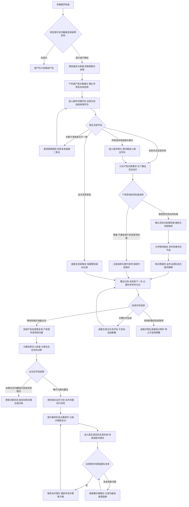
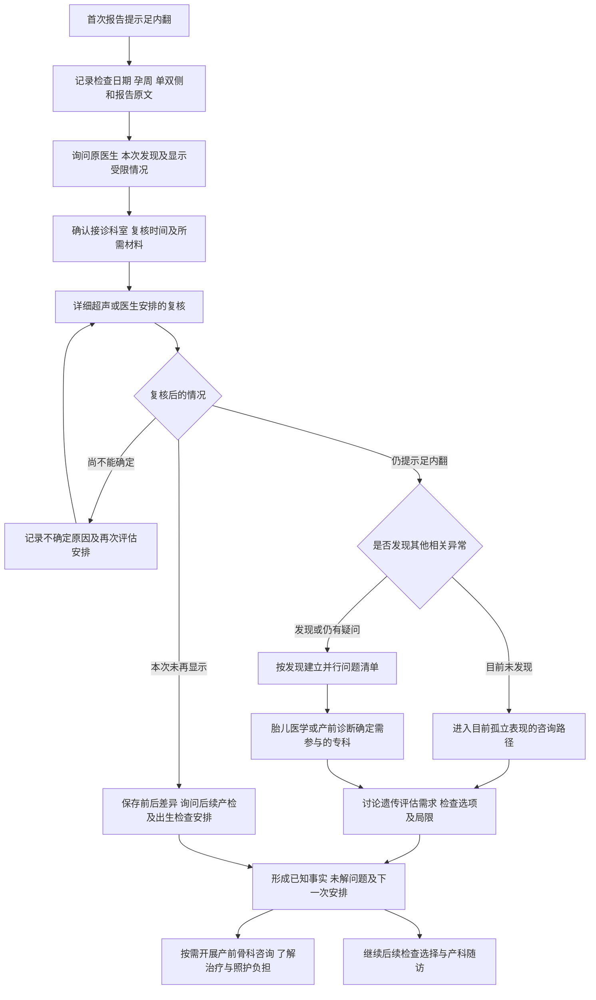
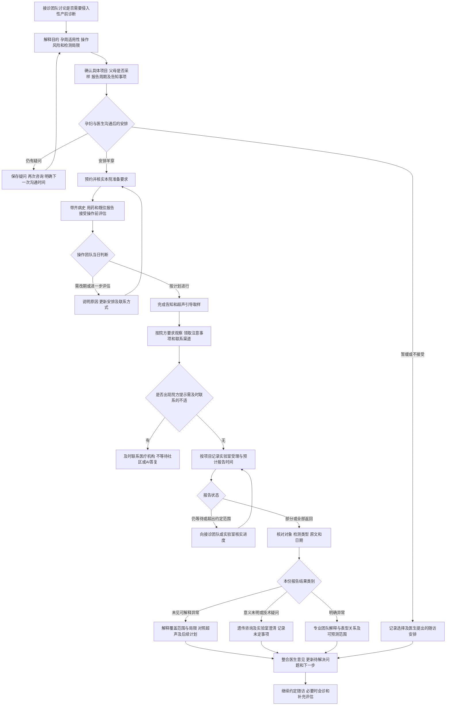
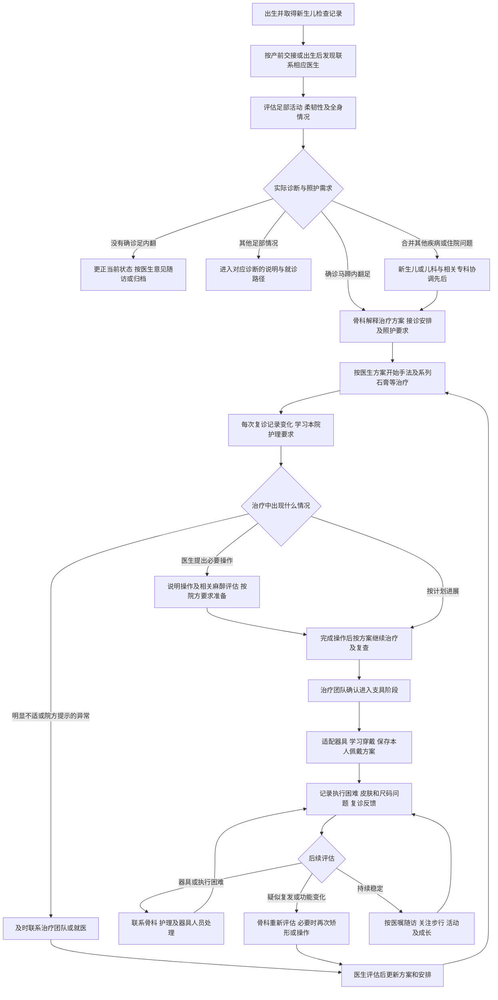

# 胎儿足内翻全流程支持平台商业计划书

微信小程序与患者论坛产品及商业方案
2026年11月11日 · Markdown 全流程图版

## 投资概要

本项目拟服务超声提示胎儿足内翻的孕妇及其家庭，将足内翻知识、产前检查说明、报告整理、专业就医导航、同伴经验和出生后治疗随访连接为一条连续的用户路径。微信小程序承担个人阶段管理和就诊工具，网页论坛承载可搜索、可追踪结局的经验与讨论。

家庭真正需要完成的任务，是在每次出现新信息后，知道它说明什么、还缺什么、下一次应与哪类医生讨论，以及该带哪些资料。系统围绕“当前阶段—待解决问题—下一步任务—专业承接—结果回填”运行，让每次搜索、咨询和复诊都能接着上一次继续。

首发面向中国大陆，拟从安徽及长三角验证服务流程，再逐步覆盖全国。首期提供经专业审核的科普、私密资料管理、公开就医信息导航和经验社区。涉及个体诊断、治疗建议及医疗服务收费的业务，须通过具备相应资质的医疗机构开展。

### 产品成立的三个条件

- 孕妇愿意在诊断和治疗节点重复使用，并认为产品减少了资料遗漏、无效搜索或重复沟通。
- 产前诊断和小儿骨科愿意使用标准化就诊摘要，参与内容审核或宣教随访合作。
- 家庭工具或机构服务能形成真实付费，而医生信息排序、医学结论和社区交流保持可信。

### 当前阶段与投资用途方向

目前具备一个家庭持续咨询、整理报告和查阅论文的需求素材。产品、团队配置、医疗合作和付费模式均为拟议方案，尚无经过验证的用户规模、收入或签约机构。拟引入投资用于产品研发、医学内容治理、种子社区和机构试点。本版聚焦需求、产品、商业逻辑及验证路径。

### 阅读导航

建议先读第4节的总流程图、三张分支图和14步行动清单，再读第34至38节系统解决方案及各阶段用户故事。第1至3节讨论需求与市场，第14至23节说明产品经营及验证，第24至33节补充专业分工、复杂场景和医生审阅任务。医生审阅尚待执行，文末附参考资料。

- [全流程图与逐步行动清单](#4-孕妇全过程旅程地图)
- [小程序与论坛产品结构](#14-小程序与网页论坛的产品结构)
- [医生参与及复杂场景](#24-各类医生的基础参与分工)
- [系统怎样解决问题](#34-系统如何把问题推进到解决)
- [现有软件思想的借鉴](#38-借鉴现有软件思想并形成自己的系统)
- [参考资料](#参考资料一)

流程图使用 Mermaid 格式；支持 Mermaid 的 Markdown 阅读器可直接显示图形。图后保留逐步行动清单，方便在普通文本阅读器中查阅。

## 1 从既有家庭经历识别产品机会

项目资料反映了一条反复回到同一问题的真实路径。超声提示双足内翻后，家庭开始查找产前检查信息，接受遗传检测，遇到意义未明变异，又整理家系、查文献、比较成人体征，最后仍需要把资料带回临床判断。以下为匿名化的需求观察，不能替代多家庭用户研究。

| 已观察到的问题 | 孕妇及家属要完成的任务 | 对产品的要求 |
| --- | --- | --- |
| 超声术语难懂，多次复查描述不同 | 弄清目前观察到了什么 | 原文定位、术语解释、时间线对照 |
| 羊穿之后有不同报告陆续返回 | 知道已完成哪些检测、还在等什么 | 检测项目清单和分别管理的状态 |
| 报告提到多个严重疾病名称 | 分清基因关联疾病与本胎诊断 | 分开显示变异分级、关联疾病和医生判断 |
| 家族有人足部外观相似 | 判断这条信息是否值得告诉医生 | 家属描述与查体、基因结果分栏记录 |
| 同一问题在多段聊天里反复出现 | 保留每次结论及依据，避免信息丢失 | 未解决问题清单和版本可追踪摘要 |
| 需要产前诊断、遗传和骨科共同解释 | 把碎片资料整理成能被快速理解的病例 | 会诊材料导出及专业分工说明 |

已有材料还出现文件名与报告内容不一致、家族外观被提前解释为基因携带、科普描述被写得过于确定等情况。这提示平台必须保存原始出处，并让用户确认报告类型和归属。信息经整理后仍要允许纠错。

### 从单一个案到可复制需求

既有家庭经历有助于识别信息断点，但不能代表全部足内翻家庭。产品入口应按孕妇当前阶段组织，既覆盖常见咨询，也覆盖结果不确定和伴随异常的情境，不围绕某个基因或单一家系建立服务路径。首轮研究必须包含不同检查选择、不同诊断结果及治疗阶段的家庭。

## 2 用户分层与服务关系

核心用户是收到胎儿足内翻超声提示的孕妇。伴侣和祖辈是协作用户，出生后的主要照护者可能发生变化。医生、护士、遗传咨询人员和机构管理者是专业供给方及潜在机构客户。

| 用户情境 | 最急迫的问题 | 需要的服务 |
| --- | --- | --- |
| 第一次听说足内翻 | 宝宝是不是还有其他问题，下一步挂什么科 | 首次发现说明、复诊问题、就医入口 |
| 医生建议产前诊断 | 为什么要羊穿，可以查什么，有什么风险 | 操作与检测的区分、院方流程、沟通清单 |
| 等待检测结果 | 先出的报告正常是否就结束，什么时候复诊 | 分项目进度、解释边界、预约提醒 |
| 发现VUS或其他异常 | 这个结果是否解释超声，父母来源有什么意义 | 原文解释、专业复评准备、会诊整理 |
| 产前评估较稳定 | 出生在哪里治，是否影响分娩安排 | 产前骨科咨询、出生交接计划 |
| 婴儿开始矫形 | 石膏怎么护理，需要多久，如何安排工作 | 医嘱记录、护理教育、复诊和异地就医经验 |
| 支具及长期随访 | 为什么还要戴，孩子抗拒怎么办，有无复发 | 实际佩戴记录、困难反馈、长期经验 |
| 失去妊娠或选择结束妊娠 | 怎样减少打扰，获得支持和后续咨询 | 可暂停提醒、独立支持区、专业服务导航 |

### 家庭协作必须尊重孕妇选择

孕妇可选择伴侣帮助整理资料、记录医生回答或安排出行。每个人使用自己的账号，授权到具体资料和任务，可随时撤回。家属账户不能自动看到全部遗传报告或讨论，也不能替孕妇提交医疗决定。

### 用户愿意继续使用的原因

产前阶段由复查和报告变化驱动；出生后由矫形、支具和复诊驱动。用户退出、减少阅读或完成随访可能代表需求已解决。产品应支持自然离开和在新节点回来，而不把持续焦虑带来的访问当作成功。

## 3 市场规模与投资判断

国家统计局公布2025年出生人口为792万人。[1] 美国儿科学会临床报告给出的特发性马蹄内翻足发生率约为每千名出生婴儿1至2例。[2] 两者只能用于探索性数量级估算，不能直接构成中国胎儿足内翻服务市场的实测规模。

若暂以1‰至2‰作敏感性情景，792万乘以该范围约为7,920至15,840名出生婴儿每年。此计算将国外报告的发生率应用于中国出生人口，存在人群、诊断与统计口径差异。产前疑似者还包括出生后未确诊、妊娠结局不同及产前漏诊等情况，不能与出生病例数简单相加。

### 三层市场定义

潜在需求层是产前疑似家庭与出生后治疗家庭。可服务层受地区医生覆盖、微信触达、语言与服务能力限制。初期可获得层应以合作入口实际转来的去重家庭数衡量，不能预设全国病例都会使用或付费。

家庭内多人浏览按同一家庭去重，双胎等情况按家庭与儿童分别记录。长期随访会增加跨年度在服务家庭，但须考虑退出和阶段结束，不能把多年的出生病例全部算作活跃用户。

### 对投资逻辑的约束

单病种社区适合验证高信任、全过程支持的产品，但单靠广告和短期付费报告解读，收入上限可能较低。更可检验的路径是先形成家庭工具和专业宣教随访服务，再确认医疗机构是否愿意持续购买。

向其他产前肢体异常或儿童骨科随访扩展，是后续选择权。每进入一个病种，都需重新验证临床路径、审核能力和用户需求，不把未来扩展计入现阶段市场承诺。

### 试点要补齐的数据

向拟合作产前诊断及骨科中心核实年度相关就诊家庭数量、转诊去重情况、主要来源地、当前宣教方式和随访流失。再记录真实触达、使用、重复使用及付费意愿，形成可追溯的市场漏斗。

## 4 孕妇全过程旅程地图

用户可能在任何阶段进入，也可能跳过、返回或暂停某个阶段。阶段选择由用户和已确认医嘱驱动，系统不把每个人引导到同一检测套餐。

| 阶段 | 用户需要理解或决定的事 | 平台交付 |
| --- | --- | --- |
| 首次超声提示 | 术语含义、尚未明确的事项、下一次问什么 | 三分钟入门和复诊问题单 |
| 专科复核 | 是否仍见足部异常、是否有伴随发现 | 按日期排列的报告和疑问 |
| 讨论产前诊断 | 羊穿的目的、可选检测和局限 | 检测沟通表与院方准备清单 |
| 取样和等待 | 当天流程、术后联系、各项何时返回 | 私密任务表和分项进度 |
| 收到检测报告 | 结果能解释什么、哪些问题仍待解答 | 原文对照和遗传咨询准备 |
| 多学科讨论 | 各科意见如何形成可执行计划 | 一页病例摘要和会诊记录 |
| 分娩前准备 | 分娩机构、出生后谁接诊、带什么资料 | 产科与小儿骨科交接清单 |
| 出生后评估和治疗 | 实际足部表现、治疗方案与护理 | 治疗日历和护理内容 |
| 支具及随访 | 生活安排、依从困难、异常如何反馈 | 随访记录和经验交流 |
| 非预期结局或暂停 | 情绪支持、停止推送、资料保留选择 | 自主暂停和支持入口 |

### 全程反复出现的四个信息问题

“我现在处于哪一步”“这次新信息改变了什么”“下一位医生需要看到什么”“类似家庭最后怎样了”。小程序首页应始终能回答前三个问题；论坛应尽可能提供有上下文和随访时间的第四类信息。

### 每个阶段的基本内容结构

先给简短解释，再列可供就诊讨论的问题，随后展示官方就医途径和可选择的经验帖。用户可直接进入深度知识和论文，但不应被迫先理解复杂遗传学才能找到下一步。

### 4.1 从超声发现到长期随访的总流程图

这张图说明家庭可能经过哪些节点。它是服务与产品流程：每位孕妇的检查项目、复诊时间和治疗安排由接诊团队确定。产前“提示或考虑足内翻”、产前综合评估与出生后查体诊断分别记录；羊穿不是所有人的必经节点，检测结果也不是唯一判断依据。[2][3][4][14]

产前骨科咨询、心理支持、资料整理和就医安排可以并行，不必等待所有报告返回才开始。图中的回路表示可以再次提出问题，不表示必须反复检查。任何阶段出现需及时处理的不适，都应优先联系医疗机构，不必先走完平台流程。

### 4.2 超声提示后如何复核与分流

孕妇这一阶段要取得四类信息：报告究竟写了什么、医生目前看到了什么、哪些仍未看清、下一次由谁回答。不能仅凭“单侧”“双侧”或一张图片自行判断轻重。[2][3]

**特殊分流**：晚孕发现时先核实可用的咨询和报告周期；双胎或多胎按胎儿分别标记；既往有相关家族史时保存真实情况供医生判断；跨院意见不同时并列保留原文。系统不根据这些标签直接增加检测项目。

### 4.3 羊穿选择取样与报告解释的详细流程

取样操作和实验室检测是两件事。进入羊穿咨询后，要明确“为什么取样、样本做哪些检测、各自能回答什么、什么时候和谁解释”，避免只知道“已经做了羊穿”。[4][5][6]

核型、拷贝数检测与基因测序并非所有人都依次开展的固定阶梯。具体方法、是否追加、是否使用原样本及父母验证的必要性，均需由接诊团队和实验室确认。某一份报告返回不自动关闭其余检测任务，报告“未见异常”也不等于解释了所有超声问题。

### 4.4 出生后确诊治疗与支具随访的详细流程

产前咨询帮助家庭提前准备，出生后则按实际查体与全身情况确定诊断和方案。下面的矫形路径用于说明常见治疗阶段，合并疾病、非典型足部情况及较晚就诊者需要个体化处理。[2][13][14]

### 4.5 孕妇及家庭每一步需要完成什么

下列编号用于产品任务模板，任务实际是否启用和日期以本人安排为准。系统只显示当前相关事项，支持“不清楚”“待咨询”“暂缓”和“不适用”，不把全部任务一次推给每个家庭。

#### 第一步 拿到首次超声报告

- **家庭行动**：保存完整报告，记下检查孕周、医生原话和最担心的三个问题；询问是否需要进一步复核及接诊渠道。
- **准备材料**：当次报告、既往相关超声与筛查记录，有条件时按医院要求取得影像。
- **需要得到的信息**：当前是疑似还是较明确的影像表现，是否存在受限或其他发现，下一次沟通对象与时间。
- **系统交付**：术语解释、原文定位、首次复诊问题单和实际安排记录。

#### 第二步 完成接诊与超声复核

- **家庭行动**：按预约就诊，将前后报告一并提供，询问目前是否只见足部异常、是否仍有未显示或需澄清的部分。
- **专业承接**：产科、胎儿超声及产前诊断团队按当地实际流程协作。
- **需要得到的信息**：本次已确认的所见、仍未明确之处及后续随访意见；单双侧本身不作为预后结论。
- **系统交付**：前后报告对照和“目前仅见足部异常／伴随发现／尚不确定”的来源记录。

#### 第三步 听懂检查建议再作选择

- **家庭行动**：询问为什么建议或不建议某项检查，各自范围与局限、风险、可能结果、实际报告时间及费用；提出个人顾虑。
- **准备材料**：既往筛查、孕产史、病史与用药，医生认为相关的家族资料。
- **需要得到的信息**：哪些选项已讨论，接受或暂缓后分别如何随访，结果由谁解释。
- **系统交付**：检查沟通表和选择记录；羊穿、核型、拷贝数检测与测序分别说明。

#### 第四步 已预约羊穿时完成院方准备

- **家庭行动**：核实医院院区、日期、报到地点、材料、术前要求和联系方式；对用药或既往疾病主动告知医生。
- **准备材料**：以接诊医院要求为准，不使用其他患者的准备清单替代本院通知。
- **需要得到的信息**：当天流程、可能改期的处理、知情同意事项及样本用于哪些项目。
- **系统交付**：带来源和更新时间的院方清单、出行待办与可自选提醒。

#### 第五步 完成操作并确认术后联系

- **家庭行动**：接受操作前评估与告知，按院方流程观察，离院前确认注意事项、联系渠道和复诊安排。
- **需要得到的信息**：出现哪些情况应及时联系医院，样本送到哪里，各检测如何查进度。
- **系统交付**：医院说明存档和联系入口。持续或明显不适、流液、出血、发热等院方提示情形优先联系医疗机构。[5]

#### 第六步 分项目等待报告

- **家庭行动**：记录已取样、已受理、等待、已返回的各项状态；超出医院给定范围时主动核实，不用等待天数猜测结果。
- **需要得到的信息**：哪些报告尚未返回，是否已安排解释门诊，是否需要先处理已出现的新发现。
- **系统交付**：分项台账、待返回清单、可暂停的通知及咨询问题单。

#### 第七步 核对并理解每份报告

- **家庭行动**：核对报告对象、检测名称、样本及日期，保留原件；请专业人员解释与超声是否相关、尚有何局限。
- **不同处理**：未见可解释异常时问清剩余问题；意义未明或技术疑问时准备遗传咨询；明确异常时讨论整体评估及选项。
- **系统交付**：原文与一般解释并列、待医生回答的问题，以及其余尚未返回的检测状态。

#### 第八步 按需补充资料或参加多学科讨论

- **家庭行动**：围绕尚未解决的问题准备摘要，说明最希望回答的事项；需要家属资料时先问清目的和范围。
- **专业承接**：由牵头团队按问题邀请相关科室，可能包括胎儿医学、超声、遗传、小儿骨科及其他相关专科。
- **需要得到的信息**：已经决定、等待后再决定及目前无法确定的事；每项由谁承接。
- **系统交付**：一页摘要、原件目录、会诊受理状态和可跟踪的后续安排。

#### 第九步 继续产检并提前了解治疗

- **家庭行动**：继续原有产科照护及医生安排的复核；按需进行产前骨科咨询，了解出生后评估、治疗阶段和实际照护负担。
- **需要得到的信息**：宝宝出生后到哪里看、如何接诊、复诊是否可持续；哪些判断必须等出生后查体。
- **系统交付**：产科与骨科并行任务、机构官方入口及带阶段背景的家长经历。

#### 第十步 制作分娩与出生交接包

- **家庭行动**：与产科确认分娩安排，保存重要咨询意见、未返回结果和出生后接诊方式；异地生产时核实目标医院接收要求。
- **需要得到的信息**：谁检查新生儿、谁领取待返回报告、何时联系骨科及实际预约情况。
- **系统交付**：可导出的交接包和待返回事项；不根据足内翻标签自动选择分娩方式或时间。

#### 第十一步 出生后更新实际诊断

- **家庭行动**：将产前资料交给接诊团队，保存新生儿及足部查体结论，按实际诊断进入后续路径。
- **不同处理**：未确诊者更正状态；其他足部情况另行导航；确诊者进入骨科方案；合并疾病者同步管理其他问题。
- **系统交付**：产前记录与出生后诊断分栏、当前责任团队和下一次安排。

#### 第十二步 按方案治疗并学习照护

- **家庭行动**：确认实际治疗计划、复诊地点和联系渠道；每次就诊后记录医嘱，学习石膏护理、足趾观察及生活安排。
- **需要得到的信息**：本次治疗目标、何时回诊、出现问题如何联系；若需操作或麻醉，取得对应团队的具体告知。
- **系统交付**：治疗日历、带来源的护理内容及问题反馈记录。家庭不根据网上照片自行拆石膏或更改治疗。

#### 第十三步 进入支具和持续随访

- **家庭行动**：在治疗团队确认后适配支具，学习穿戴并保存个人方案；记录不适、尺码、睡眠和照护分工方面的困难。
- **需要得到的信息**：支具阶段的目的、个人佩戴要求、复诊与器具处理渠道；遇到困难由团队确认调整。
- **系统交付**：个人医嘱、执行困难记录和照护者交接，不用打卡排名评价家长。[13][14]

#### 第十四步 处理新问题及长期成长

- **家庭行动**：出现重新内翻、器具异常或功能变化等疑问时联系治疗团队；稳定期间按医嘱随访，逐步关注步行、活动和入园生活。
- **不同处理**：需要专业评估的问题进入就诊准备；生活安排可参考社区经验；稳定或暂离者可以归档并减少提醒。
- **系统交付**：长期治疗摘要、重新进入服务的入口，以及自愿更新的结局记录。

### 4.6 全流程始终保留的三条支持路径

1. **情绪与决定支持**：等待、检查选择、重大决定及照护压力各有相应入口。孕妇可单独沟通、减少推送或寻找专业支持，系统不以某一种妊娠决定衡量成功。
2. **跨院和异地支持**：保留官方入口、材料清单、真实受理状态与可导出摘要；机构未接收时允许及时换渠道，不以“处理中”拖延。
3. **暂停与不同结局支持**：暂不检查、诊断改变、妊娠丢失、选择结束妊娠或暂停使用时，更新当前阶段，停用不适用提醒，按本人选择保留、分享、导出或删除资料。

### 4.7 产品如何判断这一步完成了

| 节点 | 可以记录为完成的实际结果 | 不能替代完成的行为 |
| --- | --- | --- |
| 超声复核 | 已获得复核意见或明确下一次安排 | 阅读了一篇足内翻文章 |
| 检查选择沟通 | 已理解所讨论选项并记录本人选择 | 点击了羊穿介绍或购买入口 |
| 检测报告 | 某份报告已返回并经核对 | 已完成取样，因而关闭全部检测 |
| 报告解释 | 用户记录专业解释及仍待解决的问题 | AI生成了一段解读或用户点了已读 |
| 专业咨询或会诊 | 实际受理、实际沟通及后续安排分别确认 | 仅提交申请或展示专家名单 |
| 治疗交接 | 接诊团队和实际计划已确认 | 保存了一位医生的介绍 |
| 支具问题处理 | 收到团队答复并明确后续执行 | 完成打卡或在群里得到安慰 |

这些完成条件用于确认服务任务是否兑现，不意味着医学不确定性已消失，也不等于平台证明了某种临床结局。

## 5 首次发现足内翻后的信息需求

用户故事：一位孕妇做完系统超声，拿到“足内翻可能”的报告。她记住了异常二字，回家搜索后同时看到矫形成功的孩子和严重综合征的描述，希望尽快知道自己的情况属于哪一种。

### 她首先想知道什么

足内翻和马蹄内翻足是不是同一个概念；是否有暂时姿势或影像显示因素；单侧和双侧有什么区别；医生说“目前孤立性”意味着什么；能否从一张图片判断严重程度；是否因为自己的行为导致；是否会影响走路和智力；是否需要马上去大医院。

### 产品如何回应

首次入口允许不注册阅读。先解释超声观察与出生后足部查体之间的区别，说明伴随异常和后续检查会影响评估。以可展开的小图和短文介绍足部方向与常见术语，不用严重疾病图片作为默认首屏。治疗信息与检查信息同时可见，避免用户只接触风险描述。[2][3]

用户可手动选择发现孕周、所在城市、单侧或双侧、医生是否提到其他异常、是否已预约复查；每项均可选“不清楚”。不要求填写身份证、住址、具体基因或上传报告才能继续。

### 首次访问的可交付结果

生成可保存的复诊问题单，包括“此次检查是否受胎位影响”“是否需要胎儿医学超声复核”“还有哪些结构需要重点看”“为什么建议产前诊断”“何时回诊”。问题单属于沟通工具，具体检查和时机由医生确定。

故事列表默认展示完整经历，标明“产前疑似”“出生后确诊”和孩子目前年龄。结局尚未随访的帖子显式标注，不能与已治疗多年者混为同一类。

### 验收重点

完成首次引导的用户应能说清至少一个已知事实、一个尚未明确的问题和下一次沟通对象。以理解测评和任务完成率验证，避免用页面浏览量代替实际帮助。

## 6 专科复核与是否进行羊穿的讨论

用户故事：复查仍提示双足内翻，医生建议产前诊断。孕妇担心穿刺，又想知道“无创低风险了，为什么还需要查”。她首先需要理解检查理由，而不是面对一页可以下单的检测项目。

### 平台应清楚解释的关系

羊膜腔穿刺是取得羊水样本的操作，样本可以用于不同实验室检测。无创筛查、核型、拷贝数检测和测序各有覆盖范围。既往筛查低风险不能回答所有结构异常相关问题；增加项目也不能保证解释所有足内翻。[3][4][5]

用户进入“和医生讨论检查”页面，按院方实际提出的项目查看检查目的、可能返回的结果类型、局限、父母是否需配合采样、报告周期和费用咨询入口。显示“医生建议”“已决定”“暂缓”“尚未讨论”等状态，不能把未选项目标成遗漏。

### 需要从医疗机构核实的问题

- 谁评估是否适合羊穿，按当前孕周如何安排，是否需要既往检查资料。
- 医院如何解释操作相关风险，个体情况是否影响安排，出现问题找谁。
- 拟做的检测是否需要单独同意，是否可能发现VUS或与本次问题无关的结果。
- 不同结果预计何时返回，是否留存样本，后续增加检测是否可能使用原样本。
- 如果暂不做，医生建议如何随访，还有哪些信息可以取得。

羊穿通常在孕15周以后开展，具体时间、风险和适用性由当地接诊团队判断。平台只引用注明版本的指南与医院说明，不用一个固定风险数字替代个体告知。[4]

### 家庭沟通

可把同一份说明分享给伴侣，并单独记录“我们还不理解的问题”。分享不自动开放完整病历。对检查选择的讨论保持中立，不以“负责的妈妈都应该做”或“别人都没做也很好”影响决定。

## 7 羊穿准备当天流程与术后支持

用户故事：已经预约羊穿，孕妇现在最关心能否吃饭、需不需要陪同、去哪栋楼、多久能回家、上班是否要请假。不同医院的安排可能不同，通用文章很难回答这些实际问题。

### 预约后的信息卡

以医院和院区为单位维护操作地点、报到方式、需携带材料、联系方式和更新时间。空腹、用药、术前检查、陪同、术后观察与活动安排等内容，逐项引用该院说明；缺少信息时显示待向医院确认，不推测统一要求。

任务表允许用户拍下或手动录入医院通知，确认日期与地点后生成提醒。院方通知与平台通用知识不一致时，将冲突列给用户核实，不能由算法覆盖医嘱。

### 当天用户流程

到院报到、医师评估和告知、必要检查、在超声引导下取样、按院方流程观察、确认出院及联系事项。页面用“通常流程”说明可能经过的环节，具体操作以医院为准。羊水取样后的实验室检测另设进度，不把“穿刺完成”显示成“检查全部完成”。[4][5]

### 术后页面应提供什么

保留医院给予的注意事项和紧急联系电话，显示用户自己确认的复诊安排。出现持续或明显不适、阴道流液、出血、发热等院方提示的情况时，优先引导及时联系医疗机构，不让用户等待社区回复或AI确认。[5]

论坛可以分享报到、陪同、交通、请假和体验，但应标注医院、时间与个人差异。不能把一位用户的休息时长、用药或术后感受变成所有人的要求。

### 关键设计细节

提醒必须由用户选择订阅，标题默认只写“你有一项待办”，避免锁屏泄露羊穿或遗传信息。紧急入口长期可见，不置于会员收费内容内。未接通医院时保留线下就医指引，系统不得暗示有人正在实时监护。

## 8 等待结果与分批返回

用户故事：某项初步结果已经返回，其余报告还没出。孕妇反复查看手机，担心“迟迟不出是不是有问题”，也不知道要等全部报告再挂号，还是先去找医生。

### 检测台账

每项记录名称、样本、送检或受理日期、报告预计范围、来源和联系方式。状态采用已取样、实验室受理、等待报告、报告返回、等待医生解释。实验室未提供接口时，明确由用户录入或人工更新，不伪装实时检验状态。

医院提供的预计时间是范围或约定，系统保存出处。超期只提示联系实验室或接诊团队，不用“高风险”“加急复核”等未经确认的词解释延迟。

### 等待期间的信息安排

首页只保留当前需要的少量任务，例如确认复诊时间、整理家族史、保存新超声报告、记录准备问医生的问题。基础结果说明与正在等待的检测匹配，避免随机推送重症故事或没有相关性的基因疾病。

用户可选普通阅读、简短阅读或暂停推送。情绪自报仅用于选择支持方式，不据此生成精神疾病诊断，也不向亲属自动通知。

### 专业服务与经验的衔接

社区组织按阶段的等待期讨论，主持人帮助用户确认问题已有人回应，但不对报告作诊断。用户想预约遗传咨询时，提供机构材料要求和公开渠道。涉及不适或临床时效问题，转向原接诊团队。

### 这一阶段如何产生长期价值

平台把“等待”转为资料逐步齐全的过程。报告返回后，之前的问题直接带入咨询准备页，减少重新叙述。阶段成效可以衡量问题单是否被带到门诊、资料是否完整，不能把反复刷新次数当作活跃度增长。

## 9 报告解读的内容边界与信息结构

用户故事：孕妇收到一份写有“未见明显异常”的报告和另一份包含基因变异的报告。她需要知道两份报告是否矛盾、哪个结果能解释超声，以及下一步由谁解释。

| 报告或检查 | 面向用户的基础解释 | 产品要避免的推断 |
| --- | --- | --- |
| 产前超声 | 记录结构、测量和当次观察，受显示条件影响 | 用一次正常描述保证所有功能正常 |
| 无创筛查 | 对特定染色体异常提供筛查风险 | 将低风险解释为排除所有遗传问题 |
| 染色体核型 | 在方法分辨率内分析染色体数目和结构 | 将结果正常解释为所有基因正常 |
| CMA或CNV检测 | 关注一定范围的拷贝数改变，具体能力看方法 | 将不同方法的检测范围视为相同 |
| 基因面板或WES | 在相应范围内查找序列变异及可能解释 | 默认每个人都必须做或能排除全部疾病 |
| 家系或位点验证 | 帮助核实变异及家族来源等问题 | 把携带来源直接换算成轻重程度 |

以上是报告组织方式，具体能力以实验室报告、检测方法和医生解释为准。平台为每份报告保存原件，提取内容旁显示页码或原文位置，低可信字符需要人工确认，尤其是基因名、变异、单位、日期和阴阳性词语。[3][6]

### 用户看到的四个部分

“报告原文写了什么”“这个词的一般含义”“需要医生结合哪些资料”“这次准备问的问题”。通用解释与医生对本人的意见采用不同标识，不用红绿灯替用户判断妊娠结局。

报告必须归属于正确的孕妇、胎儿或亲属。家属结果与胎儿结果分开显示，上传重复文件可提示确认。医嘱、用户转述和AI草稿均标明来源，编辑时保存版本。用户能够一键纠正识别错误，并在分享前再次核对。

## 10 遗传结果未明与异常结果沟通

遗传结果是产前咨询的一部分。平台应覆盖未发现可解释异常、明确异常、意义未明和结果之间存在疑问等情境，不把某个基因作为足内翻家庭的默认关注重点。

### 用户最常问的五类问题

为什么报告出现疾病名称；VUS是不是已经患病；父母来源对解释有什么意义；是否有必要补充家族资料；检查没有发现异常后，超声问题和出生后评估是否仍需继续。

VUS表示当前证据不足以确定临床意义，个案解释应结合表型、遗传方式和实验室证据。基因关联疾病的名单不能直接当作胎儿诊断。对明确异常也应由专业人员解释它与本次超声的关系、可预测范围及仍存的不确定性。[6]

### 产品中的遗传报告信息卡

按报告类型记录检测方法、样本归属、关键发现、报告分级、日期、检测机构及局限。需要时保存完整变异或染色体区段信息，由用户对照原件核对。解释及分级更新须来自可核查的来源，不根据关键词匹配直接给出胎儿诊断或预后。

### 家系信息怎样采集

家属可提供关系、年龄段、外观或功能描述、是否经医生查体、是否做过位点检测。未检测必须保持“未知”；外观正常者也不能自动标成不携带。遗传信息涉及多位亲属，上传、分享和公开需要相应授权。

### 需要专业处理的分支

医生提出补充家系验证、再分析或其他检查时，系统记录目的和待解决的问题。平台不把扩大亲属检测设为自动待办。阴性、致病或疑似致病、VUS、次要或意外发现分别进入相应咨询准备页，避免一套安慰话术覆盖所有结果。

论坛相似经历可以帮助准备问题，但单篇论文或少数分享不用于计算个人风险。专业解读入口要说明谁提供服务、是否已受理以及需要哪些资料，避免用户误以为有人已完成会诊。

## 11 多学科会诊与妊娠期间的决定

用户故事：胎儿超声、遗传检测和家族史都有资料，但不同医生关注点不同。孕妇希望得到一份统一且可执行的安排，并希望理解还存在哪些不确定性。

| 专业角色 | 本次需要解决的问题 | 平台支持 |
| --- | --- | --- |
| 产前诊断或胎儿医学 | 整合信息，确定后续评估及随访安排 | 一页摘要、问题优先级和缺件提示 |
| 胎儿超声 | 复核足部及伴随结构、关节和运动所见 | 分次报告和原始影像目录 |
| 临床遗传及检测实验室 | 解释变异、家系证据和检测局限 | 原报告、家系状态和分级出处 |
| 小儿骨科 | 介绍出生后评估及可能治疗路径 | 产前咨询问题和出生交接表 |
| 产科及新生儿科 | 按发现规划分娩与新生儿照护 | 机构联系人及就诊安排记录 |

参与科室由临床团队根据病例决定。平台应介绍每个专业解决什么问题，而不把更多科室等同于更好服务。

### 一页摘要应该包含

已确认的当前孕周、最近超声主要所见及受限情况、已做检测与结果、家族史的来源、正在等待的材料、最希望回答的三个问题。附原始文件目录，明确哪些意见属于医生、哪些是家属转述。用户确认后再导出或授权分享。

### 会诊结束后

把医生给出的安排分为已经决定的事、等待结果后再决定的事，以及目前无法确定的事。每项记录负责科室、计划时间和联系途径。更新摘要不能抹掉原有报告或更改其结论。

### 有重大决定时的支持

产品帮助梳理信息和个人考虑，提供合法医疗服务及心理支持渠道。继续妊娠、进一步评估或其他选择应由孕妇在专业沟通后决定。系统不输出保留或终止妊娠建议，不根据社区投票、商业转化或AI评分推动选择。

## 12 分娩前准备与出生后交接

用户故事：孕期评估已经做了很多，孕妇开始关注在哪家医院生产、宝宝出生后什么时候看骨科、是否要提前联系外地医院，以及其他照护者如何接手。

### 产前需要的信息

由产科说明分娩安排受哪些实际因素影响；由新生儿及骨科团队说明出生后检查和就诊时机。平台提供家庭物品、资料和联系清单，但不从“足内翻”标签自动决定分娩方式、提前分娩或住院级别。

出生前完成一个交接包，包含产前报告、重要遗传咨询意见、仍待确认的问题、医生联系方式和预约记录。公开经验帖与私人交接包采用独立权限，防止为问一个护理问题而泄露完整孕产史。

### 出生后的信息转变

实际查体可以评价足部柔韧性与被动矫正情况，并检查其他关节及全身表现。平台把产前记录保留为历史，另设出生后医生诊断和治疗方案，不能自动继承“产前疑似”为出生后确诊。[2]

### 治疗内容的呈现

Ponseti方法是常见的规范治疗路径，通常涉及手法和系列石膏、必要时跟腱切断及后续支具。是否采用、何时开始以及方案细节由治疗团队决定。内容同时回答功能、外观、复诊负担、可能复发和长期配合等问题，不用单一成功率承诺结果。[2]

### 特殊结局

若出生后未确诊足内翻，平台记录“出生后评估结果”并允许归档。若出现其他诊断，帮助整理转诊资料。妊娠结束或家庭暂不愿继续时，可以暂停全部常规育儿和治疗推送，自主保留、删除或导出资料，独立进入情绪支持区。

## 13 石膏矫形支具与长期生活

出生后的持续服务决定平台能否真正覆盖全过程。一次治疗结束的照片不能回答儿童后续成长、护理负担和复发问题，故事需要持续更新。

### 石膏及操作阶段

家庭关心换石膏的频率、交通与陪护、洗澡和抱姿、皮肤与足趾观察、操作前后安排，以及怎样辨认需要联系医生的问题。平台提供经审核的护理知识、院方医嘱存档和复诊记录。照片用于向治疗团队反馈，不自动诊断石膏松紧或自行指导拆除。

### 支具阶段

记录医生给出的佩戴方案、实际执行和困难原因，如皮肤问题、夜间哭闹、尺码不适及照护分工。平台提醒复诊并帮助把问题描述清楚，不自行减少时长或调整角度。提醒方式可由家庭选择，避免用羞辱和打卡排名处理依从困难。

### 走路上学与长期随访

用户关心何时站立行走、普通鞋是否合适、运动参与、左右差异以及再次出现内翻是否意味着复发。平台将知识与治疗阶段、年龄和医生意见关联，保留长期随访入口。发生新问题时导航到治疗团队，社区经验仅作沟通准备。

### 异地就医与服务公平

整理官方接诊渠道、院区、可能的跨城复诊频次及家长交通住宿经验，标明时间。优先帮助用户评估能持续复诊的方案，不能把最远或最知名的医生自动排第一。针对阅读困难用户提供简明版、音频和家属协作，核心知识与紧急指引持续免费。

### 长期结果如何记录

区分初次矫正完成、支具使用、步行功能、复发、再次操作和用户失访。记录时间和来源，允许仅分享经历而不提交病历证明。平台数据反映自愿参与人群，公开展示不能充当真实人群治愈率。

## 14 小程序与网页论坛的产品结构

两端使用统一账户及内容体系。小程序承接日常任务、拍照上传和订阅提醒；网页论坛方便长文阅读、搜索发现、电脑整理与讨论沉淀。私人医疗资料与公共内容在数据和访问权限上隔离。

| 小程序入口 | 主要任务 | 首期必须能完成的动作 |
| --- | --- | --- |
| 我的阶段 | 知道当前重点和下一步 | 选阶段、看任务、暂停或修改 |
| 知识与报告 | 理解概念并管理材料 | 查术语、存报告、核对录入内容 |
| 找专业帮助 | 找到对应科室和公开渠道 | 按阶段地区筛选、保存官方入口 |
| 经验社区 | 找到有背景和结局的经历 | 筛选故事、提问、更新自己的经历 |
| 我的资料 | 授权、导出与隐私管理 | 生成摘要、撤销分享、删除资料 |

### 一次报告返回后的完整操作

用户上传文件，确认属于谁、什么检查、哪一天；手动录入主要字段，或在识别功能通过验证后使用辅助提取并逐项核对；用户查看一般解释，把未解决的问题加入咨询单；保存医生渠道或预约信息；就诊后填写实际医嘱；如愿分享，再单独生成脱敏经验草稿。

### 通过验证后引入的AI用途

优先用于辅助提取、术语解释、重复问题归并和摘要草稿。每条医学解释必须能定位到审核内容或报告原文；没有匹配资料时提示需要专业解释。检索或模型失败时仍可手动记录、导出和查看基础知识，不能阻断用户就医准备。

### 微信及网页体验

订阅消息逐项获得用户选择，提供站内待办替代通知。分享链接默认短期有效，用户可关闭。网页公开页仅包含获准公开的知识及脱敏经验，病历页面禁止被搜索收录；小程序分享标题和缩略图不出现敏感诊断或基因信息。

## 15 一条代表性用户故事的产品演示

以下为基于既有经历构建的产品情境，用于设计验证，不代表已有用户数据或已完成的临床结局。

### 情境起点

林女士在孕中期超声中得知胎儿双足内翻，伴侣负责搜索资料。两人在不同平台看到相互冲突的解释，最担心漏掉其他问题，又不愿因未知信息被迫做决定。

| 触发事件 | 她在产品里的行动 | 应得到的结果 |
| --- | --- | --- |
| 从搜索进入足内翻介绍 | 选“刚收到超声报告”，暂不上传材料 | 知道需要问的重点并保存问题单 |
| 专科提出羊穿和检测 | 录入实际项目，邀请伴侣整理待办 | 明白每项检查目的和医院准备要求 |
| 完成取样 | 确认受理信息，订阅自己需要的提醒 | 看见各项独立进度和联系方法 |
| 一份报告显示VUS | 对照原件确认变异字段，阅读通用解释 | 形成遗传咨询问题，不自动得到诊断 |
| 医生要求补充家族资料 | 记录亲属自述与检测情况 | 未检测者保持未知，生成家系说明 |
| 准备多学科讨论 | 选择资料并导出一页摘要 | 各科能看到事实、疑点和待返回结果 |
| 出生后进入治疗 | 手动切换阶段，填入医生方案 | 保存复诊、护理和支具安排 |
| 希望帮助后来者 | 选可公开字段，补充当前随访时间 | 发布匿名经历并保留后续更新入口 |

### 另一条同样重要的路径

王女士复核后没有继续接受某项检查。平台保留医生说明和她的选择，继续提供复查问题与出生准备支持。不能因为检测缺失而取消使用资格，也不能把她的结局作为他人无需检查的证据。

### 演示验收

投资人和测试用户应能完成以上路径，清楚看出公众知识、私人资料、经验分享与专业诊疗各自在哪里。展示数据均需标明演示用途，不使用未经授权的家庭报告。

## 16 论坛怎样形成可信的全过程经验

论坛按问题与阶段建立可检索主题，包括首次发现、复查与羊穿、等待结果、遗传咨询、产前骨科、出生及治疗、支具随访、异地就医和情绪支持。地区作为筛选项，避免初期把少量用户拆成大量空版块。

### 一篇经历帖的结构

记录发现孕周或孩子年龄、单侧或双侧、伴随发现是否经医生确认、做过的检查及日期、主要就诊问题、选择的过程、治疗经历、目前结局和最后更新时间。检查结果和亲属信息均为可选，不强迫披露基因或上传病历。

“完整经历”表示有阶段与时间信息，不表示医学判断正确。“就诊经历已核验”只表示所提交材料支持实际就诊，不能标成疗效保证。未随访和退出须保留清晰状态，允许用户改正过去的理解。

### 相似故事如何筛选

按阶段、医生确认的孤立或伴随表现、单或双侧、检查结果类别、孩子年龄及治疗阶段筛选。匹配依据展示给用户；基因和罕见表型的相似性只用于找到讨论材料，不能据此预测结局。

### 社区回应和纠错

普通家长提供个人经验，认证专业人员以真实身份回答授权范围内的问题。管理员处理隐私、辱骂、骚扰、私下推销和危险建议，医学争议由专业审核处理并保存更正说明。提出质疑或报告治疗不顺利不应因影响品牌被删除。

### 冷启动方式

邀请自愿分享的既往家庭，由编辑访谈整理，作者确认后发布，逐步补充出生后长期随访。禁止伪造提问、成功案例和医生回答。高风险帖子可先限制传播并转交审核，普通帖子按公布时段运营；超出值班时段不承诺即时回复。

### 社区评价指标

重点观察有回应的问题比例、获得有用回复的时间、结局更新率、纠错时长与私信骚扰率。长时间刷帖或冲突增多不能被解释为服务改善。

## 17 医生介绍推荐和多学科服务

医生推荐应回答“这一阶段该找谁解决什么问题”。羊穿操作、产前诊断、遗传咨询和出生后足部治疗是不同需求，不能以同一份名医排行榜覆盖。

| 服务需求 | 应收录的专业能力信息 | 选择时的重要条件 |
| --- | --- | --- |
| 羊穿及产前诊断 | 所属获准开展相关技术的机构、科室和公开服务范围 | 孕周适配、当地可及性、后续报告解释 |
| 胎儿超声 | 胎儿结构及肢体检查相关公开介绍 | 复核能力、是否能取得既往影像 |
| 遗传咨询 | 临床遗传或产前遗传相关工作与服务范围 | 能否审阅原报告、联系实验室复评 |
| 小儿骨科 | 马蹄内翻足及Ponseti治疗公开经验 | 接诊年龄、复诊连续性、护理和支具支持 |
| 多学科会诊 | 官方会诊入口、牵头科室和材料要求 | 是否实际受理、参与专业与安排 |

### 每张医生卡的最低信息

姓名、医院院区、科室、职称、资料来源、最近核实日期、适用阶段、公开接诊渠道和已知限制。合作医生与仅收录公开信息的医生分别标记。没有真实号源接口时显示官方链接，不能宣称可预约或已成功挂号。

### 推荐逻辑

先匹配问题和资质，再参考地区、接诊条件和可持续复诊。向用户解释推荐原因，提供多种合理选择。排序不接受付费置顶，也不依据单一好评数量或患者自报治愈率判断水平。医院公开介绍不能自动等同于合作授权。

### 供给建设与服务兑现

首期建立经过核实的导航目录，逐家邀请医生参与科普审阅和试点。后续若开展个体线上问诊或正式会诊，由具备资质的机构承担诊疗与相关责任，清晰记录申请、接收、补件、排期、完成和退出状态。不得把提交申请等同于已组织医生会诊。[8]

## 18 知识库论文与专业内容治理

知识库以孕妇问题组织，每篇提供简短回答、适用情境、不能说明什么、可带给医生的问题，以及来源、审核专业和更新日期。内容尽量在用户实际需要时出现，不以阅读完课程作为使用工具的条件。

### 首期内容目录

足内翻概念与超声术语；孤立与伴随异常；产前诊断和羊穿流程；核型、拷贝数及测序的区别；阴性和VUS的理解；家族史；会诊准备；分娩交接；Ponseti与石膏护理；支具及随访；家庭沟通和情绪支持。具体医学内容须经相应专业审核后上线。

### 论文卡片的统一结构

题名、作者、年份、来源链接、研究类型、样本来源与数量、研究对象、主要发现、随访期限和局限。家长版解释它回答了哪个问题、与自己的情境有何差异。只展示有权使用的摘要、图表或全文链接，付费论文和用户上传论文不自动公开。

首批主题应覆盖产前诊断准确性、孤立与伴随异常的区别、遗传检测的适用范围、产前骨科咨询、出生后治疗、支具依从困难、复发及长期功能。对照学会科普、临床报告和结局综述建立内容，区分研究对象、随访长度与结局定义，不把个案和筛选队列直接变成用户的概率。[2][7][13][14][15]

### 内容发布与更新

医学编辑形成初稿，相应专科审阅，必要时交叉审核；上线后记录版本和更正原因。新的证据与旧文冲突时重新评估，提醒受影响的已收藏用户。高影响内容定期检查，医生出诊等易变信息采用更短的核实周期。

### AI与专家身份

AI可辅助检索、翻译和结构化，引用须能查回原文。未经审阅的草稿不得显示“医生解读”，公开健康内容按适用要求标明AI参与。专家讨论必须说明是否有真人参与、谁审核，不能用模拟医生头像制造正式会诊印象。[8][12]

## 19 竞争关系与商业模式

好大夫在线公开提供找医生、在线问诊、挂号和知识服务；丁香医生提供问诊和科普，并公布医生接诊规范。[16][17] 医院官方渠道、社交平台和家长群也是用户现有选择。本项目关于差异化的判断属于待验证的产品假设，不宣称其他平台没有相关能力。

| 现有选择 | 家庭通常获得的帮助 | 本项目拟验证的补充价值 |
| --- | --- | --- |
| 综合问诊平台 | 专业问答和医生发现 | 跨多个阶段保留资料、疑问与安排 |
| 医院官方渠道 | 本机构就诊与检查信息 | 连接产前到出生后，并支持跨院准备 |
| 社交内容与家长群 | 经验、即时交流和情绪支持 | 带阶段背景、来源和后续结局的检索 |
| 通用AI工具 | 解释、搜索和总结 | 审核知识、权限控制及受控输出 |

### 收入来源的优先顺序

家庭端可验证高级资料整理、家庭协作、随访工具和非诊疗性的行政协助服务。基础科普、紧急指引和个人数据导出保持可用；价格与支付意愿通过研究确认，不把焦虑或不确定结果作为收费触发器。

机构端探索向合规医疗机构提供宣教内容管理、患者阶段工具和随访软件服务，由机构按合同购买服务。若涉及处理医疗数据，必须确定双方责任与授权。平台服务不能以增加羊穿、测序或转诊数量为激励。

个体医疗咨询由符合要求的机构提供并明确收费与退款责任。初期商业成立不依赖医疗广告、检测导流佣金、付费医生排名或出售健康数据。品牌合作如未来开展，必须与医学内容及推荐分离并完成合规审查。[8][10]

### 持续经营需要验证什么

家庭端要证明付费功能对应持续任务而非一次性搜索；机构端要证明减少重复宣教、改善资料准备或随访组织，并取得续约意愿。获取成本、人工服务耗时和续费等经营指标后续独立验证，本版不作财务预测。

### 可以逐步积累的竞争能力

持续审核的阶段知识、带随访的授权经验、被临床接受的资料模板，以及能兑现的专业协作，可能共同形成替代成本。单独的论坛功能或通用AI问答容易复制。敏感病历数量不能被当成可自由商业化的数据资产；上述能力目前均有待建立。

## 20 获客冷启动与合作路径

首期从家庭问题最集中的入口启动。搜索内容围绕“超声提示足内翻怎么办”“羊穿能查什么”“报告VUS是什么意思”“出生后去哪里治疗”等问题，文章提供清晰下一步并链接到相关工具。公开内容获取应基于授权及平台规则。

### 三条可验证的获客路径

医院宣教入口可在获得机构许可后提供二维码，由医护人员介绍其资料准备或宣教用途。家长社区通过自愿访谈和阶段故事吸引后来者，避免冒充病友发广告。公开知识页通过自然搜索与微信分享触达，分享卡默认脱敏。

### 冷启动的先后顺序

先建立最常见问题与核心模板，再邀请不同结局、不同治疗阶段的家庭贡献经历，随后招募愿意试用的新增用户。早期优先保持少量讨论主题有持续回应，管理员能回答流程问题并知道何时转向专业帮助。

### 专业供给的邀请方式

向产前诊断、胎儿超声、遗传和小儿骨科分别展示需要审阅的具体内容、预期参与方式、责任边界和可退出机制。以可核查的试点工作建立合作，不以“专家顾问”头衔代替真实投入；未经同意不展示医院标识或宣称联合建设。

### 从产前留存到出生后

当用户确认出生或进入治疗，邀请自主切换阶段，继续使用同一份资料与问题记录。每次复诊后可补充实际结果，未来选择分享。对已完成阶段或选择暂停的用户减少触达，不为增长自动加入群聊或邀请亲属。

### 扩大范围的条件

只有在现有地区的内容审核、专业导航、投诉处理和关键任务完成得到验证后，才复制到新城市。新病种拓展则另行论证；自然搜索访问增长不足以证明服务能力能够同步扩大。

## 21 产品分期与验证指标

以下为拟议里程碑及试点通过条件，不代表已完成业绩。周期从项目获准启动、必要合作和资源到位后计算，实际安排根据研究与合规核实调整。

| 阶段 | 要完成的交付 | 进入下一阶段的条件 |
| --- | --- | --- |
| 需求验证期 | 多家庭访谈、专业流程访谈、可点击原型和内容清单 | 关键任务与就医流程被用户及专业人员确认 |
| 最小可用版本 | 阶段导航、知识、手动资料管理、就医目录、基础论坛、隐私控制 | 使用路径可闭合，严重安全问题已解决 |
| 限定试点 | 小规模真实使用、人工内容审核、资料摘要和问题跟踪 | 重复使用及任务帮助得到观察，运营能力可承受 |
| 服务深化 | 受控OCR与AI、机构宣教随访、真实服务合作 | 抽取质量、专业责任与付费需求分别验证 |

### 首期验收场景

新用户可不上传报告获取基础帮助；孕妇能保存复诊问题；检测项目可分别标记进度；报告归属和关键字段可核对；家庭成员授权可撤回；病例摘要可导出；经验帖可匿名发布并更新结局；医生入口可追溯；错误可反馈；账号和数据可按规则删除。

### 建议观察的指标

核心指标是“有实际就医或治疗节点的家庭中，完成至少一项有用准备任务的比例”。任务需由用户确认或有完成记录，例如带去门诊的问题单、核对后的资料摘要。同步观察下一节点回访率，而非单独追求日活。

作为初始研究阈值，可拟定关键任务无协助完成率达到80%、高风险字段错误导致的未提示误用为零、就医目录抽样来源可追溯率100%。这些是团队拟定标准，须结合样本量、错误定义和实际测试修订，不能视为行业基准。

社区需同步统计有效回应、纠错、投诉和失访。问卷满意度与长期临床结局分开衡量，试点不能宣称平台提高治愈率。出现严重隐私事件或持续医学误导时，先暂停相关功能并复盘，再决定继续条件。

## 22 团队运营与合规实施

产品负责人负责用户任务和路线图，医学编辑组织内容，相关专科审核人对专业准确性把关，社区运营处理交流和举报，工程人员保障权限及可靠性，隐私与法务支持明确数据和服务边界。可以兼任岗位，但医学发布与商业推广的决策需有独立复核。

### 医疗与平台责任

科普、导航和资料工具的实际功能要与宣传一致。进入个体诊疗、处方或正式会诊，必须由符合要求的医疗机构和医师承接，不能以“健康咨询”名称规避真实业务属性，也不能让AI替代医师提供诊疗。[8]

### 敏感资料的使用

医疗健康信息及不满十四周岁未成年人的个人信息属于敏感个人信息，需明确目的、必要性和适用授权要求。[9] 私密存储、向医生分享、向家属开放、公开发帖、研究和模型用途分别管理。默认最少收集，不把使用服务与同意公开或训练绑定。

技术上实施访问分级、传输和存储保护、操作审计、到期分享、备份恢复与删除流程。脱敏覆盖姓名、编号、二维码、影像元数据和亲属线索。罕见变异与家系组合仍可能识别个人，不能只打码姓名就宣称匿名。

### 发布和运营前核实

核实网站及小程序备案、实际微信类目和资质要求、UGC治理、适用网络安全义务，以及第三方模型和云服务的数据处理安排。微信最终类目须以提交时官方规则及实际功能核验，不能依据普通企业主体推断可开展医疗业务。[11]

医生介绍、经验帖、科普、赞助和医疗广告之间要审查实际内容及商业关系。不可把患者疗效背书或付费推荐包装成科普。[10][12] 使用AI时另行核实服务及生成内容标识要求。[18]

以上为产品上线前的核实事项，具体适用范围应由专业人员结合主体、地区和业务确认。本次资料未提供医疗合作、医生授权或相关资质证明，对外材料须按实际状态披露，不能提前宣称已经落实。

## 23 下一步用户研究与投资验证

建议开展约24至30个家庭访谈，覆盖刚发现、准备或完成羊穿、结果未明、明确异常、出生后治疗、长期支具随访等情境。纳入本地与异地就医、不同阅读能力，以及选择不做某项检查的家庭。该样本用于发现问题和测试原型，不用于估计全国患病率或支付比例。

### 访谈从实际事件开始

- 请回忆第一次拿到报告后24小时，最想知道什么，实际去哪里找过答案。
- 哪一条信息让你安心或更困惑，后来怎样确认，花费了多少实际时间。
- 医生建议检查时，哪些解释没有听懂，回家后还需要向谁确认。
- 等报告期间怎样判断进度，是否出现过重复检查、材料遗漏或挂错科。
- 收到报告后，哪些词最难理解，有没有把别人的经历套用到自己身上。
- 出生后哪些照护任务最影响工作与生活，现有工具有什么不足。
- 哪些资料愿意保存、分享给医生或公开，哪些内容绝对不愿披露。
- 试用原型后，请实际完成一个任务，再讨论哪些服务值得付费及原因。

### 专业方研究

访谈产前诊断、胎儿超声、遗传、小儿骨科及护士，了解门诊最常重复解释的问题、可接受的摘要长度、希望患者带来的材料及随访难点。机构购买意向须由有采购或业务责任的人确认，不能只依赖医生个人好评。

### 向投资人提交的下一轮证据

提交匿名访谈归纳、原型任务测试、医学审核流程、合作意向的真实状态、试点家庭的节点回访、处理过的错误案例，以及家庭或机构付费实验的结果。对未成立的假设保留反例，说明需要改变的产品范围。

如果用户只需要一次性资料、机构不愿采用、可信内容维护负担过高或合规路径不成立，应收缩到可持续的知识与导航服务。获得投资的依据应是被验证的需求和兑现服务的能力，而非单个家庭的强烈需求或未经证实的市场故事。

## 24 各类医生的基础参与分工

本节及后续场景是产品需求与专业审阅框架，尚未经过真人医生逐项确认。基础服务网络需要覆盖产前到出生后的主要任务；某个家庭实际需要哪些科室，由接诊团队判断，不能把以下名单自动变成全套挂号单。

| 专业角色 | 介入节点与家庭问题 | 希望形成的交付 |
| --- | --- | --- |
| 产科医生 | 首次发现至分娩，孕妇原有疾病和常规产检如何衔接 | 当前产科计划、转诊原因和联系人 |
| 胎儿医学及产前诊断医生 | 超声异常后，如何整合影像与检测、谁牵头解释 | 评估安排、咨询记录和未解决问题 |
| 胎儿超声医生 | 首次提示、复核或出现新发现，图像说明了什么 | 本次所见、显示受限及复核意见 |
| 具备资质的羊穿操作医师 | 穿刺咨询、操作及相关随访，如何准备和联系 | 本院告知、样本去向和术后安排 |
| 临床遗传及遗传咨询团队 | 拟检测、异常或未明结果，检查回答了什么 | 解释依据、检测局限及必要复评安排 |
| 遗传检测实验室专业人员 | 项目选择和报告核对，方法、样本和术语是否一致 | 技术说明、进度与报告更正渠道 |
| 小儿骨科医生 | 产前了解治疗及出生后就诊，实际治疗路径是什么 | 产前咨询、出生后评估和随访计划 |
| 新生儿科及普通儿科医生 | 出生交接与常规健康管理，是否存在其他问题 | 新生儿评估、专科交接与生长随访 |

### 怎样让医生愿意参与

向每个专业提供明确、有限的任务，例如审阅一张羊穿准备卡、验证一页病例摘要、检查一个术后求助流程。说明预计工作量、反馈方式、署名授权和补偿安排，避免把模糊的长期咨询义务交给医生。医生个人参与和医疗机构合作分别确认。

### 家庭看见的专业身份

区分科普审核者、公开目录收录者、实际接诊医生和会诊成员。护士、治疗师及其他专业人员按真实职业标注。用户应能知道谁看过哪些资料、是否对本人给出意见、下一步由谁承接。[8]

## 25 按实际发现加入的专科和支持人员

部分足内翻需要结合神经系统、关节活动或其他结构异常评估；出生后也需区分足部类型和全身情况。[2][7] 以下为可能参与的角色，不表示每个胎儿都存在相应疾病，也不由平台决定检查指征。

| 专业或支持角色 | 可能参与的具体情境 | 对产品的要求 |
| --- | --- | --- |
| 小儿神经科及神经外科 | 医生发现运动、肌力、脊柱或神经系统相关疑问 | 保留转诊问题和原始资料，不凭脚部照片筛查疾病 |
| 小儿心脏科及其他器官专科 | 超声或出生后检查存在对应器官异常 | 与足部路径并列管理，分别记录责任医生 |
| 影像科及胎儿影像团队 | 临床团队提出需要进一步影像澄清的问题 | 记录检查目的和材料，不默认增加MRI或X线 |
| 儿童麻醉科 | 跟腱操作或其他手术涉及麻醉评估 | 保存院方术前、禁食和恢复说明，不给统一方案 |
| 康复医学科与治疗师 | 医生提出运动、功能或照护训练需求 | 展示个体训练目标和复诊反馈，避免通用拉伸处方 |
| 矫形器专业人员 | 支具适配、尺码、穿戴和器具问题 | 与治疗团队衔接，记录器具信息和反馈 |
| 围产心理及精神卫生团队 | 情绪困扰影响生活、决策或产后照护 | 提供可兑现的专业支持入口，不以社区安慰代替评估 |
| 专科护士和助产士 | 羊穿流程、产前教育、石膏护理与随访 | 审阅操作说明的可理解性并明确联系渠道 |
| 医务社工和就医协助人员 | 交通、工作、经济或照护资源限制 | 核实支持资源，协助行政事项，避免许诺特殊号源 |

### 不能遗漏的现实条件

医院科室名称不统一，平台按实际能力核实，不能只按“遗传科”三个字查找。当地没有独立遗传科时，应展示产前诊断中心可提供的遗传咨询及官方转诊渠道。跨地区转诊须确认接诊年龄、资料要求、院区和后续复诊可及性。

## 26 产前发现与复核的场景清单

本表用于检验产品是否接得住不同入口。专业评估原则参考胎儿肢体异常指南及产前咨询资料；表内流程为待审阅的产品设计。[3][7]

| 场景与孕妇疑问 | 需要哪类专业解释 | 产品应提供的具体帮助 |
| --- | --- | --- |
| A1 首次提示但看不清 是否只是姿势 | 胎儿超声及产前诊断 | 保存原文和受限说明，准备复核问题，不自动确诊 |
| A2 单侧且暂未发现其他异常 是否比较轻 | 超声、产前诊断及产前骨科咨询 | 说明需要讨论的范围，不由单侧标签推算严重度 |
| A3 双侧且暂未发现其他异常 是否一定有综合征 | 产前诊断及遗传咨询，必要时骨科 | 对齐超声、筛查与检测信息，避免按单双侧直接归因 |
| A4 后次复查描述正常 是否可以彻底放心 | 原超声与接诊团队 | 保留历次变化，记录医生是否建议继续随访 |
| A5 同时发现其他结构异常 该先处理哪一个 | 胎儿医学牵头，按发现加入相关专科 | 生成多问题清单，标记医生给定的先后顺序 |
| A6 报告提及运动或多关节异常 是否仍是普通足内翻 | 胎儿医学、超声及相关遗传或神经专科 | 暂停按孤立足内翻匹配故事，准备针对性会诊 |
| A7 孕晚期才发现 来得及咨询什么 | 产科及产前诊断，出生后团队 | 记录孕周、实际报告周期和近期就诊安排，不许诺赶得上 |
| A8 双胎或多胎 资料属于哪个宝宝 | 产科、超声及产前诊断 | 为各胎儿建立明确标识，取样与报告归属人工核对 |
| A9 不同医院说法不一 应相信谁 | 原团队或正式第二意见服务 | 将原文并列，区分观察差异与结论差异，不投票选结论 |

### 孕妇最终应拿走什么

一份能带去复诊的记录：当前已确认的发现、仍需澄清的问题、原始资料所在位置，以及已经确认的接诊渠道。未获医生确定的事项保持待确认，不由产品填补答案。

## 27 羊穿与遗传结果的场景清单

平台应能够支持接受、暂缓或不接受某项检查的家庭。羊穿操作与实验室检测分开记录，涉及样本、技术结果或追加项目的问题回到产前诊断及实验室确认。[4][5][6]

| 场景与孕妇疑问 | 需要的专业沟通 | 产品应提供的具体帮助 |
| --- | --- | --- |
| B1 无创低风险仍被建议羊穿 为什么还查 | 产前诊断解释本次评估目的 | 并列显示筛查和拟诊断项目的覆盖范围 |
| B2 担心风险或暂不接受羊穿 是否还能继续使用 | 接诊团队解释选择与随访 | 保留选择和疑问，继续提供复查与出生准备 |
| B3 有用药或既往病史 是否要停药或改期 | 操作团队结合具体情况评估 | 提醒带完整用药史，不能自动停药或决定适合穿刺 |
| B4 取样受限或需要补样 是否出问题了 | 操作医师及实验室解释原因 | 记录院方说明、后续安排和责任联系人 |
| B5 报告迟到或只出了一部分 是不是异常 | 实验室及接诊团队 | 分项追踪，无接口则手动记录，不由等待时长推断结果 |
| B6 检测未见异常但超声仍异常 是否漏诊 | 产前诊断及遗传咨询 | 展示方法局限，形成后续随访问题，不做全排除承诺 |
| B7 报告有明确异常或意义未明 影响有多大 | 遗传咨询结合超声，必要时相关专科 | 原文对照、咨询安排、未定事项记录，避免灾难式推送 |
| B8 提到嵌合或样本质量 需要重做吗 | 检测实验室及产前诊断 | 将技术疑问标记待解释，不自动增加检查 |
| B9 建议父母验证或再分析 为什么还要查 | 遗传咨询说明目的及可能收益 | 记录拟解决的问题、样本和授权，不扩大到所有亲属 |

### 结果涉及其他人或其他问题

次要或意外发现、不同家庭成员的报告、跨机构复核结果分别管理。用户可选择是否向家属开放相应内容。任何报告更正都保留原始版本、更新日期和来源，防止旧截图继续被当作最新结论传播。

## 28 会诊决策和分娩衔接的场景清单

会诊服务要解决问题的归属与后续安排。平台收集申请之后，应让孕妇知道是否有人受理、谁还在等资料；不能用“正在组织专家”作为没有兑现期限的状态。

| 场景与家庭疑问 | 应由谁承接 | 产品需要完成的动作 |
| --- | --- | --- |
| C1 当地找不到遗传科 下一站去哪 | 产前诊断中心或官方转诊渠道 | 按服务能力找入口，显示是否真实提供相关咨询 |
| C2 各科意见不一致 是否必须自己做判断 | 牵头医生澄清差异 | 区分事实、风险解释和价值选择，保留不同意见及下一步 |
| C3 医生暂时不能预测结局 还能问什么 | 产前诊断及相关专科 | 记录已知、未知、可以补充的信息与随访节点 |
| C4 家属强烈分歧 孕妇希望单独沟通 | 接诊医生，必要时心理支持 | 提供独立授权和私密记录，避免家属账号控制决定 |
| C5 临近分娩仍有待返回报告 出生后怎样衔接 | 产科、新生儿科及相关专科 | 标明待返项目和领取责任人，不因生产自动关闭台账 |
| C6 异地生产或转院 谁接着管 | 当前医院与目标医院 | 输出交接包，确认接收渠道，记录仍未落实的预约 |
| C7 选择终止或妊娠丢失 如何减少后续打扰 | 原接诊团队及心理支持 | 立即允许停止常规提醒，按本人选择归档和获取支持 |
| C8 未来再次备孕 是否要提前咨询 | 产科或生殖遗传相关服务 | 保存真实诊断与检查摘要，不从论坛经历推算复发风险 |

### 不应被商业化的决定

妊娠选择不设成交目标，不用继续妊娠率、检查转化率或某一种结局衡量员工表现。记录用户是否理解选项、是否得到专业解释以及是否受到不当施压，比追求某个决定更适合作为服务质量指标。

## 29 新生儿与治疗起点的场景清单

出生后实际评估是新的节点。应由治疗团队明确足部类型、全身情况与方案；产前影像、网络相似图片和经验帖不能替代查体。[2][13][14]

| 场景与照护者疑问 | 参与专业及要回答的问题 | 产品应提供的具体帮助 |
| --- | --- | --- |
| D1 出生后没有确诊足内翻 之前记录怎么办 | 儿科或骨科确认实际结果 | 保留产前历史，修改当前状态，停止不适用推送 |
| D2 确诊特发性马蹄内翻足 什么时候开始治 | 小儿骨科明确接诊和方案 | 形成首诊准备清单及实际预约，不机械按日龄推送处方 |
| D3 医生判断为其他足部姿势或畸形 是一种病吗 | 小儿骨科澄清诊断 | 按新诊断重新导航，避免把所有足部问题放进同一路径 |
| D4 早产或存在其他住院问题 能否同时治疗 | 新生儿科与骨科协调 | 记录治疗优先级、转科条件和院内沟通人 |
| D5 伴神经或其他系统问题 预后是否相同 | 儿科牵头加入相应专科 | 分别记录足部治疗与整体发育问题，不套用孤立病例结局 |
| D6 数周或更晚才找到医院 是否已经错过 | 有相应经验的骨科医生评估 | 提供实际接诊入口，不吓阻就医，也不保证同样疗程 |
| D7 石膏治疗进展不如预期 需要换方法吗 | 原治疗团队，必要时第二意见 | 带齐次数、操作与随访记录，不凭次数判定治疗失败 |
| D8 需要跟腱操作或其他手术 麻醉和恢复怎么安排 | 小儿骨科及相应麻醉团队 | 分开呈现手术告知、麻醉评估和院方恢复要求 |

### 新生儿家庭还需要实际生活信息

抱姿、衣物、喂养、交通座椅、换尿布及夜间照护可以由专科护士审阅后形成短内容。每个方法标明适用阶段，允许家长演示自己是否会做；涉及操作的内容不能仅凭点赞数成为默认教程。

## 30 支具随访与家庭生活的场景清单

长期支持应覆盖实际困难和再次就医的路径。复发可以发生，不能将其简单等同于家长不配合；产品应帮助家庭把困难交给治疗团队处理。[13][14]

| 场景与照护者疑问 | 专业或支持角色 | 产品应提供的具体帮助 |
| --- | --- | --- |
| E1 石膏期间不适或足趾异常 能等到下次复诊吗 | 治疗团队及院方急诊渠道 | 首先展示院方就医指引和电话，不等待帖子被回复 |
| E2 支具磨损皮肤或尺码不合适 自己调吗 | 骨科、专科护士及矫形器人员 | 记录问题、器具和照片，预约适配反馈，不自动改角度 |
| E3 孩子哭闹睡不好 戴不住怎么办 | 治疗团队，必要时儿科支持 | 记录困难原因与实际执行，提供经审核的家庭沟通帮助 |
| E4 家人轮流照顾 经常忘记或重复记录 | 护理团队与家庭协作 | 显示同一版医嘱、交接记录和可撤回的成员权限 |
| E5 发现再次内翻或鞋子异常 是否复发 | 小儿骨科评估 | 保存变化及时间，提示联系团队，不由AI照片评分确诊 |
| E6 走路运动或入园有困难 是否需要康复 | 骨科、儿科及有指征时的康复专业 | 整理功能问题和学校沟通需求，不默认所有儿童都需训练 |
| E7 跨城复诊负担大或中断 难以坚持怎么办 | 原团队、当地接诊点及医务社工 | 帮助核实衔接方案和支持资源，保留重新进入路径 |
| E8 照护压力、失眠或情绪困扰 家长也需要帮助 | 围产心理或精神卫生团队 | 提供独立支持入口，保障隐私，不以量表分数自动诊断 |
| E9 长大后仍有疼痛或功能问题 应找哪类医生 | 按年龄选择骨科及相应功能评估 | 保留既往治疗摘要和长期转诊入口，不把婴儿期结束当作永久结束 |

### 社区和专业服务的配合

经验帖帮助家庭了解如何安排生活；需要修改治疗方案时回到专业团队。心理支持也应有评估、转介和后续跟进条件，不能只设置一个量表或无人值守的求助按钮。[19]

## 31 供产前专业团队审阅的具体任务

以下内容是邀请真实专业人员阅读计划书时使用的任务单。每位审阅者提交具体章节、场景编号、修改意见、依据、适用条件及是否需要其他专业复核。当前所有任务状态均为待邀请、待审阅。

### 产科与胎儿医学医生

重点审阅第5至12节及A、B、C类场景。核实是否清楚区分常规产检与异常评估，晚孕或多胎是否能正确交接，是否存在延误就医或过度检查的引导。请明确哪些信息必须由临床团队判断，哪些可放入通用页面，并提出本机构转诊与材料要求。

### 胎儿超声医生

重点审阅首次提示、复核不一致、伴随结构与运动疑问。检查“孤立”“可疑”“未显示”“未见明显异常”等词是否被产品混淆，图片展示是否可能让家长自行定级。请提供用于科普的术语表和允许使用的示例，确认影像共享的必要性及条件。

### 羊穿操作医师与专科护士

逐项检查预约、准备、当天流程、样本交接及术后联系。请区分通用知识、本院特有要求和必须个体化的事项；验证紧急联系入口是否真实可用。使用具体医院通知测试系统能否保存原文、显示更新时间，并处理取消、改期与院区变化。

### 遗传咨询及实验室专业人员

审阅第9至10节和B类场景。核实各检测方法的表述、VUS及明确异常的沟通、样本归属、父母验证、报告更正和再分析流程。用脱敏或合成的报告测试识别错误能否被发现，特别关注“阴性被说成全排除”和“关联疾病被说成确诊”。

### 心理及围产支持专业人员

审阅等待、重大决定、家属冲突和妊娠丢失相关页面。检查语言是否制造内疚、暗示必须做某种决定或过度展示严重案例。明确普通支持、需要专业评估和紧急情境的边界；如设计筛查，必须同时验证可落实的后续服务。[19]

### 预期交付

形成按专业签署的修订记录、适用范围及复审触发条件。署名仅覆盖其实际审阅的内容，不把一位医生的意见包装成所有专业已经认可。

## 32 供出生后治疗及支持团队审阅的任务

出生后的审阅不仅检查医学名词，还应让真实照护者试用护理、支具及复诊页面。术语准确但家长无法执行，同样属于需要修改的问题。

### 小儿骨科医生

审阅产前治疗介绍、第12至13节和D、E类场景。确认足部类型、治疗阶段、复发和长期功能的表达；检查是否过度承诺疗效、把跟腱操作与其他手术混为一谈，或误把支具理解为全部治疗。明确哪些情况需要面诊及第二意见准备。

### 新生儿科与普通儿科医生

核实出生交接包是否足够，早产或其他住院问题怎样协调，是否遗漏常规健康管理。请评估产前疑似到出生后诊断的状态切换，并明确骨科随访与儿科发育随访分别记录什么，避免所有表现都被归因于足部问题。

### 儿童麻醉科及围手术期团队

审阅涉及操作或手术的准备页，确认家长能区分不同操作、麻醉方式和院方要求。请核实禁食、药物及术后恢复说明如何保持版本一致；平台不应从操作名称自动生成禁食时长或麻醉方案。

### 康复医学科治疗师与矫形器专业人员

检查功能目标、器具适配和家庭执行的页面。明确医生、治疗师和器具人员各自职责；验证用户反馈能否送到正确团队。识别可能诱发自行拉伸、错误器具替换或自行调整角度的教程与商品入口。

### 神经及相关器官专科

仅审阅与其专业相关的伴随异常分支，确定转诊所需资料、联合评估的问题和对足部治疗的影响如何表述。专业页面不应暗示所有足内翻都提示某种神经或器官疾病，也不由平台统一开列检查。

### 护士医务社工与家庭代表

测试护理、交通、复诊与多照护者交接；核实低识字能力、异地就医、失访后重新进入等场景。家长代表可评价是否易懂、是否有实际帮助，医学准确性仍由相应专业审阅。每类测试都记录任务失败的具体原因。

## 33 医生审阅与多学科服务怎样真正落地

计划书审阅和个体患者会诊是两项工作。前者验证产品内容与流程，后者涉及具体医疗判断，须由有资质的机构按实际业务条件组织。参与产品审阅不自动表示愿意接诊，也不代表所在医院与项目合作。

### 第一轮按专业审阅

先邀请产前诊断、超声、遗传、小儿骨科及护理专业作为基础组，再按场景补充新生儿、心理、麻醉、康复和相关专科。发送本计划书与对应任务单，只用合成或取得适当授权的脱敏材料演示。反馈分为医学错误、场景遗漏、执行困难和可选改进。

### 第二轮共同走查具体场景

组织跨专业讨论A5伴随异常、B7结果异常或未明、C2意见不一致、C5临产仍待报告、D4住院合并问题及E7随访中断等场景。逐项追问：谁先接收、缺什么资料、谁答复、谁整合、没有人接收时怎么办。保留分歧，由相关专业明确原因，不能用多数表决消除医学不确定性。

### 第三轮家庭可用性测试

让不同阶段的孕妇和照护者实际查找信息、准备咨询并解释下一步。验证她能否分清通用说明和本人医嘱、知道还有哪些未知、找到真实接诊渠道。医生审核通过与用户能够理解分别记录，两者都满足后才进入试点。

### 审阅记录与发布门槛

每项保留编号、章节、场景、问题描述、提出人及专业、依据、修改责任人、处理状态和复核结果。影响就医时效、治疗执行或敏感数据的未解决问题阻止相关功能上线；一般文字问题在发布前修订。评审版本变化后，受影响部分重新送审。

### 面向投资人的可核查证据

展示实际参与者及授权范围、真实修订记录、已验证场景和仍未覆盖地区。由合作机构明确咨询受理条件、材料、排期、回复渠道、收费及退出安排。不能以虚构顾问名单、未兑现的专家资源或模拟角色发言代替这些证据。

## 34 系统如何把问题推进到解决

系统首页围绕孕妇当前需要完成的事组织。每次进入先看到“目前已知”“仍待解释”“下一步已确认的安排”，随后才是相关知识、医生入口和经验帖。疑似、临床评估、检测结果和出生后诊断分别记录，不能压缩成一个“确诊进度百分比”。

### 一条问题的完整生命周期

用户提出问题或从报告中保存疑问，选择它属于知识、流程、本人结果、治疗执行还是情绪支持。系统先提供适用的审核内容和资料准备方法，再展示可承接的专业渠道。用户就诊后记录原始回复及后续安排，确认“已理解”“仍有疑问”或“等待下一项信息”。点击文章、提交申请和预约成功都不等于问题已解决。

| 系统对象 | 应保存什么 | 怎样帮助用户继续下一步 |
| --- | --- | --- |
| 当前阶段 | 用户确认的阶段及对应医生意见来源 | 推荐相关内容，允许更正、返回和暂停 |
| 问题卡 | 原话、关联资料、希望谁回答及紧迫事项 | 按问题准备就诊，避免在不同聊天中反复叙述 |
| 任务卡 | 做什么、由谁做、时间来源和完成凭据 | 只提示实际安排，不生成未经医生确认的检查任务 |
| 资料时间线 | 检查原件、医生意见、变更和各自日期 | 对照新旧信息，防止过期结论覆盖当前情况 |
| 服务请求 | 目标机构、是否受理、缺件、排期及实际回复 | 让等待有可核实状态，拒绝或未受理可返回找其他渠道 |
| 结果记录 | 已解决事项、剩余未知、后续计划 | 自动带入下一次咨询准备，不自动推断医学结论 |

### 五类问题采用不同处理方式

基础概念由审核知识回答；医院流程优先查本院有效说明；个体结果交给相应专业人员；治疗执行按本人医嘱记录并向团队反馈；情绪及生活困难连接同伴和适当支持。出现紧急不适时直接展示就医渠道，退出普通讨论队列。

### 首期实现方式

先用结构化表单、手动状态和可导出的摘要实现完整流程。医院接口、OCR和AI属于后续效率工具，不是服务成立的前提。没有机构接收时如实显示“尚未受理”，用户仍能导出材料通过官方渠道就诊。

## 35 诊断与确认阶段怎样分别解决问题

系统依据用户录入并确认的医生评估来选择内容和工具，不通过自测替代诊断。相同的“足内翻”关键词可以进入不同服务路径；任何路径都有返回、补充资料和更换就诊渠道的入口。

| 当前情况 | 用户真正要解决的问题 | 系统动作与阶段完成标志 |
| --- | --- | --- |
| 尚未复核的超声提示 | 是否明确、下一次如何问 | 解释术语，保存原件，生成复核问题；完成标志是获得实际复核意见或明确安排 |
| 目前仅见足部异常 | 还需评估什么、怎样了解治疗 | 展示检测讨论与产前骨科两类入口；分别记录评估计划和治疗咨询回答 |
| 同时存在其他异常 | 哪个问题影响整体判断 | 将问题分组，由牵头团队确定先后；得到对应专科意见与尚待评估事项 |
| 已讨论但未决定检查 | 怎么比较目的、局限和个人顾虑 | 生成沟通表，支持暂缓或不做；以理解和记录选择为完成，不以购买检测为完成 |
| 已取样正在等待 | 哪些结果未出、找谁问 | 每项检测独立状态，连接联系渠道；报告返回只转入“待解释” |
| 检测未见可解释异常 | 是否可以不再关注超声 | 对照检测范围与医生随访安排；完成标志是用户知道剩余问题和下一节点 |
| 结果未明或报告存在疑问 | 需要补充什么证据、谁解释 | 组织报告与影像，预约或准备遗传咨询；保留未定结论，不强制追求确定答案 |
| 检测或评估发现明确异常 | 对孩子意味着什么、如何决定 | 转入相应专业沟通，提供可记录的选项和问题；不由平台给出妊娠建议 |

### 多条路径可以同时存在

一位孕妇可以同时处于“等待某项检测”“已完成产前骨科咨询”和“安排下一次超声”。系统采用并行问题和任务，避免只有一条线性进度条，导致一个结果未出就无法继续处理其他事情。

### 什么叫确认

报告原件已经核对、某位医生已经解释、出生后已经完成查体，是不同类型的确认。界面显示确认对象、时间、来源和范围。家长点“已读”只说明阅读状态，不能改变临床诊断状态。

## 36 治疗与长期随访怎样分别解决问题

出生后的服务以实际诊断和治疗方案重新建立任务。用户可以从这里直接加入，无需补齐整个孕期故事。治疗方案以团队医嘱为准，平台管理理解、执行、反馈和跨阶段交接。[13][14]

| 当前情况 | 家庭面临的主要困难 | 系统动作与阶段完成标志 |
| --- | --- | --- |
| 出生后仍待明确诊断 | 不知道先找谁、需要带什么 | 提供儿科与骨科就诊准备，记录查体结论；不自动沿用产前疑似 |
| 已明确需要治疗但尚未接诊 | 找得到医院却不知道能否持续复诊 | 按真实接诊能力及距离筛选，保存官方联系；以接诊确认和治疗计划为节点 |
| 开始系列石膏 | 护理不会做、复诊安排混乱 | 本人医嘱、护理示范和日历联动，记录每次就诊反馈；不能只统计换石膏次数 |
| 医生提出操作或手术 | 搞不清不同操作及准备 | 分别准备骨科、麻醉和护理问题，保存本院要求；完成告知与实际安排后更新 |
| 进入支具阶段 | 误以为已治好、器具或作息不适应 | 说明阶段目标，记录医生方案和家庭困难；由团队确认后续调整 |
| 疑似复发或疗程不顺 | 是否自己调整、是否换医生 | 整理变化和既往治疗，联系团队或准备第二意见；获得新的专业计划才关闭问题 |
| 伴其他系统疾病 | 多科随访相互独立且易遗漏 | 各专业保留各自计划，建立共同日历；不把所有表现归为足部疾病 |
| 长期稳定或暂离平台 | 不想持续被提醒，又怕资料丢失 | 提供低频自选随访、归档和导出；新问题出现可直接重新进入 |

### 对执行困难的处理

用户选择“没完成”后，应能说明交通、费用、器具、孩子不适、照护冲突或不理解等原因，再取得对应帮助。医疗调整交给团队，行政困难交给就医协助，生活经验进入社区；不能把所有未完成任务都变成催促通知。

### 治疗问题与家长问题并行

孩子足部治疗、孕妇产后恢复和照护者情绪需要分别记录。家长可以获得帮助而不公开孩子病历，也不必通过证明自己“足够焦虑”才能联系支持人员。

## 37 从一次报告到下一次就诊的完整演示

以下为产品原型应实现的演示，不代表已接入医院或已提供医疗服务。它用于检验知识、资料、医生、任务和论坛能否真正连起来。

### 第一步让报告进入正确的位置

用户上传超声报告，确认归属、日期及报告类型。系统保存原件，手动或经核对的辅助录入形成时间线。用户选择“最困惑的是哪一句”，把它建立为问题卡，关联原文，避免全文自动生成大量疾病提醒。

### 第二步把疑问变成可处理的请求

“这个词什么意思”连接审核解释；“我的宝宝是否还有其他问题”进入复诊准备。系统只请求完成当前任务必需的信息，例如是否已有复核安排、所在地区和希望咨询的专业。用户不必填完所有家系和检查资料才能得到帮助。

### 第三步连接医生并明确接收状态

未合作机构提供官方入口和材料清单，由用户记录预约。已经签约并具备服务条件的机构才提供站内申请。申请、受理、补件、排期和完成分开显示；用户被拒收时保留原因及其他可用渠道，不能让她在一个永不变化的“处理中”页面等待。

### 第四步就诊前形成可使用的材料

生成一页摘要、原始资料目录和优先问题单。用户预览并确认，选择下载或限时授权。多科就诊共用事实资料，但各有要回答的问题，避免每次上传全部文件并重新叙述。

### 第五步把医生回复变成后续安排

用户录入或保存真实就诊记录，标明原文、转述和待核实内容。系统让她逐项确认哪些疑问已解决、哪些仍待结果，并按已确认安排生成待办。计划改变时提示核对旧提醒，保留历史，避免新旧医嘱同时生效。

### 第六步让经验帮助下一位家庭

就诊后可选择生成公开经历草稿，只带入用户选定的字段。私人报告不会自动公开；帖子标明当前阶段与更新时间。相似用户可借此了解流程，同时保留自己的问题卡和专业咨询路径。

### 原型验收的具体问题

一个第一次使用的家庭，能否在不受协助的情况下找出当前未知、保存问题、找到正确渠道、带走摘要并回填真实结果。另用未受理、材料缺失、改期和没有智能识别的情况测试，确认系统在异常条件下仍可使用。

## 38 借鉴现有软件思想并形成自己的系统

以下根据产品官方公开说明提炼设计思想，未进行账号内全面测试，也不代表与这些产品合作。借鉴信息组织和服务方式，界面、内容、数据及规则应独立设计。[20][21][22]

| 参考产品与已公开能力 | 值得借鉴的思想 | 在本项目中的具体转化 |
| --- | --- | --- |
| MyChart 展示健康记录、结果、就诊及通知偏好 | 将资料与下一次医疗行动连接 | 家庭时间线、结果待解释状态、就诊准备和分享权限 |
| PatientsLikeMe 提供社区及健康与治疗经历记录 | 让交流具有长期背景 | 经历帖带阶段、治疗和后续更新，按情境检索而非只按热度 |
| Todoist 用项目与分区组织任务 | 把复杂过程拆为可执行的小步 | 当前阶段只展示少量任务，记录负责人、时间依据与完成情况 |
| 好大夫及丁香医生的公开就医与问诊服务 | 明确专业身份及服务入口 | 按问题匹配科室，区分目录收录、真实接诊和机构合作 |

### 必须做出的适配

患者门户通常依托具体医疗体系，本项目早期应承认跨院接口不足，以用户授权资料和手动记录开始。病友社区的自报经历存在选择偏差，只用于交流和发现问题。任务管理软件的“完成”不能照搬为医学上已解决；没有执行某项检查，也不能被标成不合格用户。

### 建议的首页信息顺序

第一屏显示当前阶段、尚未解决的主要问题、已经确认的下一次安排及联系入口。第二层呈现资料变化和当前相关知识；经验社区与论文允许主动深入。首次用户提供引导，熟悉用户直接进入待办，避免每次都经过科普介绍。

### 产品的组合价值怎样验证

单独的知识库、论坛、文件夹或待办都已有替代工具。本项目需要证明这些工具连接后，家庭准备资料更容易、问题更少丢失、找到合适服务的路径更清楚、治疗随访更能持续。分别测量任务完成、错误、重复沟通及节点回访，不将“功能齐全”当作已经形成价值。

## 参考资料一

检索与核查日期为2026年11月11日。医学依据用于指导内容设计，上线科普仍须专业审阅；网页与平台信息可能更新。以下链接支持文中相应编号的事实或规则，其他产品设计与经营判断属于本方案提出的建议。

[1] 国家统计局 2025年经济发展向新向优 预期目标圆满实现 2026年1月19日。支持出生人口792万的统计口径。
[原文链接](https://www.stats.gov.cn/sj/zxfb/202601/t20260119_1962330.html)

[2] Cady RB等 Diagnosis and Treatment of Idiopathic Congenital Clubfoot Pediatrics 2022。支持发生率参考、产前咨询、出生后评价及Ponseti路径。
[原文链接](https://doi.org/10.1542/peds.2021-055555)

[3] SMFM Fetal Anomalies Consult Series 2 Extremities 2019。支持胎儿肢体异常的专业评估与遗传咨询背景。
[原文链接](https://publications.smfm.org/publications/283-smfm-fetal-anomalies-consult-series-2-extremities/)

[4] RCOG Amniocentesis and Chorionic Villus Sampling Green top Guideline 8。支持操作与咨询框架及一般孕周信息。
[原文链接](https://www.rcog.org.uk/guidance/browse-all-guidance/green-top-guidelines/amniocentesis-and-chorionic-villus-sampling-green-top-guideline-no-8/)

[5] ISUOG Amniocentesis Patient Information。支持羊穿流程说明及术后联系事项的内容设计。
[原文链接](https://www.isuog.org/clinical-resources/patient-information-series/patient-information-pregnancy-conditions/patient-information-general-ultrasound-background/amniocentesis.html)

[6] ACMG Points to consider for the reporting of variants of uncertain significance in germline genetic and genomic testing 2026。支持VUS沟通与报告的谨慎解释。
[原文链接](https://pubmed.ncbi.nlm.nih.gov/42287277/)

[7] Prenatal Counseling for Congenital Clubfoot Journal of the Pediatric Orthopaedic Society of North America。支持产前骨科咨询、家庭准备及复杂情况的评估背景。
[原文链接](https://pmc.ncbi.nlm.nih.gov/articles/PMC12088293/)

[8] 国家卫生健康委 国家中医药局 互联网诊疗监管细则 试行 2022。支持医疗机构及医师责任、互联网诊疗管理和AI使用边界。
[原文链接](https://www.nhc.gov.cn/yzygj/c100068/202203/2072f0e8988249e59d942e1b2a933916.shtml)

[9] 中华人民共和国个人信息保护法 2021。重点参考敏感个人信息、未成年人及个人权利条款。
[原文链接](https://www.cac.gov.cn/2021-08/20/c_1631050028355286.htm)

## 参考资料二

[10] 市场监管总局 互联网广告管理办法 2023；医疗广告认定指南 2025。支持医疗宣传、科普与商业推广的边界核实。
[原文链接](https://www.samr.gov.cn/zw/zfxxgk/fdzdgknr/fgs/art/2023/art_d93a579afd45413e8576e4623fab348f.html)
[原文链接](https://app.www.gov.cn/govdata/gov/202508/13/534658/article.html)

[11] 工业和信息化部 关于开展移动互联网应用程序备案工作的通知 2023。支持小程序备案的上线核实事项。
[原文链接](https://www.miit.gov.cn/zwgk/zcwj/wjfb/tz/art/2023/art_920db564162e4312916a01bed6540ad8.html)

[12] 医务人员互联网健康科普负面行为清单 试行 2025。支持健康科普、隐私和AI内容管理要求。
[原文链接](https://app.www.gov.cn/govdata/gov/202511/08/539787/article.html)

[13] Pediatric Orthopaedic Society of North America OrthoKids Clubfoot。支持面向家庭的足内翻、治疗和支具基础介绍。
[原文链接](https://orthokids.org/conditions/clubfoot/)

[14] American Academy of Orthopaedic Surgeons OrthoInfo Clubfoot。支持治疗路径、支具配合、复发和功能目标的内容设计。
[原文链接](https://www.orthoinfo.org/bodypart/foot-ankle/clubfoot/)

[15] Di Mascio D等 Outcome of isolated fetal talipes A systematic review and meta analysis 2019。作为产前结局论文库的候选依据，不能直接用于预测某个胎儿的结局。
[原文链接](https://doi.org/10.1111/aogs.13637)

[16] 好大夫在线 官方首页。用于核实公开可见的找医生、问诊、挂号和知识服务；未进行全功能竞品测试。
[原文链接](https://www.haodf.com/)

[17] 丁香医生 平台接诊规范及问诊常见问题。用于了解公开服务和医生接诊机制。
[原文链接](https://dxy.com/doctor-college/rule/receive-question.html)
[原文链接](https://dxy.com/article/215956)

[18] 国家网信办 生成式人工智能服务管理暂行办法 2023；人工智能生成合成内容标识相关官方解读 2025。具体上线义务需结合所用模型与服务核实。
[原文链接](https://www.cac.gov.cn/2023-07/13/c_1690898327029107.htm)
[原文链接](https://www.cac.gov.cn/2025-03/14/c_1743654710166503.htm)

## 参考资料三

[19] American College of Obstetricians and Gynecologists Patient Screening。支持围产心理筛查须衔接专业评估、治疗及随访系统的设计原则。
[原文链接](https://www.acog.org/programs/perinatal-mental-health/patient-screening)

[20] Epic MyChart Explore Features。用于核实记录、检查结果、就诊及通知偏好等公开能力。
[原文链接](https://www.mychart.org/Features)

[21] PatientsLikeMe 官方帮助中心 Overview of the PatientsLikeMe app 与 How can I track my health。用于核实社区与健康历程记录能力。
[原文链接](https://support.patientslikeme.com/hc/en-us/articles/13113515019163-Overview-of-the-PatientsLikeMe-app)
[原文链接](https://support.patientslikeme.com/hc/en-us/articles/360058879333-How-can-I-track-my-health)

[22] Todoist 官方帮助 Introduction to sections 及 Get started with Todoist。用于核实项目、分区及任务组织方式。
[原文链接](https://www.todoist.com/help/todoist/features/introduction-to-sections-rOrK0aEn)
[原文链接](https://www.todoist.com/help/todoist/get-started/get-started-with-todoist-OgNNJR)

### 需求素材来源

既有家庭咨询对话、检查资料整理、家系说明和论文阅读经历，均作为匿名需求发现素材。商业计划书未载入可识别的姓名、报告编号、联系方式、影像或具体家系图；此后将其用于公开案例、产品演示或研究仍需分别取得适当授权。
