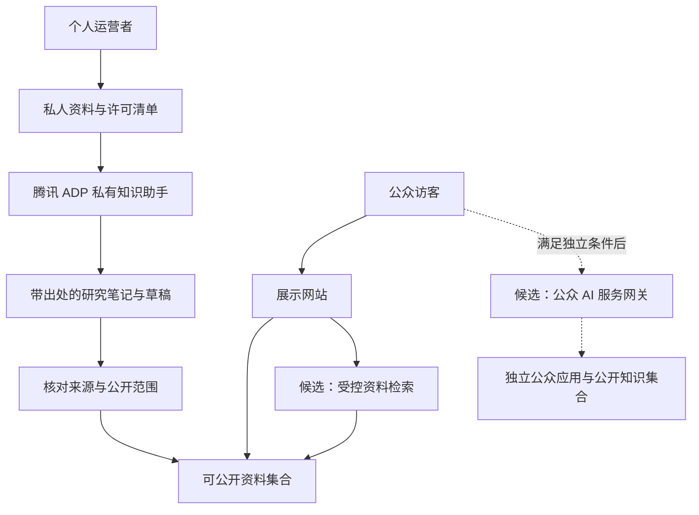

# 弯弯：个人运营与公众 RAG 可行性综合评审

版本：3.0｜研究日期：2026-11-12｜本轮只研究和调整文档，不开发代码。

> 范围补充：本评审为未来公众 RAG 的条件研究，当前执行以[项目计划书 v5.0](./项目计划书.md)、[产品需求](./产品需求与内容规范.md)、[技术方案](./技术架构与实施方案.md)和[知识导航版权边界](./个人运营与版权边界.md)为准。用户已确定首版手动精选录入，不自动采集；Halo / Spring Boot 提供 Web 和原生小程序的公开题录与自写介绍。公众 RAG 后置，后台 AI 也不作为上线依赖。下文六条路线不是六项同时开发的任务。

本评审从法规、平台合同、产品、数据、技术和个人运营六个视角讨论。属于基于公开资料的桌面分析，没有外部律师、医学专家、监管部门或云厂商参与审议，也没有实际账号开通和付费测试。文中的法律要求、平台条件、项目建议与待核实事项分别表述。

## 1. 先回答：使用腾讯云能否解决个人的困难

**可以显著减少技术建设和运维困难；不能把自己的内容、数据和公众服务责任整体转给腾讯。**

对本项目，托管 RAG 的价值在于减少文档处理、索引、检索、模型接入和运行维护。真正决定个人能否对外运营的，还包括实际输出是不是专业医疗内容、有没有合法来源、是否处理用户健康信息，以及个人账号和公众发布渠道是否满足相应条件。

腾讯 ADP 的合同提供了直接依据：第2.6（1）项对医疗等专业咨询提出专业人士审核输出及用户告知的条件；第2.10项说明平台内容审核不免除客户的相应责任。第2.1项还要求客户履行适用的备案、许可等义务。[ADP 服务条款](https://cloud.tencent.com/document/product/301/104939/)

据此，不能把“通过腾讯云审核”“模型已有备案”“使用国内服务器”“不收费”中的任何一项，单独等同于“个人医学 RAG 已具备对外运营条件”。也不能反过来推导为个人绝对不能开发任何公众 RAG。

本版保留公众 RAG 的可能，评估不同实现和发布路径。v2.0 的后台 AI 路线继续作为可比较的低复杂度方案，不再把它当作唯一可能的法律结论。

## 2. 当前已经确定与尚未确定的事

| 事项 | 本轮状态 |
| --- | --- |
| 开发和日常运营 | 个人承担，AI 辅助开发不改变实际责任 |
| 医疗专业资格 | 用户已明确没有，以家长、整理者身份运营 |
| 服务对象 | 面向全国的孕妇和家庭，最初聚焦足内翻资料需求 |
| 网站部署意向 | 中国大陆部署、个人备案 |
| 主办者备案归属 | 尚未提供具体省份；“全国”是受众范围，不是个人备案归属 |
| 公众 AI | 后续独立评估开发，当前不开放；不作为知识导航首版依赖 |
| 资料录入 | 用户已确定逐篇手动精选，公开题录、自写简短介绍和合法来源入口 |
| 当前建站 | Halo / Spring Boot，Web 主题与微信原生小程序共用内容 |
| RAG 采购偏好 | 后续优先成熟国内第三方，重点腾讯；当前不需开通采购 |
| 医生、医院、专业审核合作 | 未提供实际合作与授权证明 |
| 现有验证 | 文档和公开资料研究；没有监管书面确认、账号内验证或正式上线 |

本轮不因受众覆盖全国而逐省办理网站备案，也不虚构某省已经接受该项目。实际应以真实主办者所在地、接入方式和具体业务处理。

## 3. 全项目文档重新审阅后的主要问题

审阅材料包括 GitHub 原计划书、原技术方案、原三方审查、两个阅读入口、本地 v1.0、两份 v2.0 以及用户粘贴的 BBS/RAG 方案。源文件目录见[项目文档总目录](./项目文档总目录与决策记录.md)。GitHub 快照固定为提交 `b7af6630b6aeb58651941267e171e542a0c48eb3`。

### 3.1 原商业计划书的价值与不适配之处

原文抓住了资料分散、同一问题反复沟通、原始出处丢失和阶段信息衔接的问题。这些需求仍有价值。

但它预设专业内容审核、家庭授权、资料恢复、社区处理、医生导航核实和机构服务等工作有人持续承担。一个人可以兼任编辑与工程角色，不能因此把产前诊断、遗传、小儿骨科等专业职责自动合并成自己具备的能力。

原计划的43个复杂场景适合作为需求覆盖材料，不能转换为43套个人自动化医疗服务。原计划对没有真实访谈、没有医生审核、没有机构签约的状态说明应保留，不因换成腾讯 RAG 就更改为已完成。

### 3.2 原技术方案和 v1.0 过早决定了系统规模

原技术方案围绕档案、家庭权限、检查项目、任务和论坛，v1.0 又围绕 Java、Dify、引用与会话增加了大量实现要求。这些设计可以服务另一种产品，但不是当前个人展示站和待评估公众 RAG 的必要前提。

更换 RAG 平台不能解决原始产品范围过大的问题。应先决定具体对外服务，再选择所需后台、数据库与云产品。

### 3.3 v2.0 降低了负担，但收缩不是唯一答案

v2.0 将公众端收缩为展示与搜索，适合先开展低复杂度验证。然而，“后台 RAG”只是其中一条路线。用户仍希望研究公开 RAG，就必须比较受控检索、平台内知识分享、自有应用和专业合作等不同路径。

另外，不能仅从备案管理办法中列有“医疗保健”等字样，直接推断历史上的某张医疗信息审核同意书今天仍然需要办理。该问题须结合审批取消记录重新分析。

## 4. 必须分开的四层规则

第一层是法律、行政法规及现行监管文件；第二层是云服务、模型和内容平台合同；第三层是实际接入商、小程序和备案渠道的审核要求；第四层是项目自己的风险控制设计。

| 判断 | 应如何处理 |
| --- | --- |
| 法律规定某项实际业务需要条件 | 满足对应条件，不能以云厂商能力代替 |
| 腾讯合同限制某类专业咨询 | 即使技术上可调用，也须满足平台条件；不能靠换页面名绕开 |
| 接入商不承接某种个人网站 | 先核对其具体规则；不将它解释为全国一律禁止 |
| 本项目先不开放某功能 | 是当前产品决定，不能写成法律禁止所有人做 |

### 4.1 论坛不是本轮的法律前提

不能认定全国所有论坛均被禁止。信息发布服务有账号和内容管理要求，但本项目移除论坛，主要是为了避免个人承担不必要的社区运营。[网信办账号管理说明](https://www.cac.gov.cn/2022-06/26/c_1657868775333429.htm)

### 4.2 历史审批不能照搬

查到的黑龙江省政府正式文件明确依据国发〔2015〕57号取消“互联网医疗保健信息服务审核”，并要求加强事中事后监管；北京也有对应取消公告。它们足以说明，不能只拿旧的2009年规章或旧办事页，就认定所有此类网站今天仍须取得原审核同意书。[黑龙江省政府文件](https://www.hlj.gov.cn/hlj/c108379/201605/c00_31180880.shtml)、[北京市取消公告](https://zyj.beijing.gov.cn/sy/tzgg/201912/P020191219588638517684.pdf)

这不是“全部健康内容不再有任何要求”的结论。现行备案、医疗科普、诊疗、广告、个人信息与平台合同仍要按实际业务分别判断。也不能仅凭上述一份省级实施文件，声称已经穷尽全国当前的办事口径。

### 4.3 医疗科普不等于诊疗，也不等于一般资料导航

2025年四部门通知对平台上的医疗科普账号资质核验和内容发布提出要求。独立网站具体如何适用，仍须结合业务核实，不能既不核实就宣称不受约束，也不能扩张为个人不得讨论任何健康经历。[医疗科普通知](https://www.cac.gov.cn/2025-08/01/c_1755764425442686.htm)

对于个体诊疗，国家卫健委规则对机构、人员与执业活动有相应要求；AI不能替代医师提供诊疗。项目是否触及该范围看实际服务，不能仅凭“健康助手”名称或免责声明决定。[互联网诊疗监管细则](https://www.nhc.gov.cn/yzygj/c100068/202203/2072f0e8988249e59d942e1b2a933916.shtml)

### 4.4 公众 RAG 的规则取决于实际服务

《生成式人工智能服务管理暂行办法》第二条以向境内公众提供生成内容服务为重要适用界限，第二十二条的提供者定义包含组织和个人。因此，不能从主体定义推出“所有个人均被排除”，也不能从“个人”二字推出实际登记、渠道审核和行业条件都一定能够满足。[暂行办法](https://www.cac.gov.cn/2023-07/13/c_1690898327029107.htm)

模型备案、算法备案、安全评估、生成式 AI 应用登记、网站或 App 备案不是同一手续。网信办公告明确存在直接调用已备案模型的应用或功能由地方网信办开展登记的路径；本项目是否适用、个人如何办理及需要哪些材料，仍未核实完成。[网信办公告](https://www.cac.gov.cn/2026-01/09/c_1769688009588554.htm)

登录、白名单、邀请或仅几十位访客，不自动使对外服务变成内部使用。不能通过把开放问答称为测试就跳过实际适用条件。

## 5. 腾讯承担什么，个人仍承担什么

以下为本项目的责任划分分析，不替代具体采购合同，也不预先认定腾讯在个案中的责任。

| 工作或问题 | 采用成熟腾讯托管服务可减少的工作 | 个人仍需承担或核实 |
| --- | --- | --- |
| 模型运行 | 不必自行维护大模型推理集群 | 选择合适服务与版本、设置预算、处理故障 |
| 文档解析与检索 | 使用平台内置能力，减少自建索引 | 核对论文是否被正确解析、引用能否查回 |
| 通用内容安全 | 可利用平台拦截与审核机制 | 不把审核通过当作医学准确、版权许可或合法性证明 |
| 模型和平台合规 | 供应商处理其自身适用事项 | 核实实际调用服务及本应用的覆盖范围 |
| 网站主体与渠道 | 可能获得备案接入和渠道工具支持 | 真实提交主办者资料与业务，满足本应用条件 |
| 医疗内容 | 可以配置输出限制和来源 | 自己没有资格不会因此获得资格；专业服务条件另行满足 |
| 文献使用 | 平台帮助处理已上传资料 | 资料权利依据、允许何种云端处理和对外展示 |
| 健康数据 | 平台提供存储与访问控制能力 | 最小收集、合法处理依据、告知、授权、删除与供应商安排 |
| 公开事故 | 可能获得技术工单和诊断支持 | 用户反馈、内容撤回、纠错、通知与相应责任 |

采购的是技术服务，不是项目经营责任的整体转移。平台可能因违规内容限制服务；购买付费套餐也不保证任何具体内容永远可以运行。

## 6. 腾讯合同对本项目的具体影响

ADP条款要求客户核实上传材料的权利与个人信息处理条件，并说明第三方模型或工具可能有独立约定。对本项目，应分别确认内置模型、自定义接入、插件、联网搜索与存储实际涉及哪些服务，而不单看“腾讯云”品牌。[ADP 服务条款第1.4、2.8等项](https://cloud.tencent.com/document/product/301/104939/)

本项目不能仅凭“论文有引用”把连续生成的医学意见视作已经完成专业审核。审核论文来源、审核固定 FAQ、审核每次模型新生成内容，是三种不同工作。哪种安排能够满足具体服务场景及合同，应取得平台说明，不能自行把一次性审核理解为覆盖无限追问。

自有网站正常通过官方 API 集成，与直接出售平台账号或密钥也不是一回事。应使用产品支持的集成方式，保留自身服务边界，不把密钥交给访客，更不能借别人的资质或账号对外经营。

## 7. 不同公众功能的实质差异

| 用户看到的行为 | 实际功能 | 对个人可行性的判断 |
| --- | --- | --- |
| 搜索某主题后得到文献题录和来源链接 | 资料检索 | 更适合作为首个公开范围，仍核对内容与权利 |
| 找到某篇论文中的页码和原文短摘录 | 原文定位与引用展示 | 需要检索质量与摘录使用权；不因没有生成就当然免责 |
| 点击问题后展示固定、核对过的答复 | 预先发布的 FAQ | 版本可控，但专业内容发布条件仍存在 |
| 自然语言查询后显示已发布资料列表 | 语义检索 | 可研究，用户获得的是资料，不是新医学结论 |
| 实时解释“VUS是什么意思” | 生成式专业知识解释 | 不能仅因属于通用概念，就认定无需专业内容审查 |
| 比较研究结果并推断孕妇适用哪一结论 | 医学证据分析与个体适用判断 | 超出单纯导航，应单独评估专业、合同与数据条件 |
| 输入本人的报告，得到确诊、风险或检查建议 | 个体健康判断，可能触及诊疗 | 当前个人、无资质、无专业承接条件不支持直接推出 |
| AI回答如何整理文件名或定位网站某份公开材料 | 非医疗的资料与站点使用辅助 | 可作为较窄公众生成应用候选，仍核实平台与应用要求 |

“资料导航”和“医疗建议”的区别必须体现为实际输入与输出，不能只改标题。医院须知中也可能包含禁食、用药等医疗指示，不能将整个就诊须知库一概认定为纯行政信息。

## 8. 六条路线的大讨论

### 路线 A：私人知识库，公众只展示资料

**支持理由：** 个人先得到真实 RAG 价值；公众服务链路可独立运行，内容核对与撤回容易控制。

**反对理由：** 不能直接验证访客是否需要实时问答，网站看起来可能与普通导航站相近。

**评审意见：** 作为启动与保底路线保留，不把它写成公众 RAG 的永久禁令。可以先验证论文处理质量，再决定公开什么。

### 路线 B：在腾讯官方产品内分享知识库或助手

**支持理由：** 若产品明确支持该类个人账号及知识分享，可能减少自建登录、界面、调用控制与平台运营工作。

**反对理由：** 平台内分享也属于可能面向公众的传播或生成服务；是否覆盖医疗内容、文献版权及应用登记不能凭入口属于腾讯推断。平台账号规则和知识库发布规则还可能不同。

**评审意见：** 值得向平台核实，特别适合个人先了解真实发布条件。但本轮没有确认具体产品允许无医疗资质个人公开医疗问答，不能直接推荐为规避途径。

### 路线 C：自己的展示站，增加受控的证据检索

**支持理由：** 保留自然语言查找资料、主题筛选和原文定位的价值，减少持续生成新医学结论的不可控范围。

**反对理由：** 它主要是检索服务，不是完整的检索增强生成问答；如果最后又自由改写原文，生成服务的问题仍会回来。

**评审意见：** 最值得先研究的公众升级路线。明确输出为资料卡、来源、授权摘录与固定内容，不把它包装成 AI 已判断用户情况。是否可上线仍需按内容、合同和具体渠道核实。

### 路线 D：自己的 Web / 小程序，接 ADP 公众 RAG

**支持理由：** 最贴近原始目标，能统一品牌、内容、检索来源与交互；第三方承担大量基础技术工作。

**反对理由：** 个人要面对应用登记、渠道、内容与数据治理、费用滥用、误导纠正等问题。专业咨询还受供应商合同约束。公众号或小程序也不会因为使用官方 SDK 就自动批准。

**评审意见：** 保留有条件可行性，不立即否定，也不认定现已具备上线条件。先确定具体答复范围，再核实个人主体申请路径及医疗内容安排。若不能持续满足专业审核要求，就不能以 RAG、免责声明或腾讯接口替代。

### 路线 E：缩小成非医疗咨询的公众 RAG

**支持理由：** 个人仍能对外提供生成能力，例如本站资料使用、题录查找、一般文件整理等，专业医疗咨询的范围明显缩小。

**反对理由：** 可能偏离家庭最初想要的医学解释；开放问题容易被追问到报告与治疗。

**评审意见：** 作为真实候选。必须有明确越界处理，不能在宣传中承诺“任何孕期问题都能问”。仍要核实公开生成应用条件，不把缩小范围等同于免除所有登记和治理要求。

### 路线 F：真实专业合作方承接医疗内容或服务

**支持理由：** 可以保留更强的医学解释价值，补齐个人没有的专业参与与真实服务供给。

**反对理由：** 合作、成本和责任协调可能超过当前个人负担；成立公司、挂一个医生名字或借证并不能自动解决。

**评审意见：** 作为独立业务分支。区分文章审阅、生成输出审核和实际诊疗，由真实主体按各自条件承担；不要为了使用 AI 先虚构合作或提前搭建全流程医疗平台。

## 9. 国内技术方案比较

以下比较的是当前项目适配性，尚未完成各平台账号内功能验证，不能据此推断某家平台比其他平台在法律上更宽松。

| 方案 | 适合承担的工作 | 个人困难仍在哪里 | 本项目位置 |
| --- | --- | --- | --- |
| 腾讯 ADP | 托管知识库、应用和未来 API 集成 | 个人账号具体权限、专业场景条款、数据和对外发布条件 | 有程序接入目标时优先验证 |
| 腾讯 CloudBase AI | 微信、多端模型接入与自定义 Agent | 需要确认具体知识库模式，可能仍有开发与检索配置 | 小程序优先或需要云开发一体化时备选 |
| 腾讯 ima | 个人资料阅读、笔记和知识整理 | 系统 API、分享与专业内容条件未核实 | 单纯个人研究时先比较，不假设它是完整后端 |
| 阿里云百炼 | 托管知识库、检索与应用接口 | 实名、地域、对外应用及第三方模型条款仍须核实 | ADP 的主要技术备选，不作为法律规避替代品 |
| 百度千帆 Agent / AppBuilder | RAG、工作流及应用开发 | 产品版本、个人权限与公开发布条件仍须确认 | 备选，不增加第二套必须维护的平台 |
| Dify / RAGFlow 自托管 | 高度控制处理链路与迁移 | 自己维护服务、升级、备份、解析与全部应用责任 | 当前个人条件下后置 |

腾讯 ADP 的技术能力、CloudBase 的多端能力与 ima 的个人知识定位分别有官方资料说明。ADP当前优先，是因为本项目希望减少自建 RAG 并保留微信生态和未来集成，并非因为它替项目担保合规。[ADP 产品页](https://cloud.tencent.com/product/adp)、[CloudBase AI](https://docs.cloudbase.net/ai/introduce)、[ima](https://ima.tencent.com/download)

阿里百炼有文档知识库与接口，协议同样保留用户独立判断和专业场景责任；百度也提供知识与应用开发并有独立用户协议。换供应商可以改善功能、费用或采购适配，但不能直接解决运营者缺少专业审核的问题。[百炼知识库](https://help.aliyun.com/zh/model-studio/rag-knowledge-base/)、[百炼协议](https://terms.alicdn.com/legal-agreement/terms/common_platform_service/20230728213935489/20230728213935489.html)、[百度产品文档](https://cloud.baidu.com/doc/APPBUILDER/index.html)、[AppBuilder 协议](https://ai.baidu.com/ai-doc/AppBuilder/Blugru3ag)

## 10. 全项目功能逐项处置

| 原有功能 | 当前个人版处置 | 理由或重新进入条件 |
| --- | --- | --- |
| 按阶段阅读与原始资料导航 | 保留并核实公开范围 | 与核心查找资料任务一致 |
| 论文题录、来源、版本与勘误 | 保留 | 不自动扩展成全文公开和医学解释 |
| 私人论文 RAG | 可选后续工具，不作为首版依赖 | 使用前验证授权材料的处理与平台条件 |
| 公众语义资料检索 | 后续候选；首版仅普通关键词检索 | 严格限定公开资料与输出格式 |
| 公众生成式论文问答 | 保留有条件路线 | 确认主体、合同、审核、标识、数据与运行责任 |
| 自动报告解读、风险推算、检查决策 | 当前不进入个人首版 | 未具备相应证据与专业服务条件 |
| 病历、遗传和儿童记录 | 暂缓 | 敏感数据与长期维护负担并未因云托管消失 |
| 家庭协作、授权撤回、就诊包 | 暂缓 | 原来是独立且复杂的产品线，并非RAG必要功能 |
| 论坛、投稿、评论与私信 | 当前移除 | 用户已转向展示站，也缺乏持续社区运营必要性 |
| 医生目录 | 可研究纯官方导航 | 不做未经证实的合作、号源、排名或效果承诺 |
| 正式预约、会诊、治疗承接 | 暂缓 | 没有实际机构受理与责任安排 |
| 检查、支具与服药等提醒 | 不作为当前首版 | 个人不应替代真实医嘱与可靠的临床提醒体系 |
| 原生小程序 | 保留双端目标，独立核实类目及原文入口 | Web 可跳原站不表示小程序能任意外跳；公众号不是新增必需产品 |
| 付费问答、转介、广告与商品 | 暂不作为成立前提 | 商业与行业条件需单独验证 |
| 内容下线、反馈、备份与成本上限 | 必须有可执行方案 | 个人实际能否承担运营的直接证据 |

## 11. 医学、论文和用户数据三项不能混用

### 11.1 医学质量

论文存在、引用正确、模型回答符合原文、内容适用于某位孕妇，是不同层次。RAG主要改善材料访问与生成依据，不自动证明最后一层成立。

个人不能将模型互相审查、提示词中的“你是医生”或一次引用检查，写成真人医学审核。若开放专业解释，先落实真实专业参与及其覆盖范围，再决定允许哪些追问。

### 11.2 论文权利

为个人研究使用已发表作品的情形，与搭建面向公众的论文服务不同。《著作权法》第二十四条有适用条件，不能仅因运营者是个人、网站免费，就把全部对外展示纳入个人学习。[国家版权局公布的著作权法](https://www.ncac.gov.cn/xxfb/flfg/flfg_532/202103/t20210309_50530.html)

每篇材料记录：来源、许可、是否允许云端处理、是否允许摘录展示、是否允许翻译或改写、是否允许全文下载。开放获取、机构订阅、作者提供和可在网页阅读，不能简单当作完全相同的使用许可。具体法律例外和许可覆盖需要结合材料判断，而不是机械地认为每次私人阅读都必须另购授权。

### 11.3 用户信息

即使关闭上传，只要允许自由提问，用户仍可能输入病情、孕周、遗传结果和儿童情况。与账户、联系方式等结合后，可能涉及敏感个人信息。不能仅以没有附件或未要求实名就认定没有健康数据。[个人信息保护法](https://nmca.miit.gov.cn/zwgk/zcwj/flfg/art/2021/art_0bb3c8d9e620423fb4deeb85e1b751c5.html)

本项目优先不收集个体资料，公开检索尽量不保存完整问题历史。真正开放生成时，再明确哪些内容送给哪一服务商、处理依据、保存时间、访问与删除。去掉姓名不必然匿名，罕见表型与家系组合仍可能识别个人。

## 12. 适合个人的分层架构

本图保留为 RAG 条件研究结构，实线也不再表示首版必须建设。当前实际架构以[技术方案](./技术架构与实施方案.md)中的 Halo 手动精选导航为准。私人研究应用与未来公众应用分别配置内容，不能将内部论文、测试草稿或权限不明材料一起开放。

用户已重新明确 Spring Boot 与双端目标，因此当前建站采用 Halo＋主题＋原生小程序及其支持的数据库，首版搜索仅覆盖公开资料卡。未来确定路线 D 时再增加服务端 AI 适配、配额与范围控制；不重复建设另一套 CMS，也不把内部知识库作为公开站前置条件。

ADP负责一次完整RAG生成时，不再同时让Spring AI或另一个平台重复生成。平台提供模型并不要求自建向量库；实际模型版本、地域和处理条款按账号核实。上线公众生成也不等于把平台 AppKey 放进浏览器。

## 13. 个人运营真正需要算的账

总负担包括平台费用、资料使用许可、专业审核、内容更新、投诉处置和故障维护。AI降低其中一部分工程工作，并不意味着一个人能持续完成全部工作。

最容易低估的是：原文错位与撤稿处理、模型把通用研究套到个人、用户持续追问个体结果、费用被滥用，以及运营者临时无暇处理问题。

内部工具可以在自己有时间时使用；对外实时问答会形成连续服务。若采用的专业审核模式要求经审核再展示，就必须评估其响应时间与成本；不应先承诺即时回答，再用没有真实可用的审核流程补文档。

对比供应商时，使用相同的20—30篇代表资料及实际问题，记录解析、引用、删除、费用与人工修正耗时。只有个人能完成这些操作，平台成熟才真正转化为本项目可运营。

## 14. 对原商业计划书的章节处理

| 原章节 | 本次处理 |
| --- | --- |
| 投资概要、1—3：需求、用户、市场 | 保留需求观察；删除用未验证市场支撑完整平台投入的推论 |
| 4：全过程地图 | 改为主题与信息需求地图，不作为自动诊疗路径 |
| 5—13：检查、遗传、治疗和随访 | 作为内容研究主题，未获专业条件的部分不直接自动生成或公开解释 |
| 14—16：小程序、演示、论坛 | 改为展示、检索和公众RAG候选路线；论坛演示不再是首版交付 |
| 17：医生和多学科服务 | 区分公开导航、内容审阅和真实诊疗，未合作部分不做服务承诺 |
| 18：论文知识库 | 保留并升级许可、引用、公开与私人集合分离 |
| 19—20：商业和获客 | 改为个人可负担验证，不预设付费医疗业务、医院合作与全国服务能力 |
| 21—23：实施、人员和研究 | 从多人职责表改为实际能完成的关卡；不能把缺少专业人员写成AI已替代 |
| 24—33：专业分工、43场景与审阅 | 作为未来专业合作任务库，不能生成虚构顾问与审核结论 |
| 34—38：问题推进与参考产品 | 只保留资料查找、整理和沟通准备；真实医疗结果不由网站判断 |
| 39：技术落地 | 以托管RAG、可控公开范围和个人维护能力重新选择技术 |

原文最应保留的原则是原始出处、真实未知、可纠错和不虚构验证，不是原文的全部模块数量。

## 15. 需要供应商与属地明确回答的问题

以下是形成可行性证据的问题单，不是本轮已经发送的工单。

### 给腾讯 ADP

1. 个人实名账号是否允许建立并发布该内容范围的公众应用？使用平台体验页和自有Web/API集成是否分别有条件？
2. 如果只做论文目录、原文定位和固定资料返回，平台如何界定？如果现场生成医学知识解释，第2.6（1）项的专业审核条件如何落实？
3. 该应用应由谁办理适用的登记和标识事项？能提供哪些实际调用模型、协议和备案证明材料？
4. 哪个套餐实际包含本项目所需知识库、模型、API和访问控制？是否有明确的费用上限、停止调用与数据导出能力？
5. 所选模型、解析、存储与日志在哪处理，是否涉及额外第三方？用户数据与上传文献的使用、留存和删除条件是什么？

### 给接入商和属地相关部门

以真实主办者所在地和样例页面说明：个人站提供的是资料导航、语义检索还是生成式专业解释；是否收集个体信息；免费或收费；是否接小程序。分别核实网站备案、生成应用条件及专业内容要求，不把多个问题笼统合成“能不能做AI网站”。

不借证、不挂名、不通过移到境外或换一个云平台来宣称解决境内公众服务的全部问题。若某条路确实不能满足条件，应缩小功能或改变真实业务组织，而非隐藏实际用途。

## 16. 不写代码的下一步

当前先完成知识导航文档与真实资料的编辑样例，验证 Halo 资料卡表达、双端查找及小程序入口，核实实际备案所在地与渠道条件。无需为了普通资料目录先向腾讯开通 AI 或上传论文。

未来重启 RAG 研究时，再选取真实问题区分资料定位、固定内容、专业解释和个体判断，用有适当权利的样本向腾讯核实并测试。六条候选保留为后续决策资料，当前不恢复论坛或医疗业务系统开发。

## 17. 本轮结论与限制

后续若评估公众 RAG，腾讯 ADP 仍为优先候选，理由是减少工程维护，而非规避责任。没有医疗资质、真实专业审核和明确公众发布路径的现状，尚不足以认定独立站持续生成医疗咨询已具备上线条件。此结论针对当前证据，不是宣布所有个人公众 RAG 都违法。当前知识导航不承担这些生成服务。

若用户希望在不增加医学合作负担的情况下先公开，应优先核实受控资料检索或非医疗咨询的窄范围生成；如果确实需要对外医学解释，就把专业审核、平台条件与应用路径作为产品必要部分，而非上线后的补充材料。

仍未核实：个人实际账号的开通与发布权限、具体省份办理口径、平台对本项目问答范围的正式判断、专业参与安排、全文许可清单及真实样本质量。本轮不据此给出已合规、已备案或能够全国无条件运营的结论。
