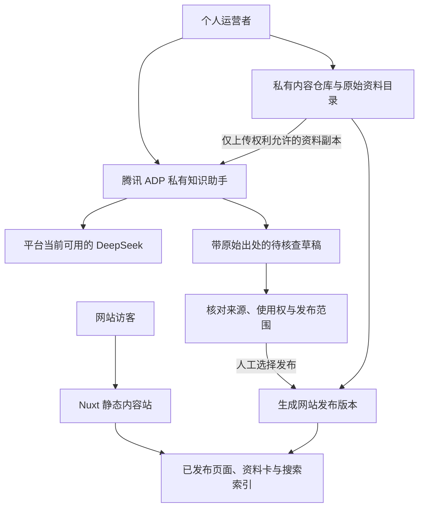

# 弯弯：个人运营版产品与技术方案

> 历史路线，不作为当前选型与验收依据。正文中的静态 Nuxt、取消 Spring Boot 必须项及后台 ADP 优先等决策均已被替代。当前为手动精选知识导航、Halo / Spring Boot、Web＋原生小程序，RAG 后置且后台 AI 非首版依赖。请阅读[当前计划书](./项目计划书.md)、[当前技术方案](./技术架构与实施方案.md)及[当前版权边界](./个人运营与版权边界.md)。原医疗信息审批的历史问题以[综合评审](./个人运营与公众RAG可行性综合评审-v3.0.md)的修正为准。

版本：2.0 选型与方案调整稿｜核查日期：2026-11-12

本轮只调整产品、选型和文档，不进行代码开发、产品开通、付费购买或公开部署。本文取代 v1.0 中关于首版 BBS、公众论文 AI 问答和自托管 RAG 的决策；原有代码与旧文档仅作为历史资料，不代表本版将继续采用。

## 1. 已确认的项目条件

运营者为个人，以家长、资料整理者身份开发和维护，没有医疗卫生相关专业背景或执业资格。计划采用中国大陆部署与个人备案。首版公众端只展示与搜索已发布内容，不开放论坛、评论、私信、病历上传或公众 AI 问答。DeepSeek 用于后台资料整理，RAG 优先采用腾讯成熟托管服务。

因此，项目定位改为：**面向孕妇与家庭的公开资料导航、就诊资料整理方法和个人经历展示网站。**

项目不是互联网诊疗平台，不以“医学专家”“医生团队”“风险评估系统”宣传，也不把个人核对写成专业医学审核。凡涉及诊疗解释或专业医疗科普的内容，不能仅靠更改页面名称、添加参考文献或声明“仅供参考”解决发布条件。

本版不以公司融资、医院采购、机构合作或多人协作作为成立前提。软件是否由 AI 编写，不改变运营主体、内容责任、采购条件和维护需求。

## 2. 本版技术决策

| 对象 | 本版决定 | 理由 |
| --- | --- | --- |
| 网站形态 | 编辑发布的内容展示站 | 与个人维护能力及首版只读范围一致 |
| 论坛底座 | 不采用 OpenIsle 作为新站底座 | 不再需要账号、帖子、评论、社交与论坛运维链路 |
| Web | Vue 3 / Nuxt，优先静态生成 | 保留既有 Vue 方向，方便内容分享、搜索收录与移动阅读 |
| 内容来源 | 私有内容仓库中的 Markdown / 结构化目录 | 版本可追踪、备份简单，初期不需另做完整 CMS |
| 公众搜索 | 发布时生成的静态搜索索引 | 仅搜索公开内容，不调用生成模型，不检索私有论文全文 |
| 腾讯知识库 | ADP 为首选验证对象 | 将文档处理、检索与模型调用交给托管平台 |
| 生成模型 | 优先选择 ADP 控制台当前可用的 DeepSeek | 不同时维护腾讯调用与 DeepSeek 官方直连两套链路 |
| CloudBase AI | 作为备选，不与 ADP 重复建设 RAG | 适合后续小程序、自定义 Agent 或一体化云开发需要 |
| Spring Boot | 取消首版必须项，作为后续轻量后台选项 | 没有公众账户和动态业务时，不必维护常驻业务服务 |
| MySQL、Redis、消息队列、OpenSearch | 不列入首版基础设施 | 现阶段不存在必须使用这些组件的业务负载 |
| Dify、RAGFlow、独立向量库 | 首版不部署 | 避免个人维护重复知识库与模型基础设施 |
| 微信小程序 | 作为后续独立发布关卡 | Web 可运行不表示个人小程序类目和资质已通过 |

**正式推荐路线：Nuxt 静态内容站＋静态站内搜索＋腾讯大陆托管资源＋ADP 私有知识助手。**

“静态”指访客读取预先发布的页面与搜索数据，并非无法更新。运营者更新、核对内容后重新发布即可。公开网站不需要等待 ADP、DeepSeek 正常运行才能被阅读。

## 3. 政策条件如何影响产品

### 3.1 不使用“论坛全国一律禁止”作为法律结论

互联网信息发布涉及账号核验与内容管理等要求，不能概括为所有论坛均被禁止。本项目不采用论坛，是个人维护负担与功能必要性的选择。属地及接入商是否承接某类个人网站，应依据实际功能确认，不能将某一家服务商的限制直接等同于全国法律。[网信办账号信息管理规定说明](https://www.cac.gov.cn/2022-06/26/c_1657868775333429.htm)

### 3.2 个人备案不等于医疗内容许可

现行《非经营性互联网信息服务备案管理办法》第十一条对医疗保健等依法需要主管部门审核同意的服务，设有相应材料要求。是否涉及该要求，应按网站实际栏目、功能及业务内容判断。不能提前承诺“个人备案后即可发布全部孕期知识”。[工信部现行办法](https://www.miit.gov.cn/zcfg/xxtxl/art/2024/art_7c8cc677bfb7433e93e31bbad81142ef.html)

准备备案时应以真实内容提交网站介绍和样例页面。需要向属地通信管理局、接入商核实的输入是具体栏目与功能；涉及专业医疗内容性质的，再向属地卫生健康部门核实。不得通过隐藏真实用途或使用无关网站名称获得备案后再恢复原功能。

### 3.3 个人资料整理与专业医疗科普需要分别处理

2025 年四部门《关于规范“自媒体”医疗科普行为的通知》对网站平台的医疗科普账号资质核验、专业内容发布和来源标注作出明确要求。它针对的平台账号管理场景，不能简单扩张为“任何个人都不能提及健康”，也不能据此声称个人自建站天然不受相关要求约束。[通知原文](https://www.cac.gov.cn/2025-08/01/c_1755764425442686.htm)

据此作出的本项目保守设计是：优先展示真实来源的导航信息、资料管理方法和清楚标明的个人经历；不由无资质运营者生产疾病风险判断、治疗方案或专业论文临床解释。增加真实专业参与后，也应核实内容与运营要求，不能以一次专家审稿替代全部上线条件。

### 3.4 后台 AI 和公众 AI 是两个范围

首版 AI 仅供运营者内部检索与草稿整理，不向访客提供生成式问答。未来开放公众 AI，需要重新评估产品适用义务、应用登记、内容标识及健康服务边界；使用腾讯或已备案模型不会自动代替这些事项。[生成式人工智能服务管理暂行办法](https://www.cac.gov.cn/2023-07/13/c_1690898327029107.htm)、[网信办关于模型备案和应用登记的公告](https://www.cac.gov.cn/2026-01/09/c_1769688009588554.htm)

仅将 AI 放在后台，不意味着其生成内容可以无条件公开。对外发布仍保留 AI 参与记录，依据适用规则标注来源及生成合成信息，不恶意删除原有标识。[人工智能生成合成内容标识办法](https://www.cac.gov.cn/2025-03/14/c_1743654684782215.htm)

本节是方案约束与待核实事项，不是本项目已取得备案、许可、专业认证或正式法律意见的声明。

## 4. 公众网站应该展示什么

### 4.1 页面结构

| 页面 | 用户任务 | 内容边界 |
| --- | --- | --- |
| 首页 | 快速找到当前需要的资料 | 清楚说明家长整理身份，不展示虚构医生背书 |
| 按阶段浏览 | 在首次发现、等待、就诊准备、出生后等主题间定位 | 阶段是信息分类，不是系统判断的诊疗路径 |
| 权威来源导航 | 找到医院、卫健部门、学会的公开原始信息 | 标明发布机构与原始链接，避免复制整站内容 |
| 就诊资料整理方法 | 整理文件、日期、疑问和沟通记录 | 说明怎样整理，不替用户决定做哪项检查 |
| 论文目录 | 找到题名、作者、年份、来源和全文入口 | 不默认公开 PDF，不自行给出个体概率或临床结论 |
| 个人经历 | 阅读运营者自愿公开的经历 | 明示自述与时间，不冒充普遍疗效证据 |
| 站内搜索 | 找到已发布页面与资料卡片 | 结果是链接与固定摘要，不是模型现场作答 |
| 关于、来源与勘误 | 理解运营者身份并报告错误 | 提供明确的反馈方式与纠错说明 |

若“专业医疗科普”栏目尚无明确合规发布路径，则暂不建设，不用“知识”“孕妇必看”等名称掩盖相同内容。

### 4.2 一张资料卡的字段

题名、资料类型、原始发布者、作者（可核实时）、原始发布日期、来源 URL、整理日期、最近检查链接日期、适用主题标签、简短的目录说明、使用权记录、AI 参与情况和公开状态。

“最近检查链接日期”仅表示链接或题录得到核对，不等于医学内容已更新到该日期。运营者核对称为“来源核对”或“编辑核对”，不能标注为“医生审核”或“医学审定”。

### 4.3 搜索结果

搜索只覆盖公开资料卡与本站可发布正文。用户搜索“羊穿”时，返回相关资料入口及其固定说明，不现场生成“你应该做羊穿”等建议，也不以 AI 为用户自动选择检查方案。

查无资料时说明没有匹配页面，提供修改关键词和浏览主题入口。不能在无结果时悄悄调用 ADP 生成答案，因为那会改变已确认的公众服务范围。

## 5. 腾讯方案的事实核查与选择

### 5.1 ADP：首选验证的托管 RAG

腾讯官方提供基于 DeepSeek 和知识库的应用创建说明，涵盖文档上传、解析入库、来源查看和应用调用。产品页也列出了面向个人测试与个人开发者的套餐。[DeepSeek 知识库实践](https://cloud.tencent.com/document/product/1759/116007)、[ADP 产品页](https://cloud.tencent.com/product/adp)

这支持将 ADP 作为候选，但不等于本人的账号已能使用全部功能。实际开通时仍需核实：个人实名认证适用性、应用模式、模型清单、可用地域、知识容量、API 套餐权益和内容使用条款。营销页中的“医疗行业案例”也不意味着个人运营者获得医疗业务资质。

本项目首先使用 ADP 控制台建立私有知识助手，任务限定为内部检索、题录整理、原文定位、对比不同材料及形成待核查草稿。关闭面向公众的体验链接或渠道；如果平台运行要求发布应用版本，应明确区分“应用版本可运行”与“允许公众访问”，验证 AppKey、体验链接和渠道的实际访问控制。若套餐不能保证内部使用边界，则先不要导入受限资料。

### 5.2 CloudBase AI：不是必须再加一套

官方简介确认支持多模型和多端调用，包含小程序、Web 及 HTTP 等接入方式。[CloudBase AI 简介](https://docs.cloudbase.net/ai/introduce)

但“可以调用模型”“支持 Agent”与“已经替你完成论文知识库的管理、解析、引用和撤回”是不同能力。当前知识库文档涉及自定义 Agent 和检索工具路线；不能把所有 Agent 模式都视为同一个一键托管知识库产品。[CloudBase 知识库文档](https://docs.cloudbase.net/ai/agent/knowledgebase)

本项目不同时维护 CloudBase AI 和 ADP 两套论文索引。以后若实际需求转向小程序原生调用或高度自定义检索，再重新比较。CloudBase 的静态托管与 CloudBase AI 是不同用途：选择其网站托管，不代表必须再采购其 AI 能力。

### 5.3 腾讯元器：排除

已核实官方公告：元器于 2026 年 11 月 9 日停止服务，公告推荐 ADP 等替代产品。因此不作为新项目底座。[元器官方停服公告](https://yuanqi.tencent.com/cl/service-discontinuation)

### 5.4 腾讯 ima：只作为个人研究工具备选

如果当前任务只是个人阅读资料、形成笔记，而尚无 API 接入需求，腾讯 ima 可以作为更轻的个人知识工具进行比较；其官方介绍包含多格式知识导入。[ima 官方介绍](https://ima.tencent.com/download)

但本版面向未来程序接入的 RAG 首选仍是 ADP。没有核实 ima 的适用 API、数据导出和采购条件前，不将其写入系统后端集成架构，更不额外形成第二个必须维护的知识库。

### 5.5 最终选择表

| 方案 | 适用条件 | 本版处理 |
| --- | --- | --- |
| ADP 托管 RAG | 要现成知识管理，并保留未来 API 接入 | 首选验证 |
| CloudBase AI | 要小程序优先或自定义 Agent 与检索 | 备选，不并行建设 |
| ima | 仅个人阅读与笔记，暂不需要系统接口 | 可作阶段性工具，不作为系统依赖 |
| Dify / RAGFlow | 确有自托管、迁移或特殊解析需要 | 后续再评估 |
| 元器 | 已公告停服 | 排除 |

这是结合当前需求作出的架构判断，不是对不同产品在所有场景下能力强弱的排名。

## 6. 推荐的首版架构

### 6.1 公开服务与内部知识库分离

公众网站读取的是已发布内容包；不会连接 ADP、不会携带 AppKey，也不会包含后台 PDF 的对象地址。内部知识库可能有尚未核对、无全文公开权或仅供研究的资料，不能通过复制“整个知识库”生成网站搜索索引。

因此，不以“私有知识库里能搜到”作为“网站可以公开展示”的判断。两者使用独立的内容清单与发布动作。

### 6.2 首版内容维护

使用私有 Git 仓库维护公开内容的源文件、来源记录与发布清单；论文原件、云密钥和受限资料不进公开 GitHub。少量内容由运营者编辑后发布，便于对照差异和恢复旧版本。

公开正文与元数据使用 Markdown/JSON 等可迁移格式。静态搜索索引随发布生成，初期采用固定排序和必要同义词表。搜索技术在内容量明确后验证，不为了展示站部署 OpenSearch 或向量数据库。

若静态索引使用第三方搜索托管，应另外检查其数据流与实际必要性；首版优先让浏览器只搜索本站公开索引，减少将健康关键词传给额外服务商。

### 6.3 网站部署

推荐先核实腾讯 CloudBase 静态网站托管是否满足个人实名认证、自定义域名、大陆区域及备案接入条件；符合时优先采用托管方式，减少个人维护操作系统与服务器的工作。官方有静态托管和 ICP 备案入口，但本次未完整读取具体资格页面，不能据此承诺某套餐支持办理备案。[CloudBase 文档入口](https://docs.cloudbase.net/ai/introduce)

如果实际个人备案接入条件不满足，再比较腾讯轻量应用服务器承载静态站的方案。只选择一条部署路线。COS 可用于资料原件和发布包备份，但不能仅凭购买对象存储就推断取得可用的备案接入资格。

这是大陆托管路线的选择建议，不是已经购买服务器或完成部署。运行预算、备案资源资格与套餐时长以实际控制台和接入服务规则为准。

## 7. Spring Boot 是否还需要

不应因为之前已经讨论或编写过 Java，就让新产品继续承担论坛系统的复杂度。

首版只有一个内容维护者，且访客只读，推荐先用内容文件与托管控制台完成工作。此时 Spring Boot、MySQL、Redis 均不是产品成立的前提。先把内容类别、来源管理和发布流程确定下来，再决定是否值得开发自己的管理后台。

在下列需求实际出现后，才采用 **Vue 管理界面＋Spring Boot 模块化单体＋一个托管关系数据库**：需要网页编辑、定时发布、来源批量检查、可追踪的 ADP 任务、较频繁的下线与发布，且文件维护已明显低效。

后续后台仅包含：管理员认证、内容与来源管理、版本、发布、撤回、ADP 适配、任务和最小审计。不要恢复公众注册、帖子、评论、积分、社交或家庭病历模块，也不为单个管理员先建一套复杂组织权限系统。

后台接入时使用一条链路：运营者 → 私有后台 → ADP 应用 → DeepSeek → 草稿。ADP 已负责本次 RAG 生成时，Java 不再另调一次 DeepSeek 重复生成。Spring AI 可在未来确有模型适配需求时加入，不作为托管 RAG 的必选依赖。

## 8. ADP 接入中的关键设计

### 8.1 控制台验证先于接口开发

先选 20—30 篇权利清楚、格式有代表性的资料，建立一个内部知识助手。覆盖英文双栏、中文 PDF、表格、扫描件和更正版本，但不要导入真实病历。观察哪些文档能可靠定位原文，哪些必须人工整理。

先在腾讯控制台完成上传、检索、来源核对、删除和费用观察。没有证明处理质量与实际可用性之前，不开发本地切片器、索引同步程序、Agent 管理后台或复杂工作流。

### 8.2 接口必须使用现行版本

官方旧版 HTTP SSE 文档明确：旧接口已停止更新，并计划于 **2026 年 12 月 31 日下线**。新项目不以旧版 `/v1/qbot/chat/sse` 为基础。[旧版接口及下线提示](https://cloud.tencent.com/document/product/1759/105561)

新版对话文档提供 `/adp/v2/chat`，有独立的对话、文本和引文事件。后续真正开发时，按已开通应用模式的最新文档做适配，并在内部转换为项目自己的草稿与来源结构；不能把旧版参数名、返回结构和模型列表直接复制过来。[新版对话 API](https://cloud.tencent.com/document/product/1759/129202)

ADP 业务接口不应被假设为 DeepSeek 官方 OpenAI 兼容接口。使用 ADP 内置模型时，按腾讯平台的调用与计费路径验证；并不因此必然需要另一份 DeepSeek 官方 API Key。自定义模型接入属于另外的套餐和配置问题。

### 8.3 模型选择

把“使用 DeepSeek 系列”作为偏好，具体模型以 ADP 当前账号与应用模式可选清单为准。不将旧教程中的 DeepSeek-R1/V3，或 DeepSeek 官方站的最新模型 ID，直接认定为 ADP 当前可调用的同一个版本。

先用同一组题比较资料引用、中文表达、证据不足处理、延迟和费用。只有材料能支持的解释才保留；不因为模型更强而放宽资料使用权或公开范围。

### 8.4 来源不是正确性保证

显示参考来源仅证明系统提供了一个来源入口，不能保证原文页码准确、论断得到支持、研究对象适用或医学建议正确。本项目逐条保存题录、原始链接和可核对位置；平台若不能返回稳定页码，则明确保留人工页码记录，不对外宣传逐句自动溯源。

双栏次序错误、表格单位丢失、否定词遗漏、参考文献被当作正文结论，均属于待修正问题。不能因为腾讯是成熟厂商就取消这些内容质量检查。

### 8.5 访问和费用保护

后台助手仅内部可用；不把体验链接放到公众网站。密钥仅存于受控服务端或平台控制台，不写入页面、公开仓库或小程序包。使用最小权限，定期检查访问记录并设置可用的预算告警与额度限制。

内部助手只处理运营者选定的必要资料；不开放任意网页抓取、任意工具调用和自动发文。模型不得自行改变网站发布状态。

## 9. 内容、论文和发布管理

### 9.1 两份清单

**内部研究资料清单**：记录文献原件、题录、来源、文件哈希、权利依据、云端处理许可、ADP 文档 ID、入库日期和删除情况。

**公众发布清单**：只记录允许公开的目录卡片、原始链接、个人经历或整理方法、公开文本版本、核对日期、AI 参与标记和撤回记录。

内部材料可以比公众目录更丰富；公众目录也可以只保留题录与出版社链接。获得阅读权限不必然获得上传第三方平台、展示摘录、翻译转载或全文公开的权限，应按具体许可核实。

### 9.2 发布状态

内容按“收集 → 内部草稿 → 来源与权利核对 → 发布范围判断 → 待发布 → 已发布 → 更正/撤回”运行。

运营者可以完成编辑核对，但没有医学资格时不能把此步骤命名为医学审查。无法判断是否属于可公开专业医疗内容时，暂存内部，先核实发布路径，而不是让 AI 扮演医生审核通过。

### 9.3 撤回比新增更重要

网站下线内容时，同步移除搜索索引、首页推荐、相关页面摘要及缓存中的公开内容。若只是源链接失效，则标记待核实；不能让旧链接继续显示“最新有效”。

ADP 中材料被删除、替换或过期时，内部草稿记录要能反查来源。平台删除的生效时延、历史会话和日志保留，应通过试用和条款核实。原始资料与公开发布版本自行保留必要备份，不把云知识库作为唯一副本。

## 10. 个人运营的工作方式与成本

### 10.1 只维护必要对象

一个网站、一个域名、一个内容仓库、一个 RAG 平台、一套可恢复备份。不开启没有明确用途的多智能体、长期记忆、自动联网、多个公开渠道和定时代理任务。

个人工作量主要来自内容核对、来源更新、使用权判断、勘误和发布，不是页面代码。不能把“AI 能写代码”当成这些工作会自动完成的证据。

### 10.2 成本判断

ADP 产品页当前列有个人体验与个人开发者适用套餐；但免费体验与正式 API、容量、模型权限不能混为一谈。部分计费资料已归入旧版套餐栏目，本版不将不同年代的价格与额度拼成一份报价。以实际账号购买页、当期条款与账单为准。[ADP 产品页](https://cloud.tencent.com/product/adp)、[计费文档](https://cloud.tencent.com/document/product/1759/127342)

成本记录分别统计：网站托管与流量、域名、原件备份、ADP 套餐、资料处理、存储、检索及模型用量。内部只有运营者使用时，先记录自己的真实使用量，不按并不存在的公众问答量做预算。

先试用或月付验证，不在方案阶段直接购买年度或企业套餐。第三方资源包用尽时停止后台生成，不影响已发布网站阅读；不为了继续生成而静默切换到另一家供应商。

### 10.3 故障时的行为

ADP 故障：资料整理暂缓，网站继续展示。托管故障：按发布包恢复；在未核对完成前不自动恢复被撤回内容。来源错误：先下线受影响页面，再核查和更正。

后台不可用不能成为保留错误公开内容的理由，因此应保留独立的紧急下线方式。备份应覆盖正文、来源记录、发布清单及必要原件；平台配置按其实际导出能力保留，不假设所有内部索引都能无损迁移。

## 11. 微信生态的安排

第一阶段先完成移动端友好的 Web，方便在微信中打开原始资料和本站页面。微信网页、小程序、公众号是不同的发布载体，不把“Web 可以打开”写成“小程序已具备发布资格”。

以后确需微信小程序时，先核实个人主体允许类目、内容范围、备案与接口资格，再建设只读资料导航与搜索。原生 SDK 能调用 AI，仅说明技术能力，不构成首版开放 AI 的授权或政策依据。

若未来建设公众号，专业医疗内容账号的认证和发布条件单独核实。不要通过公众号客服、体验链接或分享二维码，间接开放已明确暂缓的公众 AI 问答。

## 12. 计划书与旧技术方案的替换关系

| 旧方案内容 | 调整后 |
| --- | --- |
| 胎儿足内翻全流程服务平台 | 首期收缩为家长资料导航与内容展示 |
| 用户注册、帖子、评论、私信、社区增长 | 从首版移除 |
| 论坛经验自动同步知识库 | 移除；内部资料仅由运营者选定导入 |
| 面向孕妇实时论文 AI 问答 | 改为后台内部检索与草稿整理 |
| 自托管 Dify / RAGFlow、独立 Embedding / Rerank | 改为 ADP 托管能力验证 |
| 强制统一 Spring Boot 业务后端 | 不作为首版必要条件，内容管理效率不足时再加入 |
| 家庭档案、病历、就诊包、随访和机构接口 | 不纳入当前个人运营版本 |
| 医生团队、医学审核和正式医疗服务 | 不虚构；没有真实条件时不在产品中呈现 |
| 投资与收入增长假设 | 改为个人可承担的维护与实际使用价值验证 |

原计划中的阶段分类、资料出处、版本与更正思想仍有价值；旧版数据库、角色和接口数量不能直接决定本版需要开发多少功能。

## 13. 下一步关卡：仍不写代码

| 顺序 | 工作 | 得到什么才进入下一步 |
| --- | --- | --- |
| S0 范围确认 | 将展示内容分类，整理10—20张代表性卡片与页面说明 | 明确哪些只是导航、哪些涉及专业解释 |
| S1 上线路径 | 以真实栏目向接入商及属地主管部门核实个人备案与内容条件 | 保存具体答复和不接受的功能范围，不以猜测代替 |
| S2 ADP 账号试用 | 个人账号开通、选模型、导入授权样本，保持内部使用 | 明确套餐、地域、访问边界和可用功能 |
| S3 质量验证 | 20—30篇代表资料、约30个实际整理问题，人工对照原文 | 来源可核查，明显错误被记录，能处理无证据问题 |
| S4 运营演练 | 完成一次内容发布、更正、撤回、索引移除与备份恢复的桌面演练 | 个人能承担实际操作，公开范围清楚 |
| S5 技术定案 | 根据结果锁定网站托管、内容维护和ADP模式 | 只有此后才恢复代码实施 |

本轮不创建腾讯资源、不上传论文、不测试收费 API、不调整既有应用代码，也不对外发布网站。上述关卡为下一阶段计划，不是已完成事项。

## 14. 当前仍待核实的具体问题

ADP 个人账号实际可用套餐、API 权益、DeepSeek 模型版本、数据处理地域、供应商留存与训练使用条款、导出和删除能力；网站托管的个人备案接入资格；拟发布栏目涉及的实际内容条件。

官方文档之间存在版本和套餐入口差异，不能仅根据搜索摘要决定价格或接口。CloudBase 知识库与备案细则页面本轮部分读取超时，因此没有把其中未读取的具体能力和条件写成已验证结论。

本文件的产品与架构是建议；供应商事实附官方来源；账号内功能、法律适用和实际质量均须完成对应核实后才能宣称成立。
