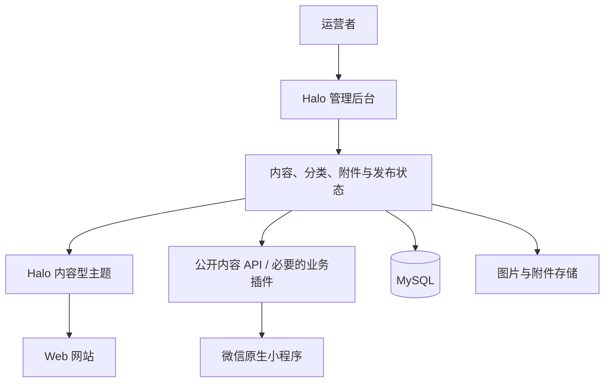

# 弯弯：内容站与 Web、小程序建站选型（历史版本）

版本：4.0｜2026-11-12｜状态：技术建议与范围调整，未开展本版代码开发。

> 已由 v5.0 替代。最新选择仍为 Halo / Spring Boot、主题 Web 和原生小程序，但主对象已进一步收敛为“手动精选的资料卡”，第三方正文不默认保存。当前依据是[项目计划书](./项目计划书.md)、[产品需求](./产品需求与内容规范.md)、[技术方案](./技术架构与实施方案.md)和[版权边界](./个人运营与版权边界.md)。下文“文章详情、富文本、经历全文”等保留历史语境，不自动进入新首版；公众 RAG 后置，后台 AI 非首版依赖。

本版依据用户最新决定：公众 RAG 推迟，当前保留 Spring Boot、Web 与微信原生小程序。它替代 v3.0 中“静态网站优先、Spring Boot 待定”的建站建议；此前的个人运营、内容权利和公众 AI 条件评审继续有效。文档入口见[总目录](./项目文档总目录与决策记录.md)。

## 1. 选择结论

推荐 **Halo 社区版作为内容后台和网站服务，Web 使用内容型主题，微信原生小程序通过公开接口读取同一套内容**。当前不安装论坛和公众 AI 插件，不另写一套文章管理后台。

Halo 本身就是 Spring Boot 应用，因此已经满足后端技术要求。首版不需要再在 Halo 外面包一层独立 Spring Boot 服务。涉及本项目专属字段、双端输出或首页聚合的不足，优先用一个小型业务插件补充。

“公众 RAG 后续开发”不等于现在必须建设私人 RAG。后台 AI 也只是可选的编辑辅助，不作为内容站上线依赖。

这是架构选择建议，不表示已经安装 Halo、验证主题、小程序过审或将原 OpenIsle 代码迁移完毕。

## 2. 产品定位与信息组织

将网站定位为：**面向产前发现胎儿疑似足内翻的孕妇及家庭的资料整理与经历分享站**。站点名称与具体内容应区分疑似发现、确诊信息和个人经历，不能由平台替读者作诊断。

首页优先回答“我现在处于哪个阶段、可以先看哪些资料”，不以最新文章流水列表为唯一入口。

建议设置五组阅读入口：

1. **刚发现**：新读者导读、术语与原始资料入口、就诊沟通问题整理。
2. **产前了解与等待**：经核对的机构资料、相关研究入口、家庭的等待与沟通经历。
3. **出生后评估与治疗资料**：权威来源导航、治疗过程的资料说明和已授权经历。
4. **支具、复查与日常生活**：相关资料与家庭生活记录，明确其适用背景和个体差异。
5. **长期随访与预后资料**：研究来源、观察时点不同的真实经历、资料的局限。

上述是阅读导航，不是对读者制定医疗方案。另设资料库、经历分享、关于本站、来源与更正页面。读者既能按阶段阅读，也能跨阶段搜索。

默认“分享”指运营者编辑发布的个人经历或取得授权的家庭故事。首版不开放访客发帖、即时评论、私信和病历上传。若以后需要读者投稿，另行设计授权、去标识、审核及撤回流程，避免直接把内容站改回论坛。

## 3. 为什么选择 Halo

Halo 已提供文章编辑、分类标签、附件、主题和插件机制、REST API 及内置全文搜索，能够复用大部分首版基础能力。它的价值在于减少后台和发布系统的维护，而不是因为已有 AI 插件。

但要分清三个事实：

- **后台使用 Vue 不等于网站主题使用 Vue。** Halo 常规主题采用 Thymeleaf 模板；选择主题路线，就不必再维护一套 Nuxt Web 应用。
- **Spring Boot 不等于 MVC＋MyBatis。** Halo 使用 WebFlux、Reactor 和 R2DBC。尽量通过主题和插件扩展，避免深改核心，也不能将耗时阻塞操作直接放进响应式请求处理。
- **有 API 不等于有现成业务小程序。** 本次没有验证到可以直接套用的足内翻内容站原生小程序；小程序页面、富文本适配和分享导航仍需开发。

社区版采用 GPLv3。主题、插件可能有独立授权和付费条件，选用时分别核对。不能将“核心开源”理解为市场全部应用免费，也不应直接断言独立 API 客户端一律需要公开源码。

## 4. 备选方案与切换条件

| 方案 | 适用情况 | 本项目判断 |
| --- | --- | --- |
| Halo＋主题＋原生小程序 | 文章、资料、专题和故事为主，希望复用编辑后台 | 当前首选，定制范围控制在主题与小插件 |
| UJCMS | 核心需求转为多类结构化内容、复杂字段筛选和审核流程 | 备选；官网展示 Spring MVC 和自定义模型能力，具体社区版功能、API 与授权需要进一步验证 |
| 自建 Spring Boot＋Nuxt＋管理后台 | 已有大量独立业务，例如家庭协作、长期记录和精细权限 | 当前不选，个人需承担整套后台、权限和发布系统维护 |

JPress 不满足严格的 Spring Boot 约束；OpenIsle 与当前内容站定位不符。不因为旧方案已写过代码就沿用论坛基础设施。

若用户明确要求 Web 也必须采用 Vue 3 独立前端，可改成 **Halo 作为内容后端＋Nuxt 作为 Web＋原生小程序**。这条路线仍复用 Halo 后台，但增加 Web 构建、部署及双端接口适配成本，不是当前默认方案。

## 5. 首版架构

图示是规划，不是现有运行环境。数据以 Halo 为唯一内容主源，Web 和小程序不各维护文章副本。

部署建议为一台大陆服务器运行反向代理、Halo 与其支持的 MySQL 版本，配置 HTTPS；图片初期本地存储并做异地备份，数量增长后再考虑对象存储插件。定期备份数据库、附件、主题和配置，并验证可恢复。管理员入口限制访问并持续更新安全补丁。

首版不引入 Redis、RabbitMQ、Elasticsearch、向量数据库及独立 AI 服务。搜索先使用 Halo 现有能力；小程序端的搜索接口、中文检索效果与自定义字段覆盖情况，需要在选型验证中确认，不能只看到 Web 搜索框就视为双端完成。

## 6. 内容模型与发布规则

以文章作为主要公开内容对象：阶段使用分类，材料类型使用受控标签；来源、更新记录等字段先使用元数据或少量插件扩展。暂不构建一套独立文献管理系统。

| 字段组 | 建议保存内容 |
| --- | --- |
| 基础内容 | 稳定内容 ID、标题、摘要、正文、封面、分类、类型标签、相关内容 |
| 来源 | 作者或机构、原始链接、发布日期；论文可增加 DOI 或其他可靠标识 |
| 阅读背景 | 适用阶段、资料性质、经历发生时间和随访时点、内容局限 |
| 更新与核对 | 版本、最后核对日期、核对方式、真实参与审核者及其范围（如有） |
| 内部权利记录 | 来源取得方式、授权凭据、展示/摘录/云上传/后续索引的允许范围 |
| 发布控制 | 草稿、待核对、已发布、撤回；未来是否具备进入 RAG 的条件 |

“待核对”等编辑步骤是项目工作流要求，能否全部使用 Halo 内置状态表达，需要验证；不足时由业务插件补充。不能把普通来源核对标成专业医学审核。

公开内容分清机构原始资料、运营者整理和家庭经历。转载、翻译、图表及全文下载按实际授权处理。对来源不明的第三方代下论文，当前不上传到公开附件库或未来云知识库；先保留合法可公开的题录和来源入口，核实权利后再决定其他用途。

内部授权凭据、核对备注与管理员资料不向公开 API 输出。不能仅靠页面隐藏实现隔离。

## 7. 双端接口与阅读体验

Web 和小程序首版都支持阶段入口、专题列表、文章详情、资料卡、关键词搜索和相关内容。小程序可增加本机阅读记录或收藏，不为这些功能强制建立用户账户；换机同步和跨端同步另行评估。

Halo 官方区分 Public API、Console API、Extension API 等分组。小程序只使用经过检查的公开接口，或业务插件提供的公开投影，绝不内置管理员个人令牌。存在管理权限的接口不作为访客读取入口。

公开输出应明确限定为已发布且允许公开的内容，使用字段白名单。除发布状态外，也需检查可见性和撤回状态；附件权限需单独处理，不能认为文章下架会自动使历史文件链接失效。

小程序不直接照搬 Web HTML。需适配富文本支持范围、图片域名、表格、外链和引用呈现方式。来源保留机构、题名、年份及标识等可阅读信息，不依赖小程序能够任意打开外部网页。

选型验证需覆盖：阶段筛选、文章与元数据读取、中文搜索、图片、长文和表格、撤回后的双端表现。API 能力与具体实现以所选稳定版本为准。

个人主体小程序的实际类目与该主题能否发布，仍未完成微信侧核实。技术上可接入不代表可以过审；不能承诺改用 Halo 就解决。保留双端设计，同时将小程序发布列为单独验证事项，不以网页包装或错误类目绕开。

## 8. 为后续 RAG 保留什么

目前只保留可靠内容和数据边界，不部署 RAG 基础设施。以后使用腾讯 ADP 时，新增服务端适配模块统一连接，Web 和小程序不保存供应商密钥。

后续候选流程为：经过权利确认的已发布版本 → 导出与同步 → 腾讯 ADP 知识库 → 服务端访问控制和引用映射 → 双端展示。

同一内容 ID 对应可追踪版本，记录供应商文档 ID 和同步状态。撤回或修改时同步更新缓存与知识索引；删除未确认前停止受影响内容的检索输出。这些是未来验收要求，当前尚未实现。

“网站允许展示”不自动等于“允许上传第三方云并用于 RAG”。保存授权范围记录，比现在提前安装 AI 插件更有用。腾讯产品个人账号权限、专业内容条件与公众服务要求，延续 v3.0 的待验证事项。

## 9. 下一步验证与验收

本轮到选型和方案为止。恢复开发前，以少量真实但可公开的材料验证：

1. 一个阶段导读、一个有完整来源的资料卡、一个已授权经历，是否可在同一后台完成编辑发布。
2. Web 是否能呈现阶段式首页及专题关联，而非只能展示博客时间流。
3. 小程序是否能通过公开接口读取同一内容，并正确显示正文、引用和图片。
4. 草稿、内部备注、授权凭据不可读取；内容撤回与文件删除在双端表现一致。
5. 内容和附件是否可备份、恢复和导出；必需主题与插件的维护及授权是否可接受。
6. 依据真实功能向微信核实个人主体可用类目和发布条件，再决定小程序实施节奏。

若基础内容闭环需要大改 Halo 核心，或者结构化筛选已成为主要功能，再重新比较 UJCMS 与自建业务后端，不继续叠加插件。

## 官方依据

- [Halo 官方说明及社区版授权](https://github.com/halo-dev/halo/blob/main/README.md)
- [Halo 架构概览：Spring Boot、WebFlux、R2DBC](https://docs.halo.run/developer-guide/core/framework)
- [Halo API 分组与认证](https://docs.halo.run/developer-guide/restful-api/introduction)
- [Halo 主题模型元数据](https://docs.halo.run/developer-guide/theme/annotations)
- [Halo 系统与主题开发入口](https://docs.halo.run/developer-guide/core)
- [UJCMS 官方产品与模型说明](https://www.ujcms.com/)
- [微信小程序类目材料入口](https://developers.weixin.qq.com/miniprogram/product/material/)：本次公开页面未能读取，未据此确认项目可用类目。

核查日期：2026-11-12。已核对公开产品说明和部分源码，未进行账号内配置、真实部署或采购。用户提供的 Halo 建站建议已阅读，其中论坛和 AI 插件组合不作为当前选型依据。
