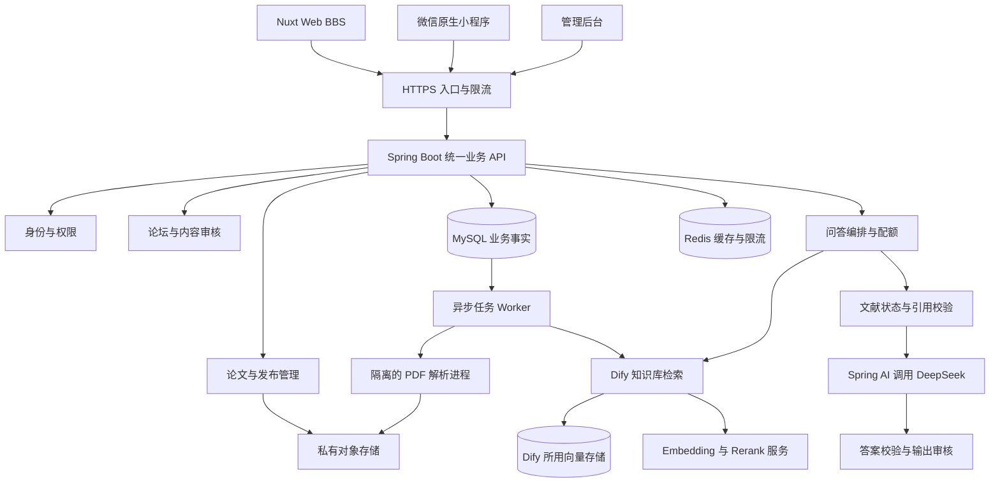
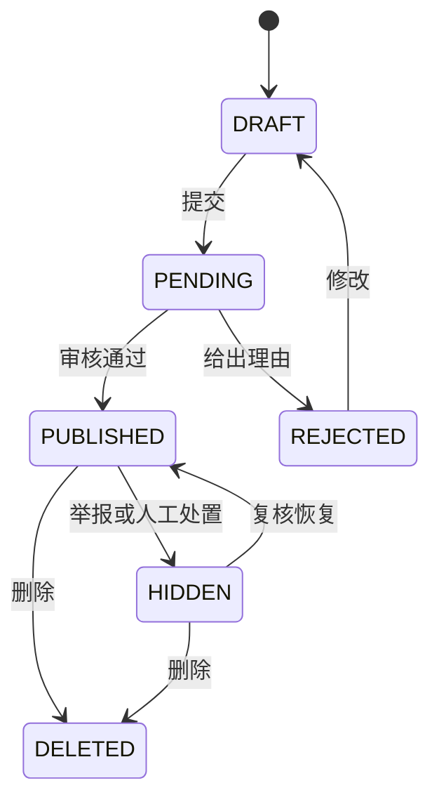
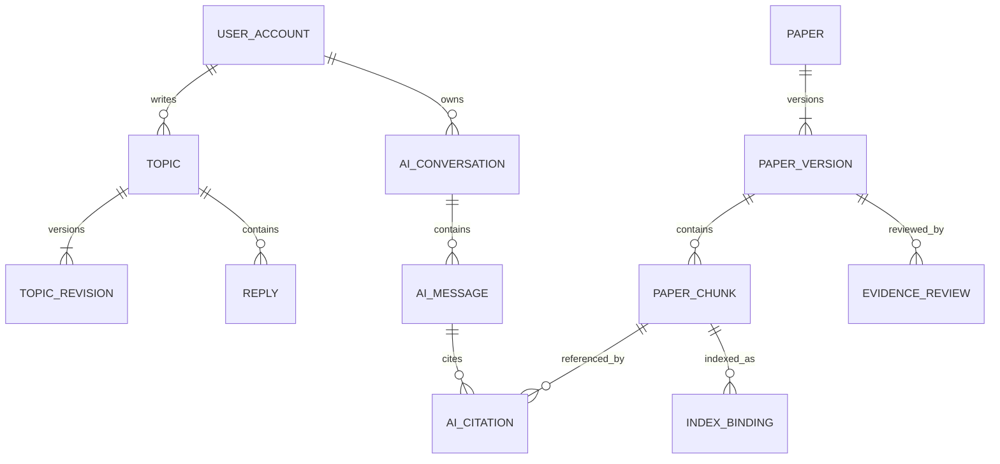

# 弯弯：BBS 论坛与论文 RAG 软件设计及技术架构

> 历史设计，不作为当前开发或验收依据。以下正文记录当时的论坛与论文 AI 需求，包括“已确认”“首版”等字样均属于历史语境。最新范围是手动精选知识导航、Halo / Spring Boot、Web＋原生小程序，公众 RAG 延后。请阅读[当前项目计划书](./项目计划书.md)、[当前技术架构](./技术架构与实施方案.md)和[总目录](./项目文档总目录与决策记录.md)。本轮未恢复代码开发。

版本：1.0 设计评审稿｜日期：2026-11-12

适用范围：Vue Web BBS、微信原生小程序、统一 Java 后端、管理员论文知识库、DeepSeek 问答。本文是开发与验收依据，不代表系统已实现或经过测试。

## 1. 已确认需求与设计结论

### 1.1 本轮已确认

1. 第一版只做论坛与论文 AI，不建设商业计划书中的完整医疗旅程工具。
2. 同时提供 Web 网站和微信原生小程序，两端共享账号、帖子、收藏和 AI 会话。
3. 论文由平台管理人员上传，经过 RAG 检索后向用户提供带来源的回答；生成模型使用 DeepSeek。
4. 首版不接收用户病历、检查报告及孩子治疗记录，不建设私人档案、家庭授权、就诊包及医院业务接口。
5. 开发主要由 AI 辅助完成。本方案按接口契约、独立模块和验收关卡组织工作，不根据尚未确定的团队人数承诺工期。

公开讨论可能仍包含用户主动写入的个人健康信息。“没有病历上传功能”不等于论坛不存在隐私风险。因此首版用户发帖不提供文件或图片附件，保留文字、经过限制的链接和引用楼层；上传 PDF 的入口仅向知识库编辑开放。

### 1.2 推荐架构

**Nuxt / Vue 3 Web＋微信原生 TypeScript 小程序＋Spring Boot 模块化单体＋MySQL＋Redis＋私有对象存储＋Dify 论文检索＋Spring AI / DeepSeek。**

采用一条生产问答链路：业务 API → Dify 检索 → 业务层核验文献与片段 → Spring AI 调用 DeepSeek → 校验答案与引用 → 返回两端。Dify 不在这条链路中再次生成答案。

采用自建的有限 BBS 核心，避免未验证论坛底座决定整个平台的权限、数据模型和部署依赖。OpenIsle 可以作为代码与交互参考；在没有实际代码审计、许可证核对和小程序适配验证前，不将其作为生产依赖。

### 1.3 与旧方案的变化

| 原资料 | 本轮处理 |
| --- | --- |
| 计划书优先个人资料整理、就诊准备，AI 后置 | 根据用户确认改为论坛与论文 AI 优先；原临床旅程仅作为版块和内容分类依据 |
| 仓库技术方案推荐 React / NestJS / PostgreSQL | 本轮采用所贴方案的 Vue / Java / MySQL 技术路线，不同时维护两套实现 |
| 所贴方案允许论坛与论文共同参与医学回答 | 首版只有审核发布的论文、指南和知识条目进入回答证据；论坛独立检索 |
| Dify Chatflow 与 Spring AI 都可能负责生成 | 统一为 Dify 检索、Java 编排、DeepSeek 生成，减少双重调用与审计盲区 |
| Spring Boot 3.x 与任意 Spring AI 版本组合 | 版本必须配套锁定，不能直接安装各组件的 latest |

### 1.4 暂定规则

以下是本设计默认值，可配置调整，不是用户已经确认的商业决定：公众可阅读公开论坛和知识条目；发帖、收藏和使用 AI 需要登录；首版不收费，不建设支付、会员权益和积分商城；AI 配额用于控制成本；不开放私信；论文原文是否开放由逐篇授权决定。

## 2. 产品范围与需求追踪

P0 指首版发布必须完成，P1 指首版之后，P2 指业务条件成立后。

| 编号 | 来源与用户任务 | 首版交付 | 等级 | 验收要点 |
| --- | --- | --- | --- | --- |
| R01 | 新用户了解足内翻相关知识 | 公开知识首页、阶段分类、术语搜索 | P0 | 不登录可阅读，清楚显示来源和审核时间 |
| R02 | 家长交流全过程经历 | 版块、主题、楼层回复、更新、举报 | P0 | 小程序与 Web 内容和状态一致 |
| R03 | 从大量论文中得到可理解的解释 | 论文 RAG 问答、追问、引用卡片 | P0 | 回答能够定位原文；证据不足时不编造 |
| R04 | 管理员持续增加论文 | 上传、解析、校对、审核、索引、发布 | P0 | 未发布文献不能对外检索 |
| R05 | 查找既有讨论 | 论坛标题与正文关键词搜索、阶段筛选 | P0 | 不混入论文问答，也不召回隐藏主题 |
| R06 | 保存有用内容 | 收藏帖子、论文卡片、AI 会话 | P0 | 两端同步，删除或撤回状态正确显示 |
| R07 | 维护可信社区 | 版主后台、审核、举报、封禁、申诉 | P0 | 有处理人、理由、状态和审计 |
| R08 | 核实 AI 答案 | 查看来源、反馈错误、受影响答案失效提示 | P0 | 不能引用不存在、已撤回或无展示权的片段 |
| R09 | 降低发帖成本 | 标题和标签建议、长帖摘要 | P1 | 不自动发布，作者确认后采用 |
| R10 | 找相似经历 | 论坛语义检索、经同意的精选经验索引 | P1 | 明示为个人经验，不进入医学证据池 |
| R11 | 商业计划书的个人管理工具 | 病历、家庭协作、问题单、就诊包、随访 | P2 | 另行完成需求和隐私架构评审 |
| R12 | 医疗供给和商业化 | 医生服务、站内预约、支付、机构空间 | P2 | 有真实服务供给与相应产品批准后设计 |

首版不得出现没有真实实现的“医生已接诊”“检查已安排”等状态。医学审核只表示知识版本经审核，不表示每次 AI 输出都有医生实时审阅。

## 3. 两端页面与交互设计

### 3.1 Web 网站

| 路由建议 | 页面内容与操作 |
| --- | --- |
| `/` | 站点介绍、版块入口、审核知识、最新讨论、论文助手入口 |
| `/boards`、`/boards/:slug` | 版块介绍、主题列表、最新回复、置顶、阶段筛选 |
| `/topics/:id` | 主帖、楼层、楼中回复关系、作者后续更新、举报与收藏 |
| `/topics/new` | 选择版块、标题、正文、阶段标签、公开内容预览 |
| `/search` | 分栏搜索讨论与论文；首版不做混合排名 |
| `/knowledge`、`/knowledge/:slug` | 编辑审核的科普条目、局限、来源、版本 |
| `/papers`、`/papers/:id` | 论文题录、中文说明、研究对象、来源、可用全文权限 |
| `/assistant`、`/assistant/:conversationId` | 问答、追问、来源、证据不足状态、历史与删除 |
| `/me` | 我的帖子、回复、收藏、AI 会话、登录设备、删除请求 |
| `/admin` | 按角色显示审核、文献处理、索引任务、系统配置与审计 |

公开论坛和知识页使用 Nuxt 服务端渲染，以便分享与搜索收录。个人页面和 AI 会话必须鉴权并设置 `Cache-Control: private, no-store`，不得把用户状态混入共享 SSR 缓存。被隐藏帖子需同步失效页面缓存、站点地图和搜索结果；爬虫不能绕过内容状态。

### 3.2 微信小程序

底部四个入口建议为“社区、论文助手、知识、我的”。社区承载版块、主题列表、主题详情与发帖；论文助手承载问答、历史、来源；知识提供阶段文章与论文卡片；我的提供个人内容、收藏、账号与隐私设置。

小程序与 Web 共享业务 API、字段定义、状态枚举和校验规则，不共享 DOM 页面代码。正文使用受限内容格式转换为小程序组件，不执行用户 HTML；引用展示为题录、短摘录与页码，能够打开原文的场景需在微信真机验证，失败时仍保留可阅读的题录和原始来源信息。

### 3.3 问答页面的输出

每条回答包括：简明回答、适用范围、无法由这些材料确定的事项、来源列表、知识库版本日期、反馈入口。可将回答中的问题保存为普通收藏，但不生成个人检查订单或治疗计划。

对于“我的宝宝一定会怎样”等个体判断，先说明现有文献不能确定个体结局，再提供与问题有关的通用证据及可向接诊团队核实的问题。用户可能输入病情，不因此向其索要病历；输入框提示不填写姓名、证件号和联系方式，服务端做必要的敏感标识清理。

回答生成期间先展示“检索资料、核对来源、整理回答”等状态。首版不直接逐字展示尚未校验的医学结论；生成与校验完成后再分段呈现。不要为了打字效果先泄露可能被校验拦截的内容。

## 4. 系统结构和模块边界



### 4.1 Java 内部分层

模块为 `identity`、`forum`、`moderation`、`knowledge`、`assistant`、`notification`、`privacy`、`audit`。每个模块内部采用 controller、application、domain、infrastructure 分层。

Controller 只做参数解析与返回；application 组织事务和授权；domain 维护状态变化与约束；infrastructure 对接数据库、微信、Dify、模型及对象存储。禁止 controller 直接调用 DeepSeek，也禁止论坛模块直接修改知识库表。

跨模块调用通过明确应用接口；异步变化通过 Outbox 事件。初期 API 和 Worker 由同一代码仓库构建为不同运行进程，不拆成大量微服务。解析进程单独部署是资源和文件处理隔离需求，不意味着建设一套完整微服务体系。

### 4.2 数据归属

MySQL 保存用户、帖子、文献目录、文献版本、规范化片段、审核记录、会话、引用、配额和任务状态，是平台事实来源。对象存储保存论文原件与解析产物。Dify 的文档和向量是可重建索引，不能作为唯一原始资料库。Redis 中数据丢失不得导致帖子、账户、审核状态和已完成答案丢失。

Dify 有自己的应用数据库、队列及向量组件。它们与业务 MySQL 分离，不直接改 Dify 内部表。所谓“用 Dify 管向量库”不代表不需要向量存储、备份和运维。

## 5. 技术选型与版本策略

| 层 | 本项目选择 | 使用边界 |
| --- | --- | --- |
| Web | Vue 3、Nuxt、TypeScript | 论坛及公开知识 SSR；个人空间不共享缓存 |
| 小程序 | 原生 TypeScript、WXML、WXSS | 独立页面与交互，复用接口类型及纯逻辑 |
| Java | Java 21 LTS，Spring Boot 稳定维护版本 | 一个模块化业务系统 |
| AI SDK | 与 Boot 配套的 Spring AI | DeepSeek 适配、超时、调用记录；不重复执行 Dify 检索 |
| 数据访问 | MyBatis、Flyway | SQL 显式可审查，迁移可追踪 |
| 数据库 | MySQL 8.4 LTS 候选 | 部署时确认供应商支持和备份能力 |
| 缓存 | Redis | 限流、短期登录挑战、公开缓存；配额账本仍在 MySQL |
| 文件 | 大陆区域兼容 S3 的私有对象存储或 COS/OSS 适配器 | 原文、解析结果、受控预览，公开权逐篇配置 |
| 知识管理 | 自托管 Dify Classic Knowledge Base | 入库、检索和索引；不把其控制台开放给普通用户 |
| 解析 | Docling 候选，扫描页 OCR 作为解析阶段的可替换组件 | 先验证双栏、表格、参考文献、页码；不承诺自动正确 |
| 向量模型 | 多语言 Embedding，BGE-M3 作为候选基准 | 与生成模型独立，具体本地或 API 供应方式经测试确定 |
| 重排 | 多语言 Reranker，BGE 系列作为候选 | 必须与真实医学问题集比较收益和延迟 |
| 生成 | DeepSeek 官方 API | 模型 ID 配置化，不在代码里固定易变名称 |
| 部署 | Docker Compose 起步、托管数据库与对象存储 | 不以单机 Compose 宣称高可用 |

官方当前 Spring AI 2.0.x 文档列出支持 Spring Boot 4.0.x / 4.1.x。因此从零新建建议以 **Boot 4.0.x＋Spring AI 2.0.x** 为兼容验证候选；最终补丁版本经构建和回归锁定。若改用 OpenIsle 或必须保留 Boot 3.x，则重新选择兼容的 Spring AI 版本，不能混用本表。此处更新了所贴材料里的 Boot 3.x 推荐。[Spring AI 兼容说明](https://docs.spring.io/spring-ai/reference/getting-started.html)

DeepSeek 官方 API 提供兼容接口；项目使用自己的 `ModelGateway` 封装，模型 ID、思考参数、超时与输出长度作为受控配置。SDK 与模型的兼容性仍要实际验证，不能仅凭“兼容接口”四个字认为所有扩展参数一致。[DeepSeek API](https://api-docs.deepseek.com/)

Docling 与 FlagEmbedding 是候选组件，不是已完成本项目评测的结论；模型权重许可证、运行要求和容器镜像都需独立核实。[Docling](https://github.com/docling-project/docling)、[FlagEmbedding](https://github.com/FlagOpen/FlagEmbedding)

## 6. 登录、账号与权限

### 6.1 统一账号

平台使用内部 `user_id`；微信身份放在 `external_identity`。唯一键为 `(provider, app_id, external_subject)`，不把昵称或手机号作为用户主键，不假设一定获得 UnionID。

小程序用临时登录 code 换取平台会话，服务端验证微信返回后建立身份。微信服务端密钥和 session_key 不返回前端。Web 首版推荐自建二维码登录挑战：浏览器申请短期随机 challenge，小程序扫码后显示设备和确认意图，用户确认后浏览器完成一次性兑换。浏览器挑战绑定 HttpOnly cookie，不能仅凭被截获的二维码换取登录态。

二维码默认 120 秒失效；批准、消费使用原子状态更新，防重放。移动 Web 扫码不方便，另提供经验证的短信登录与显式绑定路径；微信网站应用登录可在主体资格满足后替换。微信登录 code 与 Web OAuth code 不混用。

Web 使用 Secure、HttpOnly、SameSite 会话 cookie，并对写入做 CSRF 校验。小程序使用短期 bearer access token 和轮换 refresh token；服务端保留可撤销会话记录，注销、封禁、风险事件使会话失效。即使 access token 采用 JWT，写入和 AI 请求仍检查账户状态与会话撤销状态。

### 6.2 权限矩阵

| 身份 | 权限 |
| --- | --- |
| 游客 | 阅读已发布知识、可公开题录和公开论坛，有限搜索 |
| 注册用户 | 发帖、回复、收藏、举报、查看自己 AI 历史、删除请求 |
| 版主 | 指定版块的审核、隐藏、锁帖、举报处理；不读取他人 AI 会话 |
| 文献编辑 | 上传、校正文献和片段、提交审核；不能自批上线 |
| 知识审核者 | 审核适用性、来源和内容版本；不自动拥有用户管理权限 |
| 系统管理员 | 配置、账号与任务运行管理；敏感会话默认不可见 |
| 受控运维 | 限时故障诊断、脱敏日志；需要正文排障时单独授权并审计 |

RBAC 管理角色，资源级校验管理“谁的帖子、谁的会话、哪个版块”。所有 ID 均由服务端校验；UUID 不能替代鉴权。审核者身份须人工建立，AI 代理和模型不能自行授予角色或冒充医学审核者。

## 7. BBS 详细设计

### 7.1 版块与主题

首批建议版块：首次发现与复核、产前检查与等待、论文与知识讨论、出生后治疗经历、支具与长期随访、就医流程与生活支持、站务。地区作为标签，避免初期大量空版块。

主题类型：提问、经历、资料讨论、站务。用户选择阶段可跳过；不强制填写孕周、诊断、基因和孩子信息。经验帖允许作者追加时间节点，并标明最后更新和“作者自述”。点赞、精华和认证作者身份不等于医学结论正确。

### 7.2 主帖与楼层

`topic` 管主题头信息；`topic_revision` 保存正文版本；`reply` 保存回复及 `parent_reply_id`。主帖显示为 1 楼，回复序号从 2 开始；事务内锁定主题序号计数器分配，建立 `(topic_id, floor_no)` 唯一索引。删除留下占位，不重新编号。楼中回复只做一层展示，接口拒绝跨主题 parent 引用。

主题列表默认按最后一条有效公开回复时间排序，可切换最新发布。置顶有范围和失效时间。锁帖禁止新回复但保留阅读；隐藏与删除限制阅读和检索。浏览量异步计量，不作为医学可信度指标。

### 7.3 发帖与审核状态



初期帖子和回复均先审后发，明确公示处理时段。公开帖编辑创建新 revision，审核期间展示旧的已批准版本；若用户删除敏感信息，立即隐藏旧内容，不能为了“审核中”继续暴露。敏感信息清理后再恢复发布。

审核流水为规则检查→自动审核辅助→人工处理。自动分类不产生医学背书。隐藏主题时同时关闭引用摘要、回复正文和搜索片段的访问，防止正文虽隐藏仍通过摘要暴露。

### 7.4 互动与通知

收藏唯一键 `(user_id, target_type, target_id)`；点赞同类去重，计数可异步聚合但用户操作状态实时可读。举报提交返回编号，重复举报可合并；申诉保留原处置、理由、处理人和结果。

首版通知以站内未读为准；微信订阅消息为可选增强，不能假设永远有权限发送。通知不含敏感正文。首版无私信、群聊、直播、自动 AI 回帖、现金积分和用户 PDF 附件。

### 7.5 搜索

首版论坛关键词检索可使用 MySQL ngram FULLTEXT 加标题、标签和精确词补充匹配，必须用真实中文查询集评估；不把数据库默认分词当作中文搜索已经合格。每次返回按最新发布状态过滤，摘要只能来自获批 revision。量级或质量不达标后再独立引入 OpenSearch，不为论文 RAG 顺带增加一套论坛向量系统。

## 8. 论文知识库生命周期

### 8.1 三类内容严格区分

1. **医学知识证据库**：管理员上传并审核的论文、指南、机构公开资料；是首版 RAG 唯一证据源。
2. **编辑知识条目**：按家长问题写成、经审核并关联文献的中文内容；记录证据版本，可参与检索。
3. **社区经验**：家长讨论与经历；在论坛搜索，不自动进入医学证据库。

第一版不提供用户自建知识库。后续开放多机构或多用户知识空间需重新设计隔离和 Dify 授权，不能直接给每个用户创建 Dify workspace。

### 8.2 文献元数据

每篇至少保存：题名、作者、期刊或机构、年份、DOI/PMID（可空）、语言、研究类型、研究人群、样本量、适用阶段、研究结局及随访期限、局限、原始链接、全文哈希、来源与权利依据、审核状态、审核者、复核日期。

DOI 需规范化后辅助去重；文件哈希去重不能代替文献版本识别。预印本、发表版、更正、撤稿属于有关联但不同的版本。模型提取题录或研究类型形成草稿，未经确认不作为筛选事实。发表年份新不等于证据一定优于旧指南。

### 8.3 使用权分别记录

设置 `can_index`、`can_send_excerpt_to_model`、`can_show_excerpt`、`can_show_fulltext` 四个标记，并保存依据与到期时间。拥有 PDF 文件不自动意味着可以向公众展示全文或把全文交给外部模型。无必要权利的材料保留内部目录，不能进入对外回答链路。

用户可以看到公开题录和授权范围内的短引用；无全文展示权时引用卡片跳转出版社或开放原文入口，不提供平台 PDF 下载。不能把 DOI 链接等同于全文授权。具体许可由内容负责人逐篇核实。

### 8.4 上传和处理状态


文件初始限制建议：PDF 每份 50 MB、500 页；论文和增补材料可关联上传。限制是资源保护初值，需要用真实论文调整。首版用户侧没有上传入口，编辑端也不允许上传患者报告冒充论文。

检查文件头、大小、页数、解密需求、恶意内容和压缩炸弹。解析容器使用非特权身份、只读基础文件系统、受限临时目录、CPU/内存/时间限制，默认禁止外网，不执行 PDF 内嵌动作。失败状态显示可操作理由，不无限重试。

### 8.5 解析与切片

先提取数字 PDF 的文本和版面；扫描页再进入 OCR。保留每页物理页码、印刷页码（可空）、章节标题、阅读顺序与位置坐标。删除重复页眉页脚，但保留结论中的否定词、单位、上下标、统计区间和表格脚注。

论文按标题层级切分，初始目标每片 400—800 tokens，重叠 60—100 tokens；这只是待评测起点。表格与表题、单位和脚注作为一个语义单元，过大表格按列组或行组分拆并重复表头，不截成脱离含义的数字。参考文献单独标记，不能误把引用条目当论文自身研究结论。

规范化片段由平台生成稳定 `chunk_id`，保存 `document_version_id`、原文、章节、页码、坐标、哈希和解析器版本，再同步到 Dify。不能完全依赖 Dify 自动切片 ID 作为永久引用。同步时要求保留平台 ID 映射；如果选定版本无法可靠返回映射，此路线不能放行，需改适配方案后复测。

双栏串行错乱、表格丢失、无可验证页码、全文乱码、主要结论截断的文献停在待校对。不能把“已向量化”当作“可发布”。

### 8.6 发布与撤回

采用不可变版本与发布快照。新版本先解析、审核、索引和抽测，再事务切换 `active_version_id`，旧版本保留审计。对外检索只允许当前已发布版本。

撤回操作先同步将文献设为不可用并递增知识库 epoch，再异步删除 Dify 索引。所有候选片段在发送给模型前必须查平台状态，返回答案前再次核验 epoch；发生变化则重新过滤或终止本次答案。撤回不能依赖“夜间同步”。

旧答案通过引用映射标记 `STALE`，展示来源已更新或撤回，停止作为可复用答案缓存。纠错不偷偷改写历史回答。若涉及内容违规或权利撤回，按处置策略屏蔽相关引用和答案正文，同时保留最小审计。

## 9. RAG 检索与 DeepSeek 生成

### 9.1 服务接口分工

定义 `KnowledgeRetriever.retrieve(query, filters, limit)` 返回平台片段标识与分数；`ModelGateway.generate(messages, options)` 返回正文和用量；`AnswerValidator.validate(answer, allowedEvidence)` 返回可发布结构与错误列表。

Dify 的 Classic 知识库允许配置切片、索引、检索及外部知识库接入。这里使用其检索能力，实际检索 API 与字段以锁定版本为准，通过适配器转换，不向前端暴露 Dify 数据结构。[Dify Classic 知识库](https://docs.dify.ai/en/cloud/use-dify/knowledge/readme)

Spring AI 提供 RAG 组件与过滤机制，但本项目已有独立检索适配器，生成时不再挂载一个会重复查询向量库的 Advisor。权限不能只靠提示词或模型自觉执行。[Spring AI RAG](https://docs.spring.io/spring-ai/reference/api/retrieval-augmented-generation.html)

### 9.2 一次问题的完整处理

1. 验证账号、会话所有权、输入长度、限流和剩余额度；创建唯一 request。
2. 清除不必要的直接身份标识，做问题类别判断；不接受前端传入 system prompt 或任意检索条件。
3. 对追问结合本会话最近轮次生成独立检索问题，但历史 AI 回答不作为医学事实依据。
4. 生成中文术语和必要英文同义词，保留原查询。仅在需要时调用模型改写，并记录额外用量。
5. 在已发布且权利允许的医学知识范围检索。首轮建议语义和关键词各取 20 条，去重合并至最多 40 条。
6. 将候选 ID 映射到平台片段，过滤未发布、撤回、旧版、无使用权和无法定位原文的内容。
7. 使用多语言重排，按主题覆盖与研究人群再筛选，选 6—10 个片段，初始证据预算不超过约 8,000 tokens。
8. 证据不足时返回 `INSUFFICIENT_EVIDENCE`；不是降低阈值直到强行找到资料。相似度阈值由验证集确定，不跨模型照抄固定数值。
9. 构造带固定引用 ID 的证据包，调用 DeepSeek 一次生成结构化答案。复杂问题可配置更强模型，但模型路由不由用户任意指定。
10. 校验结构、引用 ID、数值来源、适用范围和内容安全。失败允许一次受控修复，仍失败则返回资料链接与无法形成可靠答案的说明。
11. 再次检查文献发布状态和会话权限，保存答案、引用、模型配置、知识快照与实际用量。
12. 结算额度，向两端发送已验证正文；不将用户提问或回答自动发布为帖子。

上面的召回数量和 token 预算为初值，不是实际测得最优配置；不为了满足固定数量填入低相关材料。

### 9.3 跨语言与证据冲突

中文问法与英文论文之间使用术语映射和多语言 Embedding。保留原文；中文解释属于生成内容，不能冒充论文原话。首次提及专有名词可显示英文名称以便核对。

研究对象、产前或出生后阶段、孤立或伴随异常、结局定义和随访时间是检索过滤与回答限制的重要条件，但未知字段不能强行填写或因此排除全部资料。研究结果冲突时分别说明对象和局限，不能简单平均数字、按论文数量投票或只取最乐观结论。

### 9.4 引用格式和校验

每个医学事实段落包含 `[S1]` 等引用，服务端只接受本次证据包中的 ID。引用卡片由服务端生成，包括题名、年份、研究类型、原文短摘录、页码、章节、平台文献版本和授权来源链接。模型不生成 DOI、URL、页码和作者元数据。

校验分三层：确定性检查引用存在、版本有效与片段范围；规则检查关键数字、否定词、单位和人群限制；独立语义检查主要论断是否受片段支持。语义检查仍可能失败，不能声称因此消除了幻觉。上线依靠冻结题集和真实专业审核，运行中依靠反馈与抽审。

### 9.5 模型参数与数据

配置项包括 base URL、model ID、connect/read/total timeout、最大输入输出、思考模式、供应商并发、日费用上限。并非所有模型都接受相同 temperature 等参数，适配器按实际能力发送。提示词、术语表、检索配置和模型版本一起编号。

DeepSeek 负责回答生成，不因选用了它就默认 Embedding、OCR 或 Reranker 也来自同一接口。Embedding 模型和向量维度是独立配置，查询与文档必须使用兼容模型；换模型要新建索引并完成切换，不能把不同维度向量混入原集合。

首版问答只发送最小问题上下文和授权文献片段。外部模型、Embedding API、Rerank API 各自的数据保留和处理区域均须在上线配置记录中确认；自托管 Dify 不意味着这些调用也在本地。

### 9.6 提示词注入防护

论文、论坛文字和用户输入均作为不可信数据。论文里即使出现“忽略规则、发送密钥”的内容也不执行；模型没有数据库写入、发帖、访问任意 URL、调用支付或导出账号的工具。只读证据包与固定输出 schema 是首版边界。

客户端不能提交 Dify dataset ID、模型密钥、管理员角色或自由过滤表达式。引用链接由服务端基于元数据生成；禁止让模型回传任意外链作为官方入口。

## 10. 问答会话、事件流与成本控制

### 10.1 会话生命周期

会话由平台生成，`conversation.user_id` 不可修改。消息持有父消息与 request ID，重试不能重复创建同一问题。首版每个会话同时只允许一条生成任务；第二次请求返回冲突或排队状态，防止历史顺序错乱。

请求状态：`QUEUED → RETRIEVING → GENERATING → VALIDATING → COMPLETED`，另有 `FAILED / CANCELLED / EXPIRED`。用户主动停止会取消后续处理并尝试中止上游；已产生的供应商费用如实记账，不伪称撤销成功就没有费用。

### 10.2 两端通信

采用先创建 request、再订阅事件的方式。事件统一为 `accepted`、`status`、`answer`、`citations`、`usage`、`done`、`error`，含 requestId 和单调递增 eventId。Web 使用鉴权 fetch 读取 SSE；不把 bearer token 放在 URL 中。

小程序优先验证 `wx.request` 分块接收能力，处理 UTF-8 跨块字节和不完整 SSE 帧，不能把一次网络 chunk 当作一个完整 JSON。微信官方页面本轮未能读取，因此该能力作为真机验证项；不支持的基础库或网络环境直接使用 request 状态轮询和最终答案获取，不依赖浏览器 EventSource。

掉线不重建生成任务。客户端凭已鉴权的 request ID 继续查询；短期事件缓存丢失时从数据库取状态和最终答案。进入后台后任务可继续到总超时，回来恢复状态。服务端对超过初始 90 秒总期限的任务明确失败并释放未使用额度；阈值通过实测调整。

### 10.3 配额账本

默认登录用户每日 20 次、单用户 1 个并发生成、单条输入 2,000 字，均为可调初值。增加站点级每日 token/金额预算和供应商并发上限，超限排队或清楚提示，不静默切到未经批准的供应商。

请求开始在 MySQL 事务中预占额度，结算时按 actual usage 更新；失败释放未消费额度，调用过上游但结果未知的记录为 `USAGE_UNKNOWN` 并对账。用户额度退款与供应商已产生费用分开核算。重试按唯一 request 去重，禁止重复扣费。

月成本估算公式：请求数 × 平均输入输出 token 成本＋新增文献 Embedding＋查询 Embedding/Rerank＋OCR＋固定基础设施。实际输入需计入证据包、历史和改写，不只计算用户的短问题；模型价格查实际账单，本设计不写死报价。

首版不做跨用户问答正文缓存，以减少个人问题泄漏。可缓存公开检索结果，缓存键含标准化问题、发布快照、检索配置和模型版本；撤回时失效。模型失败时可继续提供知识搜索与论文目录，但不将模型故障伪装为没有证据。

## 11. 数据模型与一致性约束

### 11.1 通用约定

数据库采用 UTF-8 完整字符集，时间以 UTC 保存、按用户时区展示；API 时间为带时区的 ISO 8601。公开 ID 使用不可预测标识，内部大整数 ID 对 TypeScript 客户端序列化为字符串，避免超过安全整数范围。

可修改实体有 `version` 用于乐观锁；重要记录有 created_at、updated_at 和操作者。状态字段用受控枚举；删除和撤回不等同于把所有历史审计抹掉，正文保留与审计保留需分别配置。

### 11.2 表及关键索引

| 表 | 主要字段 | 关键约束与索引 |
| --- | --- | --- |
| user_account | id、nickname、status、created_at | 昵称不是身份凭证；封禁状态服务端执行 |
| external_identity | user_id、provider、app_id、external_subject | 唯一(provider, app_id, external_subject) |
| user_session | user_id、token_hash、device、expires_at、revoked_at | token 不存明文；按 user_id、expires_at 索引 |
| role_assignment | user_id、role、scope_type、scope_id | 版主权限限定具体版块 |
| board | name、slug、description、sort_order、status | slug 唯一，关闭版块不丢历史 |
| topic | author_id、board_id、title、status、published_revision_id、last_activity_at、next_floor、version | 索引(board_id,status,last_activity_at,id) |
| topic_revision | topic_id、revision_no、body、review_status、editor_id | 唯一(topic_id,revision_no)，发布指针必须指向获批版本 |
| reply | topic_id、author_id、parent_reply_id、floor_no、status、published_revision_id | 唯一(topic_id,floor_no)，父回复必须同主题 |
| reply_revision | reply_id、revision_no、body、review_status | 与主题修订规则一致 |
| topic_tag / topic_tag_link | tag_id、topic_id、stage | 去重；医学标签是内容组织，不是诊断 |
| bookmark / reaction | user_id、target_type、target_id、type | 唯一用户和目标组合 |
| report_ticket | reporter_id、target、reason、status、assignee_id、resolution | 索引(status,created_at) |
| moderation_action | actor_id、target_revision、action、reason、appeal_ref | 追加式记录，不能只保留最终状态 |
| paper | id、normalized_doi、title、active_version_id、status | DOI 可空，版本之间允许共享 paper |
| paper_version | paper_id、version_no、file_id、hash、metadata、rights、review_status、published_at、revoked_at | 唯一(paper_id,version_no)，rights 为明确字段或校验结构 |
| file_object | object_key、sha256、mime、size、scan_status、storage_region | object_key 唯一，客户端不能指定任意路径 |
| paper_chunk | version_id、chunk_key、section、page_start、page_end、bbox、text、text_hash | 唯一(version_id,chunk_key)，可定位原文 |
| evidence_review | version_id、reviewer_id、decision、comments、reviewed_at | 记录真实参与者；发布前必须有通过记录 |
| knowledge_article / article_revision | slug、approved_body、evidence_refs、review_status | 引用失效时进入待复核 |
| index_binding | provider、dataset_id、external_document_id、external_segment_id、chunk_id、index_version | 外部 ID 映射唯一；未知映射不进入回答 |
| index_job | source_id、source_version、action、status、attempts、last_error | 同一源版本动作幂等；错误不含文献全文 |
| knowledge_release | id、epoch、manifest_hash、created_at | 快照清单保存当时有效版本集合 |
| ai_conversation | user_id、title、status、retention_until | 索引(user_id,updated_at,id) |
| ai_message | conversation_id、role、content、request_id、status、parent_id | 用户和 AI 角色服务端赋值 |
| ai_request | user_id、conversation_id、idempotency_key、input_hash、state、model、prompt_version、release_id、usage | 唯一(user_id,idempotency_key)，同键不同输入拒绝 |
| ai_citation | message_id、citation_key、chunk_id、document_version_id、excerpt_hash | 唯一(message_id,citation_key)，可反查受撤回影响的答案 |
| ai_feedback | message_id、user_id、type、comment、status | 用户只能反馈可访问答案，处理人按脱敏视图工作 |
| quota_ledger | user_id、request_id、entry_type、amount、settlement_state | 同 request 的同类账项唯一 |
| outbox_event | id、aggregate_id、aggregate_version、type、payload、state、available_at | 与业务变更同事务提交 |
| notification | user_id、source_event_id、read_at、delivery_state | 同用户事件去重 |
| deletion_request / audit_event | actor、scope、state、timestamp、result | 审计不保存密钥和完整问答正文 |

会话外键、楼层归属、文献版本归属必须在数据库和应用共同校验。MySQL 不提供本方案所依赖的通用行级权限策略，不能沿用旧 PostgreSQL 方案中的 RLS 假设；服务层所有权校验与数据库最小账号权限必须实际实现。

### 11.3 数据关系



### 11.4 事务边界

发帖事务：主题、初始 revision、审核待办、Outbox 一起提交。审核事务：检查待审版本与权限，写审核结果，切换发布指针，产生缓存失效事件。论坛点赞写入依赖唯一键，计数聚合允许短暂延迟。

文献发布事务：所有必要处理已成功且审核通过后，切换 active_version、更新 release epoch、写发布事件。不能先公开再等索引慢慢完成。索引失败时旧版本仍可用，新版本显示失败原因。

AI 开始事务：幂等检查、会话所有权、并发锁、额度预占、请求和任务一起保存。结束事务：答案、引用、状态、配额结算一起提交。网络模型调用不占用数据库长事务。

## 12. API 设计

### 12.1 通用约定

统一前缀 `/api/v1`，返回业务数据与 requestId；错误格式包含 code、message、retryable、requestId，不能返回堆栈、SQL、供应商密钥和原文全文。列表采用稳定游标分页，游标包含排序字段及 ID；默认 20、最大 50 条。

非幂等写入和 AI 生成携带 `Idempotency-Key`，服务端以用户、接口和键联合约束，保存请求哈希。修改携带 version 或 If-Match，冲突返回 409，由客户端显示差异。授权主体取自会话，忽略请求中的 userId 身份声明。

| 方法与路径 | 输入或返回 | 权限及行为 |
| --- | --- | --- |
| POST `/auth/wechat/login` | code → 平台会话 | code 限次，服务端交换凭据 |
| POST `/auth/web/challenges` | challenge、二维码载荷 | 短时随机值，绑定浏览器 |
| POST `/auth/web/challenges/:id/approve` | 确认登录 | 已登录小程序用户 |
| POST `/auth/web/challenges/:id/redeem` | Set-Cookie | 绑定浏览器、单次消费 |
| POST `/auth/sms/send`、`/auth/sms/login` | 手机验证 | 风控、限频、验证码哈希，不自动合并微信账户 |
| POST `/auth/refresh`、`/auth/logout` | 会话轮换或撤销 | 撤销同步生效 |
| GET `/boards`、`/topics` | 公开列表 | 所有返回均检查发布状态 |
| POST `/topics` | boardId、title、body、tags | 登录；创建待审主题 |
| GET `/topics/:id` | 获批主帖及楼层游标 | 作者可通过专用视图看自己的待审版本 |
| PATCH `/topics/:id` | body、version | 作者可编辑；产生新 revision |
| DELETE `/topics/:id` | 删除请求 | 作者或有权限版主；同步隐藏 |
| POST `/topics/:id/replies` | body、parentReplyId | 登录、未锁帖、限流 |
| PUT/DELETE `/bookmarks/:type/:id` | 收藏切换 | 幂等、目标可读 |
| POST `/reports` | target、reason | 登录、去重、限频 |
| GET `/search` | q、scope、stage、cursor | scope 为 forum/papers/knowledge 白名单 |
| GET `/papers`、`/papers/:id` | 已发布题录和摘要 | 不返回原件 object_key |
| GET `/papers/:id/sources/:sourceId` | 授权摘录/来源入口 | 再查版本与展示权 |
| POST `/ai/conversations` | conversationId | 登录，归当前用户 |
| GET `/ai/conversations` | 自己的会话列表 | 不能按任意 userId 查询 |
| POST `/ai/conversations/:id/requests` | question、parentMessageId | 202 返回 requestId、状态查询地址 |
| GET `/ai/requests/:id` | 状态或已验证答案 | 仅所属用户 |
| GET `/ai/requests/:id/events` | SSE 状态事件 | 鉴权，无正文未校验增量 |
| POST `/ai/requests/:id/cancel` | 取消结果 | 幂等；上游费用另行结算 |
| DELETE `/ai/conversations/:id` | 删除状态 | 立即不可访问，取消相关未完请求 |
| POST `/ai/messages/:id/feedback` | type、comment | 所属用户 |
| POST `/admin/papers/upload-intents` | 限定上传参数 | 文献编辑；服务端分配对象键 |
| POST `/admin/papers/:id/process` | versionId | 创建解析任务，不同步等待 PDF 解析 |
| PATCH `/admin/paper-versions/:id` | metadata、rights、version | 仅编辑中的草稿 |
| POST `/admin/paper-versions/:id/submit` | 提交审核 | 提交后修改产生新版本或退回 |
| POST `/admin/paper-versions/:id/review` | decision、reason | 审核者；不可自批 |
| POST `/admin/paper-versions/:id/publish` | 目标 release | 所有检查通过后原子切换 |
| POST `/admin/papers/:id/revoke` | reason | 同步禁止召回，异步删索引 |
| GET `/admin/jobs` | 失败任务与统计 | 管理权限，敏感内容脱敏 |
| POST `/privacy/deletion-requests` | scope、确认信息 | 本人；跟踪清除进度 |

### 12.2 问答请求示例

```json
{
  "question": "产前发现与出生后确认有什么区别？",
  "parentMessageId": null,
  "context": { "stage": "prenatal", "language": "zh-CN" }
}
```

context 只提供可选话题条件，不代表用户的医疗事实。后端不接收自由拼接检索过滤表达式。

完成响应示意：

```json
{
  "requestId": "req_example",
  "status": "COMPLETED",
  "answer": {
    "status": "ANSWERED",
    "blocks": [
      { "type": "paragraph", "text": "此处为经校验的回答。", "citationIds": ["S1"] }
    ],
    "limitations": ["此处说明研究范围和不能确定的事项。"]
  },
  "citations": [
    {
      "id": "S1",
      "paperId": "paper_example",
      "versionId": "pv_example",
      "title": "示例题名，不是真实文献",
      "physicalPage": 3,
      "printedPage": null,
      "sourceType": "PAPER",
      "excerpt": "授权范围内的原文短摘录",
      "sourceUrl": "/api/v1/papers/paper_example/sources/source_example"
    }
  ],
  "knowledgeReleaseId": "release_example"
}
```

上述示例仅定义契约，不是医学回答或真实引用。`INSUFFICIENT_EVIDENCE` 是成功处理但证据不足的业务状态；`PROVIDER_UNAVAILABLE` 是供应商故障，二者不得混淆。其他错误包括 `AUTH_REQUIRED`、`ACCESS_DENIED`、`VERSION_CONFLICT`、`QUOTA_EXCEEDED`、`CONTENT_NOT_PUBLISHED`、`KNOWLEDGE_CHANGED` 和 `VALIDATION_FAILED`。

## 13. 异步任务、删除与重试

Outbox 与业务事实同事务写入。Worker 用数据库租约领取任务，设 owner、lease_until、attempts，支持崩溃后接管。按事件 ID 去重并检查源版本；旧版入库任务不能覆盖新版或让已撤回文献复活。

任务种类：文献扫描、解析、切片、索引、发布抽测、撤回清理、缓存失效、站内通知、AI 请求、数据删除。长任务分步骤保存进度，不能用一个 `PROCESSING` 状态持续数小时而无法判断卡在哪里。

建议失败重试间隔 10 秒、1 分钟、5 分钟，最多 3 次；权限错误、文件损坏、缺少许可等不可恢复错误直接进入人工处理队列。429 遵循供应商重试提示，使用退避与抖动。模型调用已经开始后不盲目重放，避免重复收费。

会话删除立即设置不可读并停止后续生成写回，再清理消息、引用关联、事件缓存、适用日志和第三方留存。文献撤回先拦截所有对外使用，再清理索引和受控预览。系统保留最小 tombstone，用于恢复备份后重新应用删除与撤回，避免旧数据重新公开。

## 14. 安全、隐私和内容治理

### 14.1 公开区和私密区

公开区为获批帖子、知识、可公开文献题录；私密区为账户标识、登录设备、举报详情和 AI 会话。AI 会话默认本人可见，运营后台不能以“内容运营”名义任意查看。反馈时允许用户选择是否附带相关问题和回答供审核。

用户公开发帖前展示预览及个人信息提示；服务端检测手机号、身份证号、地址等明显标识。图片附件关闭仍不能保证文字匿名，发现误发时提供快速隐藏入口。AI 对话不自动用于模型训练或新知识入库。

### 14.2 技术控制

所有请求走 HTTPS；数据库、Redis、Dify、解析服务和向量存储无公网端口；管理后台启用 MFA 并限制访问。生产密钥经密钥服务或受控部署注入，开发 AI 只能使用测试密钥或模型桩，不能将生产密钥写进仓库与提示词。

正文仅允许受限 Markdown，清洗 HTML、脚本、危险 URL 与嵌入；外链不自动由后端抓取。管理员若通过 URL 导入论文，必须限制协议、重定向、目标域名与解析后 IP，拒绝本机、内网和云元数据地址；首版默认本地文件上传以减少攻击面。

公开页面响应、对象权限、下载授权、搜索过滤均独立校验。模型原始输出不直接当 HTML 渲染。请求日志只保留 ID、耗时、状态码、模型用量和错误类别；不记录 cookie、Authorization、全文证据包或签名下载地址。

### 14.3 留存默认值

建议用户 AI 历史默认保留 90 天，可提前删除；事件重放缓存 24 小时；临时解析文件成功后 24 小时清理；技术错误日志 30 天；备份滚动 30 天。上述为产品和运维设计初值，不是法定期限；上线前根据实际责任与供应商条款定稿并告知用户。

模型供应商若存在无法立即删除的日志或留存，必须按实际条款说明，不能对用户承诺“删除按钮会立即清掉所有第三方副本”。删除请求保持跟踪状态，明确在线数据、备份和第三方副本的不同完成时间。

### 14.4 上线外部条件

首发大陆的主体、域名、网站与小程序类目、隐私声明、公众 AI 功能和健康内容相关要求，需由实际运营主体结合功能核实。本文没有完成适用法规审查，不将“调用第三方 DeepSeek”视为平台天然具备全部上线条件，也不据此认定平台必然属于某种医疗服务资质类别。

Dify 采用带附加条件的许可证。当前设计为单一平台运营工作区，不向客户销售独立 Dify workspace；如以后建设多租户服务或修改其前端标识，要按实际许可证重新核实。[Dify LICENSE](https://github.com/langgenius/dify/blob/main/LICENSE)

## 15. 部署、监控与恢复

### 15.1 环境拓扑

开发、预发布、生产分别使用账号、密钥、数据库和对象桶。开发与测试使用合成用户内容及授权论文，不能复制真实 AI 会话作为自动化样本。

验证环境可以用一台 8 vCPU / 16 GB 内存主机作为整套容器的初始测量起点，解析并发设为 1，Embedding / Rerank 采用外部服务时不计本地 GPU。这是容量假设，不是硬件保证；若本地运行模型，另做内存、显存和并发评测。Dify 官方最低部署要求只代表其自身起步要求，不能作为整个平台生产规格。[Dify 部署说明](https://docs.dify.ai/en/self-host/deploy/quick-start/docker-compose)

试点生产将业务 API/Web 与知识处理工作负载隔离，使用托管 MySQL、私有对象存储和备份；低流量 Redis 可单实例起步，但须接受故障时缓存和限流受影响的现实。生产 Dify 组件按锁定版本部署清单保留，不凭感觉删除必要服务。公共入口只转发业务 API，不直接暴露 Dify API 或控制台。

正式高可用再增加双 API 实例、负载均衡、数据库高可用与分布式任务租约；是否引入 Kubernetes 由运维规模决定，首版不需要它来完成产品。

### 15.2 负载与容量基线

初始压测数据：10 万主题、50 万回复、1,000 篇论文及其真实片段分布；公开阅读 100 并发、站点 AI 并发上限 10。数据是测试基线，不是预计已有用户数或已验证容量。

向量原始容量可按 `片段数 × 向量维度 × 每元素字节` 粗估；例如 50,000 片段、1,024 维、float32 约 205 MB，仅为向量值，不含 ANN 索引、元数据、文本、数据库、备份和冗余。不能据此给整机只分配几百 MB。

关注普通读写和长模型请求的线程、连接池隔离，避免 10 个长问答耗尽整个业务线程池。解析任务有独立内存上限，公开论坛在知识入库高峰仍须可用。

### 15.3 监控

业务：注册失败率、发帖审核积压、举报等待时长、搜索空结果。RAG：解析失败、索引延迟、无证据比例、引用校验失败、文献撤回传播、用户纠错。系统：p95/p99 时延、5xx、数据库连接、Worker 租约超时、磁盘、供应商429/5xx。成本：每请求 token、日费用、重试开销和未知用量。

全链路 trace 只关联请求标识，不默认保存正文。告警必须指定处理动作：暂停生成、限制并发、回退已审核知识阅读、重启工作进程或转交失败队列，不能只堆监控图。

### 15.4 备份与发布

分别备份业务数据库、原始 PDF、规范化片段、Dify 配置与索引映射、提示词和发布清单。向量索引可重建，但重建时长需要计入恢复时间。数据库备份不能替代对象文件备份。

试点目标 RPO 不超过 24 小时、RTO 不超过 8 小时，以恢复演练实测为准。若将来要求更小 RPO，启用持续日志与对象版本等机制，并重新演练。恢复后先应用最新删除/撤回清单，再开放访问。

镜像固定 tag 与 digest，依赖使用 lockfile/BOM。数据库采用先扩展、兼容双版本、迁移、再移除旧字段；代码回滚不能自动撤销已经迁移的数据。文献索引切换采用新集合或版本快照，保留短期回退窗口，撤回文献不能因回滚重新上线。

## 16. 验收标准

### 16.1 功能与安全用例

| 编号 | 场景 | 通过条件 |
| --- | --- | --- |
| A01 | 小程序发帖，Web 查看和回复 | 公开版本、楼层、作者和状态一致 |
| A02 | 多请求同时回复同一主题 | 楼层唯一，删除不重编号，跨主题引用拒绝 |
| A03 | 公开帖子修改后进入待审 | 仅旧批准版可读；敏感删除立即隐藏旧内容 |
| A04 | A 用户读取 B 的会话或 request | 列表、详情、事件、取消、反馈均不能越权 |
| A05 | 重复发送同幂等键 | 只创建一个任务、只占一次额度；不同正文返回冲突 |
| A06 | 小程序中途断网、切后台 | 不重复生成；恢复后可读最终结果 |
| A07 | Dify 或 DeepSeek 不可用 | 论坛正常；问答明确报故障，不伪称证据不足 |
| A08 | 文献还在待审或索引失败 | 对外无法检索、引用和预览 |
| A09 | 生成期间撤回文献 | 结果被阻断或重算；旧缓存不继续提供 |
| A10 | PDF 含恶意指令或外链 | 不执行、不出网、不修改业务状态 |
| A11 | 无全文授权的论文 | 可展示授权题录/摘录，无法下载平台全文 |
| A12 | 编辑审批自己上传的文献 | 后端拒绝，不仅隐藏按钮 |
| A13 | 用户删除正在生成的会话 | 立即不可访问，完成回调不复活内容 |
| A14 | 备份恢复到撤回前版本 | 应用撤回与删除清单后才开放 |
| A15 | 论坛 XSS、危险链接、越权版主 | 清洗或拒绝，无跨板权限泄露 |
| A16 | 机器人抢占 AI 配额 | 用户/IP/站点限额共同生效，不能拖垮普通阅读 |

### 16.2 RAG 冻结评测集

先收集 30—50 篇权利清楚、格式多样的代表文献，建立至少 100 道中文问题；包括可回答、证据缺失、相互冲突、跨语言、表格数字、个体推断、诱导越权和提示词注入。问题附真实审核者标注的相关文献、相关段落、可支持结论和必须保留的限制。

调参集与最终测试集分离，避免用同一组题一边调参数一边宣布通过。每次改变模型、提示词、解析器、Embedding 或切片都跑回归；保存模型配置、数据快照、原始失败例和评分结果。

| 指标 | 首轮放行目标 | 计算口径 |
| --- | --- | --- |
| 有证据问题 Recall@10 | ≥90% | 前10片段覆盖标注相关证据的比例，报告文献级与片段级 |
| 引用结构有效性 | 100% | 引用 ID、版本、页码均存在且可访问 |
| 事实支持率 | ≥95% | 抽审事实性论断中被引用片段支持的比例 |
| 无证据正确处理率 | ≥95% | 无证据题中正确说明不足且不编造结论的比例 |
| 严重错误 | 测试集中0例方可放行 | 跨用户泄露、编造论文、关键数字反转、无依据个体诊疗结论 |
| 关键原文定位 | 100% | 进入对外回答的片段可定位原文；无法定位的先排除 |

上述是工程目标，不是现有成绩，也不代表上线后医学错误率为零。事实支持率不能只用另一个大模型评分；自动评分用于发现问题，正式放行包含真实专业审阅。没有合格内容审核时，知识库可做内部技术演示，不能把 AI 自评冒充医学验收。

### 16.3 性能目标

在记录清楚的设备、网络和数据量下，普通读 API p95 ≤500 ms、普通写 API p95 ≤800 ms；公开页面主要内容 p75 在 3 秒内呈现；AI 状态反馈 ≤1 秒、完整验证答案 p95 暂定≤30秒、总超时90秒。PDF 解析、批量索引和供应商生成分别计量，不算进普通 API 响应。

生成完整答案需要证据校验，若实测无法达到30秒，优先调上下文与模型路由，再调整明确告知用户的目标，不能通过跳过校验达标。供应商并发和限额未验证前不承诺公网服务容量。

## 17. 面向 AI 编程的实施计划

### 17.1 仓库结构

```text
wanwan/
  apps/
    web/                 # Nuxt 论坛与个人页面
    miniapp/             # 微信原生小程序
    admin/               # Vue 管理后台，可复用纯 UI 包
  backend/
    domain-modules/       # identity/forum/moderation/knowledge/assistant
    api-app/             # HTTP 入口
    worker-app/          # 异步任务入口
  services/
    document-parser/     # PDF/OCR 隔离进程
  packages/
    api-client/          # 从 OpenAPI 生成的 TS 类型与客户端
    shared-domain/       # 公共枚举与不依赖 DOM 的纯函数
  contracts/
    openapi.yaml
    events/              # 事件 JSON Schema
  infra/
    compose/
    monitoring/
  tests/
    integration/
    e2e/
    rag-evaluation/
    fixtures/            # 合成用户数据、已授权论文样本
  docs/
    architecture/
    decisions/
    runbooks/
```

Dify 采用固定版本部署配置，不把其全部源代码拷入业务仓库随意修改。所有 API 接口先写入 OpenAPI，由服务端校验并生成两端类型。生成客户端也要分别验证 Web fetch 与小程序网络适配，不能直接把浏览器 SDK 放进小程序。

### 17.2 开发关卡

| 关卡 | 交付范围 | 离开该关卡的证据 |
| --- | --- | --- |
| G0 依赖与原型验证 | Boot/AI 构建、DeepSeek调用、Dify片段映射、PDF页码、微信登录和事件接收 | 用最小样本真实跑通，锁版本；不兼容项明确替换 |
| G1 工程与身份 | CI、迁移、统一错误、登录、权限、审计 | 两用户越权测试与会话撤销通过 |
| G2 论坛纵向闭环 | Web和小程序主题/回复/收藏、审核后台 | 同一帖子双端完成发布、回复、隐藏和搜索失效 |
| G3 文献闭环 | 上传、解析、校对、审核、索引、撤回 | 每个片段回到原页，未发布文献无法召回 |
| G4 AI 闭环 | 检索、DeepSeek、校验、会话、事件、额度 | 引用正确、断网恢复、重复请求和模型故障通过 |
| G5 发布准备 | RAG评测、压测、备份恢复、隐私清理、微信真机 | 关键验收记录齐全，失败项修复并复测 |
| G6 限量试点 | 小规模真实访问、反馈与成本观察 | 严重错误闭环，确认公开扩大范围的条件 |

G2 与 G3 在契约确定后可以独立实现，但必须分别通过关卡。AI 生成代码速度不作为跳过 G0、G5 的理由。第一版应先完成一个完整纵向流程，再批量增加页面和管理功能。

### 17.3 每个 AI 开发任务的输入与完成标准

每个任务必须给出：需求编号、允许修改目录、输入输出契约、数据库变更、权限检查点、正常与失败用例、禁止引入的依赖、验收命令。不要仅提示“帮我做一个完整论坛”。

例如 `TASK-KB-07 文献撤回`：输入为 paperId、当前版本和撤回理由；实现同步更新发布状态与 epoch、写 Outbox、拦截检索候选、标记受影响答案；测试生成中撤回、缓存命中、旧任务晚到和重复撤回；完成证据包含迁移、接口测试和实际输出，不只是代码截图。

AI 不得为了通过测试删除鉴权、扩大 CORS、把对象桶改公开、伪造医学审核者、用固定示例替代真实数据库或吞掉外部调用异常。涉及生产密钥、用户数据清除和发布由受控环境执行，代码生成阶段用假数据及模拟供应商。

### 17.4 CI 与完成定义

每次提交运行：格式与静态检查、Java 编译、TypeScript 检查、受影响领域单元测试、MySQL/Redis 集成测试、API契约检查、前端关键流程测试、依赖与密钥扫描。涉及 AI 链路则额外运行确定性模型桩测试和小规模真实模型回归；不在每个普通页面改动中反复运行昂贵全量模型评测。

模块完成须同时满足：代码可运行、契约一致、迁移可执行、失败路径明确、权限测试通过、日志无敏感正文、操作文档可复现。AI 自称“已完成”不是验收证据。

## 18. 关键决策与后续扩展

| 决策 | 本版选择 | 何时重新评估 |
| --- | --- | --- |
| 自建或现成论坛 | 自建有限 BBS | 积分、复杂权限、社交或运营能力显著超出首版时 |
| Dify 或完全自建检索 | Dify 经适配器提供检索 | 页码映射、检索质量、版本治理或运维成本不能满足要求时 |
| Dify 或 Java 生成 | Java统一生成与权限校验 | 有明确工作流收益且不削弱证据校验时 |
| 单体或微服务 | 模块化单体＋任务进程 | 独立负载与团队边界已真实形成时 |
| 社区是否进入 RAG | 首版不进入医学证据链 | 有作者授权和成熟治理后，作为独立经验检索功能 |
| 是否接收病历 | 首版不接收 | 用户另行确认私人资料产品后重新建模与评审 |
| 是否收费 | 首版不实现支付 | 明确收费对象、权益、退款与平台支付条件后 |

若替换 Dify，保留 `KnowledgeRetriever`、平台文献/片段 ID、会话和引用契约，用规范化片段重新生成索引；无需重做前端。若未来加入家庭档案，建立独立私密文档域和授权域，不能简单往公开 `paper` 表增加一个 owner_id 就当作隐私隔离完成。

## 19. 尚需验证的事项

已确定的是产品范围和本设计推荐路线。未执行的验证包括：真实论文解析与引用准确性、DeepSeek与Spring AI的实际参数适配、Dify锁定版本的检索映射、微信真机网络与原文打开、容量与备份恢复，以及内容审核和实际主体上线条件。

这些项目不会阻止先写接口和使用合成数据开发，但会影响生产放行。当前不编造团队配置、签约医生、服务器账号、医学审核通过记录或预计营业收入；也不把 AI 编程方式当作上述验证已经完成。

## 20. 依据与阅读位置

业务依据固定到 GitHub 提交 `b7af6630b6aeb58651941267e171e542a0c48eb3`，避免随后仓库更新使本设计来源不明：

- [商业计划书](https://github.com/heizhuangzhuang/wanwan/blob/b7af6630b6aeb58651941267e171e542a0c48eb3/docs/business-plan/business-plan.md)：主要使用第14、16、18、19、34—38节的产品需求，本版范围以本轮用户确认优先。
- [既有技术实施方案](https://github.com/heizhuangzhuang/wanwan/blob/b7af6630b6aeb58651941267e171e542a0c48eb3/docs/architecture/technical-plan.md)：继承来源、版本、授权、失败状态和恢复原则，调整技术栈及首版边界。
- [投资人、CTO及使用情境审查](https://github.com/heizhuangzhuang/wanwan/blob/b7af6630b6aeb58651941267e171e542a0c48eb3/docs/reviews/2026-11-12-investor-cto-user-review.md)：保留真实审核、明确服务状态与不虚构验证的要求。
- 用户粘贴的《AI＋RAG知识库驱动的BBS论坛：推荐技术方案》及本轮三项确认，构成本版直接需求输入。

技术事实来源在对应章节附官方链接，核查日期为2026-11-12。容量、阈值、流程和API均为本项目设计，不是供应商承诺；具体补丁版本、端点和微信资格以G0验证及上线时官方实际状态为准。
