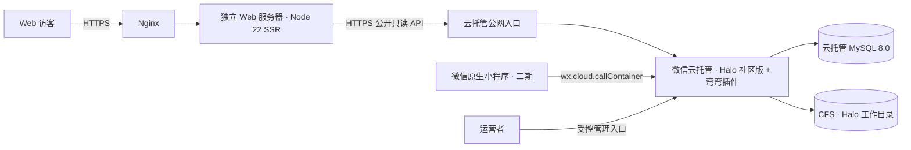

# 弯弯技术架构与实施方案

现行架构以 [ADR-005](./adr/ADR-005-前后端分离与微信云托管部署.md) 为准。需求和实施顺序见[产品需求与内容规范](./产品需求与内容规范.md)与[开发计划](./项目计划书.md)。

## 系统拓扑

| 模块 | 技术和职责 |
| --- | --- |
| [`plugin-wanwan/`](../plugin-wanwan/) | Halo 2.27.3、Java 21、Gradle 9.4.0。插件实现资料模型、匿名查询、公开字段投影、搜索和 Vue 3 Console；编辑原创导读使用 Halo 自带后台 |
| [`web/`](../web/) | Node 22 + TypeScript，服务端渲染 HTML。由 SSR 服务调用后端公开 API，前置 Nginx 提供 HTTPS 和限流 |
| [`miniprogram/`](../miniprogram/) | 微信原生小程序 + TypeScript，生产接入计划使用 `wx.cloud.callContainer`，本地可切换 `wx.request` 调试 |
| [`deploy/`](../deploy/) | Docker Compose 本地联调，微信云托管后端镜像和独立 Web 部署模板 |

业务逻辑集中在插件，沿用 Halo 的 Spring Boot、WebFlux、Extension API 和管理后台。公众号由运营者手动维护。生产不运行 Halo Thymeleaf 业务主题。

## 内容模型与发布

| 模型 | 职责 |
| --- | --- |
| `ResourceCard` | `wanwan.run/v1alpha1` Extension。以 `metadata.name` 为稳定 ID，保存公开题录、介绍、来源入口、人工顺序、阶段、标签和状态 |
| `Topic` | 同组 Extension，保存标题、导读、状态及有序资料卡 ID |
| `Stage` | 五个固定枚举，前端从 `/stages` 取得标签和顺序 |
| Halo `Post` | 本站原创导读。列表仅返回公开已发布文章，详情正文读取发布快照。当前公开 Post DTO 没有作者字段，需补公开作者展示并核对文内来源 |
| 私有台账 | 许可依据、每次修订、投诉与撤回的记录，按稳定 ID 关联。首版依 ADR-001 由运营者在独立受控位置维护 |

发布状态为 `DRAFT`、`PENDING_REVIEW`、`PUBLISHED`、`WITHDRAWN`。来源状态独立维护。当前 Console 已能更改状态，但新卡表单默认填核对日期和 `OK`。编辑流程应改为默认 `UNCHECKED`，由运营者确认日期和来源状态。预览只在受控后台显示，读取草稿所需的访问权限与管理权限一致。已发布卡片当前保存即写入主数据。编辑流程应先在后台预览拟修改内容，正式保存前保持当前公开版本。查重按 URL 和论文标识查找候选，由编辑处理同一材料的不同来源或版本。

## 公开 API 和撤回规则

统一前缀为 `/apis/api.wanwan.run/v1alpha1`。公开读取经白名单 DTO 输出。资料卡和专题的管理使用受保护的 Halo Extension 接口，权限配置见 [roles.yaml](../plugin-wanwan/src/main/resources/extensions/roles.yaml)。

| 接口 | 当前行为 |
| --- | --- |
| `GET /stages` | 返回固定阶段 |
| `GET /resources?stage=&type=&tag=&page=&size=` | 按条件分页查询可列出的资料卡，按人工顺序和稳定 ID 排序 |
| `GET /resources/{name}` | 读取公开资料。草稿、本站撤回和删除返回 404 |
| `GET /topics`、`GET /topics/{name}` | 查询已发布专题，详情按编辑顺序返回可列出的资料卡。摘要目前按关联 ID 总数计数，待与详情可见项对齐 |
| `GET /posts`、`GET /posts/{name}` | 查询公开已发布原创导读，正文使用发布快照 |
| `GET /search?keyword=&stage=&type=&page=&size=` | 已发布资料卡检索结果，返回前重新读取主数据并检查公开状态 |

- [可见性规则](../plugin-wanwan/src/main/java/run/wanwan/model/Visibility.java)区分「本站撤回资料」与「原站撤回原文」。本站撤回后详情 404，并退出列表、专题、搜索和站点地图。原站撤回时退出推荐和索引，已发布的旧详情可保留题录和撤回提示；需要隐藏详情时再执行本站撤回。待补的相关推荐复用同一规则。
- [来源入口解析](../plugin-wanwan/src/main/java/run/wanwan/api/EntryResolver.java)在链接状态为 `OK` 后，按类型校验并返回 `WEB`、`MP_ARTICLE`、`MINIPROGRAM` 或 `CITATION_ONLY`。Web 对已核对的 HTTP(S) 原始出处提供直达入口；小程序按渠道能力决定跳转，普通网页使用出处展示或复制。
- 公网网关仅放行公开读取接口，Console 和管理 API 走受控入口。`WANWAN_CORS_ALLOWED_ORIGINS` 作用于浏览器跨域访问，SSR 服务的服务器间请求由网络和网关规则处理。上线前需通过实际部署核对边界，包括 Halo 核心读接口、原生文章页和附件 URL 的访问范围。凭据仅在受控运行环境配置，公开客户端无需管理令牌。

## 搜索与 Web 页面

插件当前以中文字符二元组和小写英文词构建内存倒排索引，索引标题、介绍、来源、作者、标签、DOI 和 PMID。启动时全量同步，资料卡变化时更新，搜索要求查询词都命中，结果按人工优先级和 ID 排序。关键词上限 100 字符，每页上限 50。原创 Post 有独立阅读入口，当前没有接入索引。未来如调整搜索范围或命中排序，需要更新 [ADR-003](./adr/ADR-003-站内搜索.md) 的决策记录。

Web 已有 `/`、`/stages`、`/resources`、`/topics`、`/posts`、`/search`、`/about` 及对应详情。SSR 成功响应使用 `Cache-Control: no-store`。当前站点地图每类只取首批最多 50 项，超过该规模需要遍历公开分页。Web 阶段与搜索页待补翻页、筛选和关联资料，翻页沿用原有查询参数。后台故障显示服务暂不可用，内容下线显示旧地址对应的 404 状态。

资料卡字段按文本转义。原创 Post 正文目前经过轻量 HTML 清洗后渲染，生产验收需验证可用的标签、链接及附件范围。第三方原文、封面和配图由来源站承载，链接复核由运营者手动执行。

2026-11-19 小程序增加专题与原创导读直达页、筛选翻页及来源降级。详情使用 HTTP 状态区分 404 和可重试故障，并在重新进入前台时读取最新状态。项目仍使用测试 AppID，`cloudEnv` 为空。正式接入验证 AppID、云环境、服务路由、公众号文章入口与真机撤回。页面路径和配置见[小程序接入说明](../miniprogram/README.md)。

## 本地构建与联调

本轮已在 Node 22 下通过 Web 4 项测试和小程序 TypeScript 检查。Halo 插件默认 Gradle 构建在 `:ui:pnpmInstall` 失败。当前可先用 `pnpm 9.15.9` 构建 Console，再复用输出测试和打包。该路径通过 22 项插件测试，JAR 内包含 `console/main.js` 和 `console/style.css`。

在对应目录运行以下命令：

| 目录 | 命令 |
| --- | --- |
| `web/` | `pnpm install --frozen-lockfile`，`pnpm typecheck`，`pnpm test` |
| `web/` | `./node_modules/.bin/tsc --noEmit -p ../miniprogram/tsconfig.json` |
| `plugin-wanwan/ui/` | 使用 pnpm 9.15.9 执行 `pnpm install --frozen-lockfile` 和 `pnpm build` |
| `plugin-wanwan/` | Console 构建后执行 `./gradlew test jar --no-daemon -x :ui:pnpmSetup -x :ui:pnpmInstall -x :ui:buildFrontend` |

待完成的本地全链路验收使用 [`deploy/docker-compose.yml`](../deploy/docker-compose.yml)。先在 `web/` 执行 `pnpm build` 生成 `dist/`，在 `deploy/` 基于 `.env.example` 配置本地 `.env`，然后执行 `docker compose up --build`。Console 在 `http://localhost:8090/console`，Web 在 `http://localhost:3000`。通过 Console 录入 3 条已核对资料，至少验证草稿不可读、发布后可浏览和搜索、正文快照与草稿隔离，以及撤回后列表、详情、专题、搜索和站点地图的结果。该 Compose 链路本轮未运行。

## 生产部署、备份与验收

| 环节 | 当前材料 | 上线前验收 |
| --- | --- | --- |
| 后端 | [微信云托管部署说明](../deploy/cloudrun/README.md) | 镜像安装插件，连接云 MySQL，CFS 挂载 `/root/.halo2`，最小实例数设为 1，验证重启和索引重建。扩到多个实例前验证索引与共享存储行为 |
| Web | [独立 Web 部署说明](../deploy/web-server/README.md) | 配置实际 API 域名、站点域名、HTTPS、联系邮箱、备案信息；检查网关限流、路由、故障提示和实际请求日志 |
| 备份恢复 | [`backup.sh`](../deploy/backup.sh) 可备份本地 Compose 的 MySQL 与 Halo 目录 | 生产另行配置云 MySQL、CFS 和关键配置备份，保留独立副本；隔离恢复后重放备份时点之后的撤回记录、重建索引，再核对公开结果。版本升级前用备份副本做兼容性回归 |
| 可用性 | Web 提供 `/healthz` 进程探活及后端故障页 | 除 Web 进程外，监测公开 API、存储和备份任务；核对访问日志处理，避免默认留存完整搜索词 |

所有渠道的发布日期以实际验收结果为准。公众 RAG 与向量索引单独评估，当前没有模型服务部署依赖。

## 新资料订阅消息

Web 和小程序继续共享公开浏览 API。小程序首页通过 `GET /apis/api.wanwan.run/v1alpha1/notice-config` 获取当前模板 ID。用户点击授权或取消待发后，使用 `POST /apis/api.wanwan.run/v1alpha1/notice-subscriptions` 提交 `code`、`templateId` 和布尔值 `enabled`。后端通过微信接口验证登录码，返回 `subscribed`。读写接口不缓存。匿名角色仅获配置读取和登记入口权限，待发授权和发布记录保存在 Halo 私有扩展中。

资料卡和 Halo 原创导读首次公开时记录持久化发布事件，派发前再检查公开状态。系统为每个用户保留一条待发授权，使用 Halo 版本号原子占用。授权 90 天到期，取消、占用和到期都会清除原始微信标识。发布超过 24 小时的事件跳过。请求微信发送前已持久化占用结果，网络超时、进程中断等结果不明的情况下可能漏发一次。使用同一条授权重试会有重复发送风险，下一次由用户重新授权。部署配置和真机验收见[云托管说明](../deploy/cloudrun/README.md#小程序新资料订阅)。
