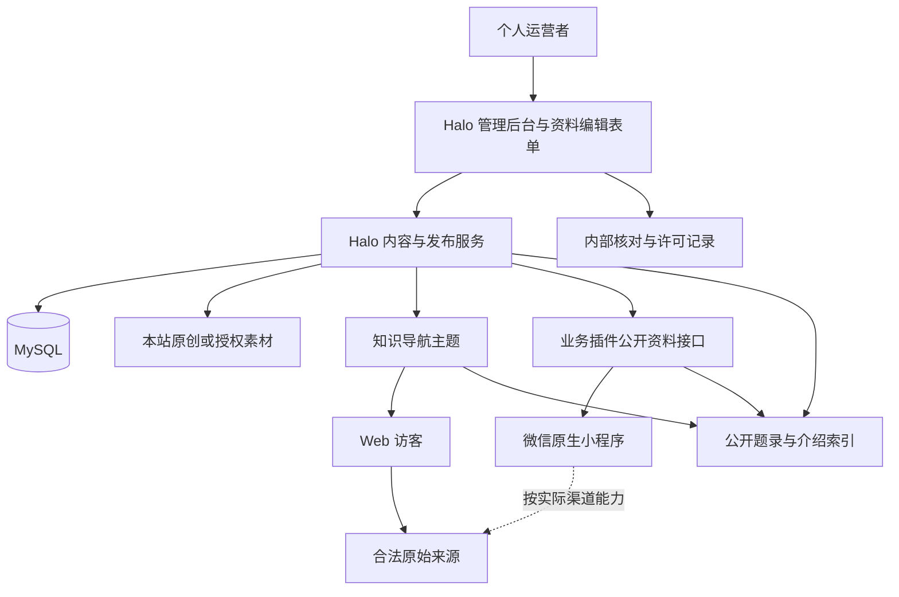

# 弯弯：知识导航技术架构与实施方案

版本：5.0｜2026-11-12｜当前技术基线；以下均为待实现、待验证设计。

需求依据：[项目计划书](./项目计划书.md)与[产品需求与内容规范](./产品需求与内容规范.md)。个人运营和资料使用边界见[版权文档](./个人运营与版权边界.md)。本轮只修改文档，不进行代码开发、部署、云服务开通或论文上传。

## 1. 架构决策

采用 **Halo 社区版＋导航主题＋一个必要的业务插件＋微信原生小程序＋MySQL**。

用户已确认首版由运营者逐篇手动精选录入。系统保存必要题录、独立撰写的简短介绍和合法原文入口，不建设自动采集与全文入库链路。

Halo 是 Spring Boot 应用，自带编辑后台、发布体系与内容接口。Web 使用 Halo 的 Thymeleaf 主题输出页面，小程序通过公开内容接口读取资料卡。当前不再建设额外 Spring Boot 网关、不重写后台、不接入公众 AI。

Halo 后端采用 WebFlux 和 R2DBC，不是 MVC＋MyBatis。扩展应遵守其响应式运行和插件机制，不向其数据模型直接写 SQL，也不将原 OpenIsle 的 JPA 模块复制进 Halo。

“选择 Halo”是方案决定；主题、插件、中文搜索、具体版本和小程序能力尚未完成实际验证。实施时锁定一个受维护稳定版本及配套插件版本，不以 main 分支依赖直接代表生产组合。

## 2. 系统关系

外部原文仍由原网站提供。本站不充当正文代理、图片镜像、PDF 下载站或付费访问转发服务。图中的搜索是站内索引，不是联网搜索或 RAG。

## 3. 职责与复用

| 部分 | 复用或新增范围 |
| --- | --- |
| Halo 核心 | 管理员认证、文章与草稿、分类标签、基础附件与发布能力 |
| Web 主题 | 阶段首页、导航卡、专题、来源详情、原创导读、移动适配与 SEO |
| 业务插件 | 资料字段表单、公开字段投影、双端筛选和搜索适配、内部记录与撤回协调 |
| 小程序 | 原生阶段页、资料列表与详情、搜索、来源入口适配、关于页 |
| 数据库 | Halo 支持的数据持久化，不额外维护一套同名文章表 |
| 素材存储 | 本站原创、明确授权的图片与站点资源，不存默认收录的第三方全文 |

插件按实际缺口实现，已有功能直接复用。若必须大量重写发布和内容模型才能满足资料卡闭环，应停止叠加功能，重新比较其他 CMS。

## 4. 内容存储方案

### 4.1 首版首选：文章＋公开元数据

使用 Halo 的 Post 保存资料卡：标题是材料标题，正文仅保存本站独立撰写的介绍；分类表达阶段，受控标签表达材料类型和主题。外部 URL、来源、原文日期、语言、访问条件、论文标识等通过元数据表单补充。

本站原创导读同样使用 Post，但有明确类型并可保存原创正文。专题优先复用可维护的专题配置或插件模型，不把一个专题复制成多篇资料。

一条资料的 ID 使用稳定的 Halo 资源标识；slug 仅用于展示链接，不作为未来跨系统主键。额外记录公开版本，避免后续同步时把题名相似的材料混为同一条。

元数据的读写能力、分类多选及筛选效果需在所选版本验证。若公开检索不能有效查询元数据，可由插件建立小规模派生索引，仍以 Halo 内容为主源。

### 4.2 公开字段与内部记录必须分开

公开元数据按“可能被核心接口或主题读取”处理，只放允许公开的字段。许可凭据、采购记录、投诉人资料、编辑判断和内部备注另存受限资源，并配置独立权限；不能放到 Post.annotations 后仅靠页面隐藏。

业务插件公开 DTO 使用白名单，不返回整个 Halo 对象，不允许访客自行指定管理字段。管理与内部模型的 Extension API、权限配置和附件 URL 都必须纳入验证，不能只验证新增接口。

如果暂时不实现内部记录功能，可使用受控的运营台账保存；台账不放在网站公开目录，也不写入可被发布索引扫描的文件路径。

### 4.3 最小字段映射

| 内容 | 存放建议 |
| --- | --- |
| ID、标题、原创介绍、发布状态 | Halo Post 的实际可复用字段 |
| 阶段、类型、主题 | 分类与受控标签；不足部分由插件补充 |
| 外部 URL、来源、原文日期、语言、访问条件、DOI 等 | 允许公开的元数据 |
| 关联资料、推荐顺序、复核日期、链接状态 | 公开配置或业务插件字段 |
| 许可证据、内部审核与投诉 | 受限内部模型或私有运营台账 |
| 未来供应商文档 ID、同步状态 | 未来 AI 模块内部映射，首版不实现 |

不默认创建 original_full_text、paper_pdf 或 embedding 等采集与向量字段。后续需要变更时重新评审，不把任意 URL 自动转换成全文入库任务。

## 5. 编辑与发布状态

业务流程为候选、草稿、待核对、已发布、暂停/撤回。优先映射到 Halo 的实际草稿与发布机制，额外状态由插件维护。该流程不是宣称 Halo 原生具备完全同名状态。

发布前核对原站、独立介绍、分类、公开范围和入口能力。不自动抓取标题、封面或正文。首版也不自动调用 AI 补充缺失字段。

一次发布应同时产出可公开数据和索引更新。若索引失败，保留可重试记录，不能因此将草稿开放。修改采用受控预览和发布版本，编辑中的内部草稿不影响当前公开版本。

撤回先阻止内容公开，再更新索引和缓存。Halo 内置文章路由、公开 API 和附件可能是独立访问路径，因此撤回必须作用于核心发布/可见性，不能只给业务接口加一个标记。

## 6. API 与安全边界

以下是逻辑接口契约，实际路径需结合 Halo 插件路由确认，不表示已存在：

| 逻辑接口 | 输入 | 输出 |
| --- | --- | --- |
| GET /api/wanwan/v1/stages | 无 | 公开阶段、简介和排序 |
| GET /api/wanwan/v1/resources | 阶段、类型、标签、页码 | 公开资料卡摘要与分页 |
| GET /api/wanwan/v1/resources/{id} | 稳定 ID | 公开资料卡详情或不可用状态 |
| GET /api/wanwan/v1/topics | 页码 | 已发布专题 |
| GET /api/wanwan/v1/topics/{slug} | 专题标识 | 专题导读及当前允许公开的资料 |
| GET /api/wanwan/v1/search | 关键词、阶段、类型、页码 | 已发布资料结果，无模型生成文本 |

资料输出包括标题、介绍、来源、日期、阶段、类型、访问条件，以及经过核对的入口描述。入口可表达 Web 原文、可用的微信入口或只显示出处等状态，小程序不能自行把任意 externalUrl 当作可打开网页。

管理端复用 Halo 认证和角色权限。需要管理令牌时只用于受控管理环境，浏览器访客与小程序不得内置管理员 PAT、数据库密码或云密钥。API 文档中的管理示例不能直接复制进公开客户端。

限制分页大小、关键词长度和请求频率。建议初始上限每页 50 条、关键词 100 个字符，实际根据使用调整；限制是工程配置，不是法律标准。只允许必要 CORS 来源，注意 CORS 不能替代服务端访问控制。

外部 URL 只允许 HTTP/HTTPS，拒绝脚本和本地资源协议，剔除不必要的跟踪参数但保留能正确定位原文的参数。不以任意跳转接口作为开放重定向服务，不在来源链接中加入营销追踪或未经验证的付费跳转。

## 7. 搜索设计

先验证 Halo 现有全文检索是否覆盖双端必需字段和中文需求。通过插件统一按阶段、类型筛选，或维护小规模可重建索引。现阶段不采购外部搜索集群，也不承诺语义搜索。

索引范围是原标题、本站介绍、公开来源信息、分类标签及允许公开的本站原创；不抓取原文来改善召回，不索引私有备注和许可凭据。

最终返回前按主数据核验状态与公开版本，避免索引尚未刷新时泄露撤回内容。旧版本索引仅用于内部重建，不能直接提供给客户端。主题搜索、插件搜索和 Halo 其他公开搜索入口要一并验证。

排序先采用关键词匹配和人工推荐顺序。无结果时返回真实空列表，不转交大模型或联网抓取补齐。只记录必要的运行指标，不默认留存完整访客搜索词。

## 8. Web 设计

主题提供阶段入口、卡片列表、专题、资料详情及原创导读模板，采用服务端输出，做好手机排版、可访问性、清晰层级和加载失败提示。导航卡不需要强制封面，避免形成搬运图片的工作流。

外部资料详情明确标注本站写的介绍，原文按钮显示来源，直接访问合法原站。禁止嵌入镜像阅读页、绕过登录/付费墙或隐去作者标识。

站点地图仅包含允许公开的本地页面，摘要与结构化数据反映本站真实内容，不能用医疗资质或专家署名增强 SEO。站点本身的 canonical 指向真实本地页面；不借 canonical 或 nofollow 等标签替代版权判断。

默认不把第三方页面图片作为远程封面加载，以减少权利、跟踪和可用性问题。Web 原创图片与静态素材的缓存可较长，资料正文与状态接口初期不做长时间共享缓存。

## 9. 微信小程序设计与待验证能力

使用原生小程序页面读取资料 API，不把整个网站套进 web-view。支持阶段、列表、搜索、详情、专题和关于页，不要求微信登录，不申请与资料阅读无关的权限。

必须区分业务域名配置与服务器 request 域名；后者允许请求本站接口，不代表可以打开任意第三方网页。web-view、公众号文章和跳其他小程序各有条件，不能通过一个通用按钮混用。

微信官方页面本次未能直接读取，因此个人主体最新开放能力、类目和具体文章打开条件均列待验证。不基于旧教程承诺一键直达全部原站。对尚不具备入口的材料显示可核对的题名、来源和标识；复制来源功能也须结合渠道规则验证。

API 可提供入口类型和状态，但入口有效性必须来自实际测试，不能由 URL 看起来像公众号就自动判定可用。平台不允许时不以域名代理、隐藏跳转、抓取正文或网页包装规避。

本机收藏可仅保存资料 ID 和必要显示信息，不保存第三方全文或健康资料。资料重新打开时在线校验状态；跨端同步和账号后置。小程序发布与 Web 分开验收、分开发布，保留双端目标但不互相阻塞。

## 10. 链接复核与应用安全

首版由人工复核，记录最后核对时间、可访问状态、来源变化和原文撤回。网站打不开时先标记需复核，不自动访问不明镜像，不替用户模拟登录。

以后若新增自动可用性检查，应作为单独变更：只检查必要元信息和状态，限制频率，不默认下载正文；服务器出站需防止访问内网、回环、云元数据地址，对 DNS 解析和每次重定向重新检查，设置超时与大小限制，避免成为任意 URL 请求代理。

即使只有管理员编辑，原创 HTML、链接、附件名也需过滤和编码输出，防止脚本注入。使用框架支持的认证、防请求伪造和最小权限；后台尽量限制访问并启用可用的强化认证方式。更新主题和插件前备份并在测试环境核对兼容。

版权、错误和隐私反馈通过真实联系方式受理。若以后提供反馈表单，另评估滥用、最少字段和留存；首版不需要为邮件式反馈建设用户系统。

## 11. 撤回与缓存一致性

撤回操作同时触发核心内容非公开、专题关联更新、搜索移除和必要缓存失效。旧详情请求返回下线状态或合适的不可用响应，不通过外部 URL 把访客继续导向停用材料。

首版减少共享页面缓存，不把全站资料库预打包进小程序；需要缓存时使用版本和较短有效期。内置公开内容 API、直接页面 URL、搜索结果及分享预览都列入撤回检查。

对已被访客保存的离线信息、搜索引擎历史缓存和第三方转载不承诺即时删除。恢复旧备份后，先重放撤回与投诉处置记录，再重建索引并恢复外部访问，避免已撤回内容再次上线。

## 12. 部署、备份与运行

初期采用单机部署：反向代理、Halo 与其支持的 MySQL 版本；分别持久化数据库和 Halo 工作目录。HTTPS、域名、数据库访问限制和管理员入口按实际接入配置。小规模站点不因为保留双端就拆微服务。

不默认使用 Redis、RabbitMQ、OpenSearch、独立向量库、CloudBase 和 ADP。图片先本地存储并做异地备份，实际增长后再验证对象存储插件和访问策略。内部台账与凭据不放公开附件目录。

建议每日备份数据库及必要工作目录，并保留定期独立副本；凭据加密保存，不放 Git 或公开存储。恢复设计目标可先设为最多损失一天编辑内容、一天内恢复基础阅读，具体目标需由演练确认，不是已实现承诺。

监测 HTTP 错误、应用可用性、磁盘和备份任务。访问日志最少化、限制访问与留存，不记录完整请求体或在常规日志写出密钥。按实际功能和适用规定确定必要日志期限，不在文档中承诺零日志。

版本升级使用受维护稳定版本，先恢复测试再切换；回退需要应用与数据兼容方案，不能仅将镜像换回旧版本。尚未建设此运行环境，不列未经报价的服务器成本或套餐承诺。

## 13. 后续 RAG 的位置

公众 RAG 后续独立立项，腾讯 ADP 作为优先验证候选。未来流程为：有适当权利且已批准使用的内容 → 导出与同步 → 托管知识库 → 服务端范围与费用控制 → 双端回答及可追溯引用。

先确定索引的是本站原创、资料卡介绍还是有授权的原文；三者能力不同。资料卡向量化不等于已经理解原论文，不能宣传成医学论文全文问答。

未来保留稳定内容 ID、公开版本、许可范围和撤回记录即可；不提前部署向量库、不将当前所有外部链接全文抓取入库。供应商文档 ID、同步重试、索引删除确认和生成安全控制在该阶段实现。

对外调用通过服务端适配，供应商密钥不下发双端。若 ADP 已承担一次完整生成，不再叠加另一套模型生成链路。具体模型、地域、接口、个人账号及专业内容条件按届时实际服务确认，不锁定过时教程 API。

## 14. 分阶段实施与验证

| 关卡 | 要验证的问题 | 失败后的处理 |
| --- | --- | --- |
| Halo 内容小样 | Post＋元数据能否表达资料卡；管理表单是否可用 | 少量插件补齐；若需改核心则重选 CMS |
| 双端公开接口 | 阶段、列表、详情和中文搜索是否可用 | 调整插件公开 DTO 与索引；不重复建 CMS |
| 权限与撤回 | 草稿、内部记录不可公开；所有读取路径能下线 | 修复后再进入发布验收 |
| 小程序渠道 | 个人类目、阅读入口和素材能力是否实际成立 | 缩小为真实可用范围或延后发布，不伪装能力 |
| 内容闭环 | 一条真实来源从录入到双端查找、原文阅读是否完成 | 修订录入和界面设计 |
| 运行维护 | 备份能恢复、管理员可纠错和停用、费用可承担 | 调整部署和维护流程 |

开发授权后再建立独立 Halo 工程或插件目录；原 OpenIsle 工作区不作为生产底座，已有代码保留，不删除、不声称完成迁移。

实施阶段应执行适合实际变更的构建与验证：插件权限、公开 API 的草稿与撤回负例、中文搜索真实材料、Web 原文入口、小程序真机入口、备份恢复和升级回退。不为本轮 Markdown 更新运行与新架构无关的旧论坛全套测试。

## 15. 交付和未知项

未来交付包含版本锁定清单、插件与主题授权、部署配置样例、公开接口契约、资料录入说明、备份恢复及下线操作说明。机密值不写入文档或示例配置。

尚待确认：实际备案归属、小程序类目与外链能力、Halo 稳定版本及必需主题、元数据查询和搜索效果、真实资料许可、运营联系信息。这些不影响先完成设计，但会影响开发与发布验收。

## 官方技术依据

- [Halo 架构概览](https://docs.halo.run/developer-guide/core/framework)：Spring Boot、WebFlux 与 R2DBC。
- [Halo API 介绍](https://docs.halo.run/developer-guide/restful-api/introduction)：公开、管理等分组及认证方式。
- [Halo 元数据与主题](https://docs.halo.run/developer-guide/theme/annotations)：主题读取元数据的基础。
- [Halo README 与授权](https://github.com/halo-dev/halo/blob/main/README.md)：社区版、主题插件和 GPLv3。
- [微信 web-view 官方入口](https://developers.weixin.qq.com/miniprogram/dev/component/web-view.html)、[类目材料入口](https://developers.weixin.qq.com/miniprogram/product/material/)：本次未能读取官方正文，相关能力保留为待验证，不用作已过审依据。
- [腾讯 ADP](https://cloud.tencent.com/product/adp)：未来候选，不是当前部署依赖。
